# DriveMesh

[](https://github.com/PRAJINRAJ-RANAWAT/DriveMesh/actions/workflows/ci.yml)

**A fault-tolerant, encrypted storage layer that pools the storage accounts you own** (several Google Drive accounts, local disks,
S3-compatible buckets) into one replicated namespace. It is designed after HDFS/GFS.

- **Chunked and encrypted:** files are streamed in 8 MiB chunks. The server encrypts each chunk with a per-file key (AES-256-GCM, envelope encryption) before anything reaches Google.
- **Replicated:** every chunk is copied to *different* accounts (RF=2 by default), chosen by weighted rendezvous hashing. Optional Reed–Solomon erasure coding.
- **Self-healing:** health checks, re-replication when an account disappears, a checksum scrubber, a balancer, garbage collection, and encrypted metadata backups stored on the accounts themselves.

> Origin: this started as a 3-person course prototype (preserved unchanged in [`legacy/`](legacy/)).
> - The prototype stored one copy of each chunk.
> - It identified accounts by list position.
> - It leaked its key in git history. See the [audit](docs/design/01-current-state.md).
>
> Everything outside `legacy/` is a redesign and rebuild.

## Screenshots

| Landing (light) | Landing (dark) |
|---|---|
| 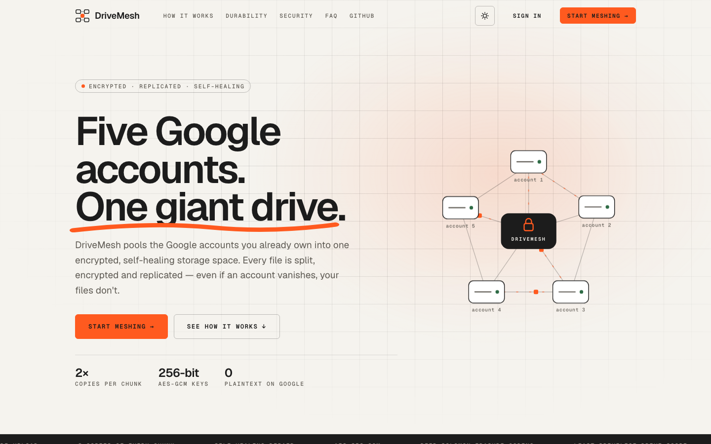 | 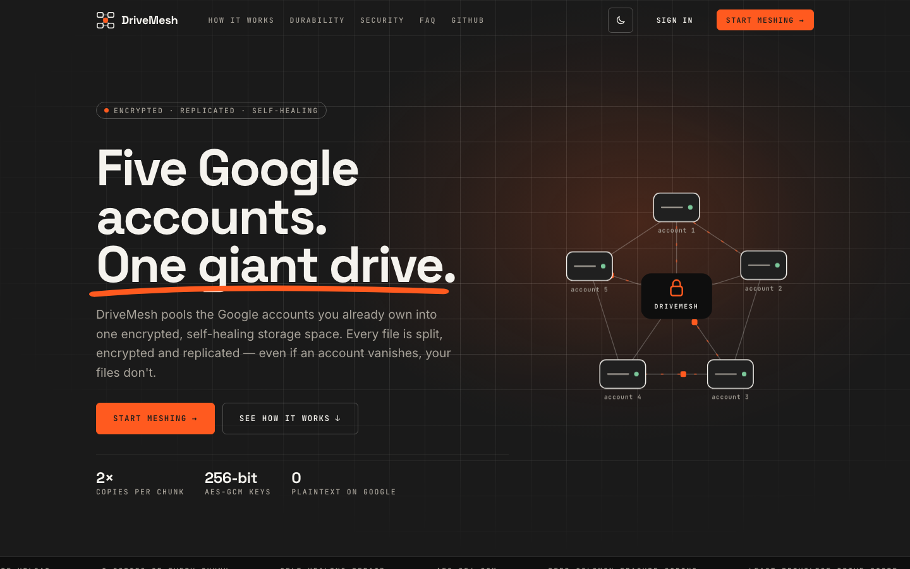 |
| **Scroll story: split → encrypt → replicate** | **Overview dashboard** |
| 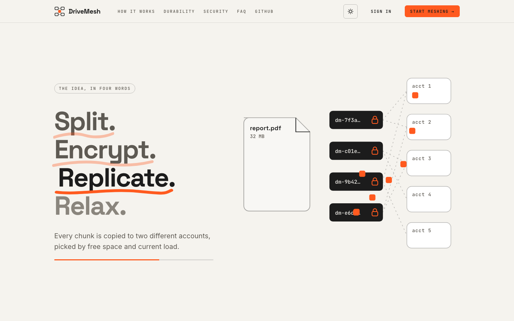 | 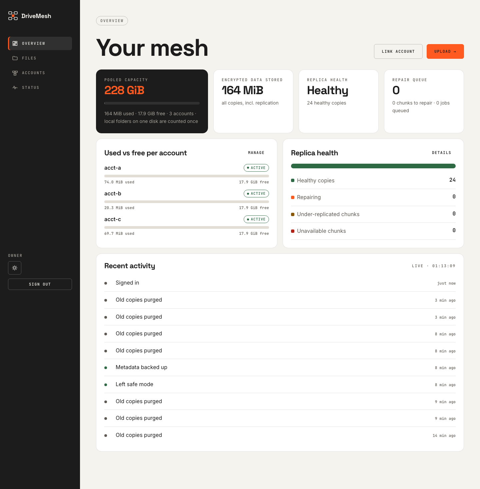 |
| **Files** | **Cluster status** |
| 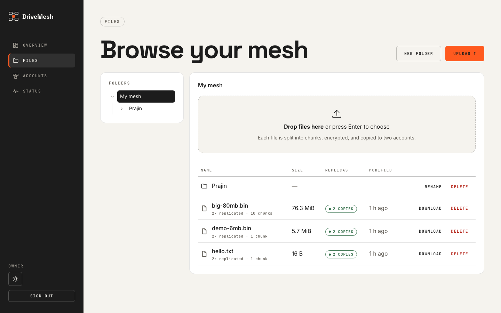 | 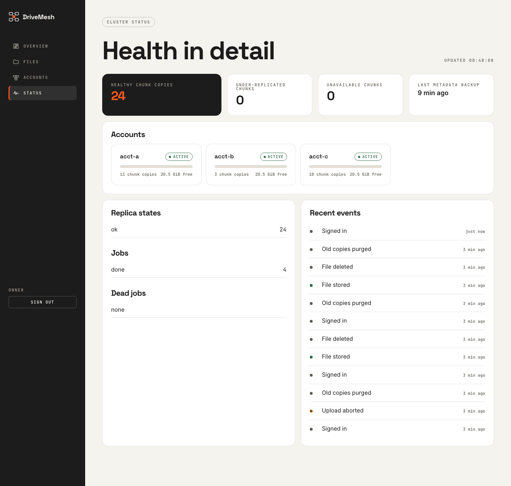 |

<details><summary>Accounts page and mobile (390 px)</summary>

| Accounts | Mobile landing | Mobile overview |
|---|---|---|
| 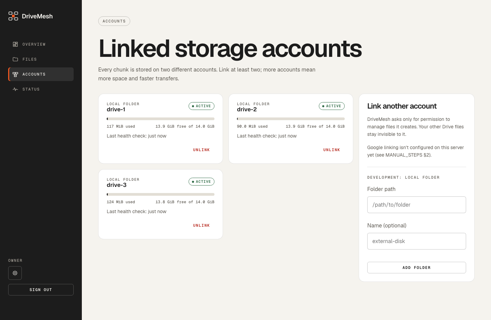 | 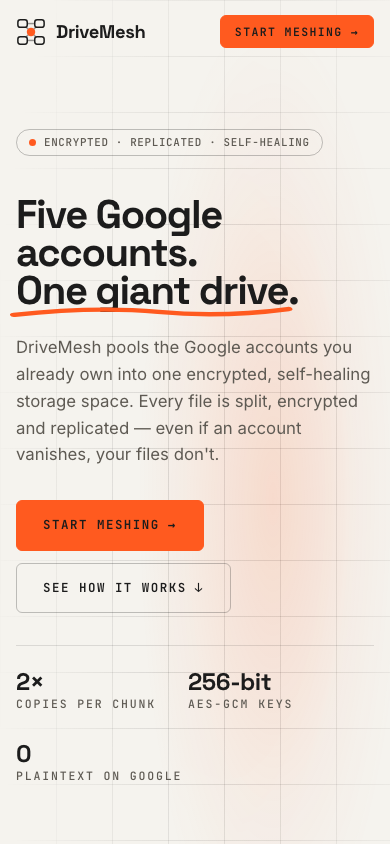 | 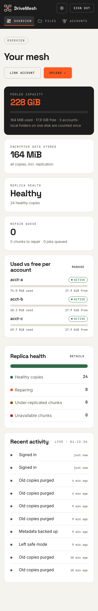 |

</details>

The app screenshots come from a local demo instance: 3 local-folder accounts with a simulated 15 GB capacity each, and four sample files.
More screenshots are in [`docs/design/ui-reference/`](docs/design/ui-reference/).

## How it works

### Architecture
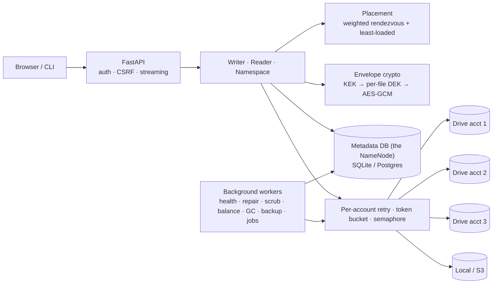
- The **metadata DB** is the single source of truth (the NameNode).
- Storage accounts are **passive object stores** (DataNodes that run none of our code). Objects are opaque `dm-<uuid>` names in one `DriveMesh` folder per account.

### Write path: two-phase, streamed, bounded memory
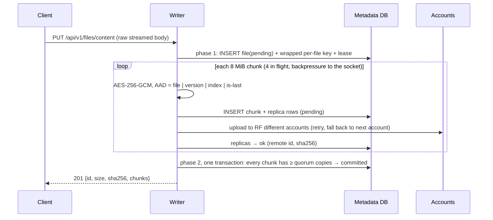
- A crash, cancel or failed account before the commit leaves nothing visible. GC removes the leftovers.
- The writer renews its lease while bytes arrive, so slow uploads survive.

### Read path
For each chunk:
1. Pick the least-loaded healthy replica.
2. Verify its **SHA-256** (no key needed), then the **GCM tag**, which binds the chunk to its position.
3. If either check fails, fall back to the next replica and mark the bad copy for repair.

Full reads also verify a **whole-file SHA-256**. Downloads stream with bounded memory and support HTTP `Range` (video seeking).

### Self-healing
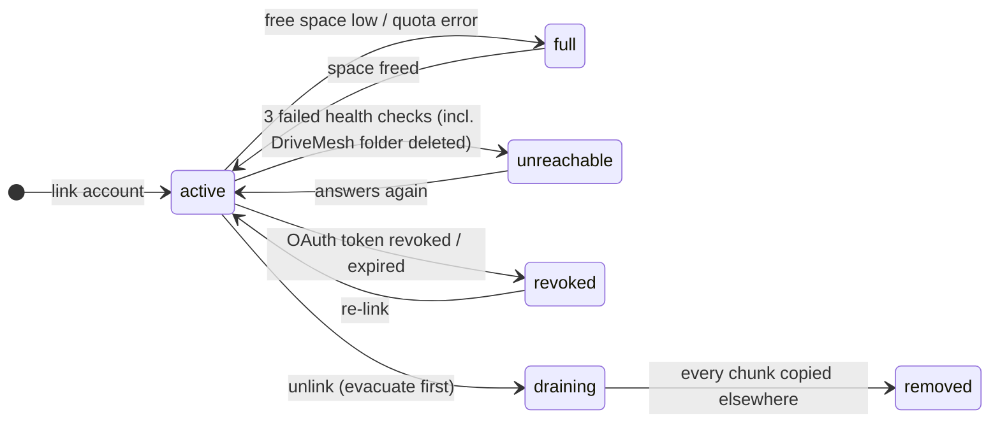
- Replicas on an `unreachable`/`revoked` account keep counting for **10 minutes**, so a network blip causes no repair storm.
- After that, the repair worker re-replicates the affected chunks, **fewest healthy copies first**, 8 at a time.
- The scrubber re-reads the oldest-verified copies at 1 MiB/s to catch silent corruption.

### Metadata model
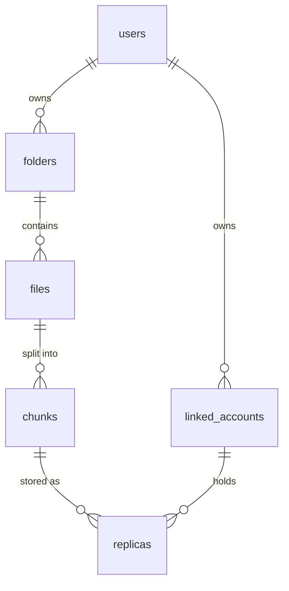
The database enforces these invariants:
- one committed version per path (partial unique index)
- never two copies (or two erasure-coding shards) of a chunk on the same account
- each external account linked once

The full schema, the SQL and the indexes are in [08-how-it-works §12](docs/design/08-how-it-works.md#12-database).

## Measured results
All from scripted runs recorded with their method in [results.md](docs/design/results.md). **These are local-disk or simulated-network numbers.
Real Google Drive runs are pending** (see [MANUAL_STEPS §4](docs/design/MANUAL_STEPS.md#4-real-google-drive-benchmarks-fills-the-gdrive-rows-in-resultsmd)).

| What | Result |
|---|---|
| Chaos: account loss, chunk deletion and corruption, `SIGKILL` mid-upload and mid-repair, metadata wipe + restore | **0 files lost and 0 wrong bytes across 140 trials** (7 experiments × 10, run before and after the 2026-11-09 fixes; R-008, R-015) |
| Memory while streaming 1 GB → 5 GB files | peak RSS ~291–331 MiB, flat across 1/2/3/5 GB (68 MiB interpreter baseline) |
| Parallel transfer, 8 accounts, simulated 10 MB/s per account | 47.2 MB/s mean vs 8.5 MB/s sequential; load-aware placement +39 % over plain hashing |
| Repair after losing 1 of 4 accounts (simulated 10 MB/s links) | 12.7 MB/s (parallel repair; 4.3 MB/s before the fix) |
| Storage overhead (measured) | RF=2: 2.0000×, RS(4,2): 1.5000×; encryption adds 32 B per chunk (legacy Fernet: +33.34 %) |
| Metadata at 1M chunks (Postgres 16) | repair scan 5.0 s, full fsck 7.9 s (fsck was 291 s before a query rewrite) |
| Hot queries use the right index with or without DB statistics | the download replica lookup used to scan every replica on SQLite without statistics (19.9 ms at 40k replicas). Now it always uses the `(chunk_id, state)` index, pinned by plan tests (R-014) |
| Tests | **249 tests**, 91 % line coverage; CI runs them on SQLite **and** Postgres 16, plus Playwright browser tests |

### How much space do I get?
Each free Google account has 15 GB **shared with Gmail and Photos**. DriveMesh keeps 256 MiB free per account.

| Accounts | RF=2 (survives 1 loss) | RF=3 (survives 2) | RS(4,2) (survives 2) |
|---|---|---|---|
| 3 | 22.1 GB (14.7 GB to stay self-healing after a loss) | 14.7 GB | needs 6 accounts |
| 5 | 36.8 GB | 24.5 GB | needs 6 accounts |
| 10 | 73.6 GB | 49.1 GB | 98.2 GB |

These are computed best-case figures, with empty Gmail/Photos. For 3 accounts use the default **RF=2**: it's the only setting that can copy data to a remaining account after a loss. See [08 §5](docs/design/08-how-it-works.md#5-capacity-math) for the full table.

## Quick start (local, no Google account needed)
```bash
python3.12 -m venv .venv && source .venv/bin/activate && pip install -e ".[dev,pg]"
export DRIVEMESH_MASTER_KEYS="$(drivemesh gen-key)"   # keep an OFFLINE copy: losing it loses all data
drivemesh create-user owner
drivemesh account-add-local /tmp/dm/a && drivemesh account-add-local /tmp/dm/b && drivemesh account-add-local /tmp/dm/c
drivemesh put ./some-file.pdf /some-file.pdf && drivemesh ls / && drivemesh status
drivemesh serve            # web UI on http://localhost:8000
```

### Accounts and sign-in
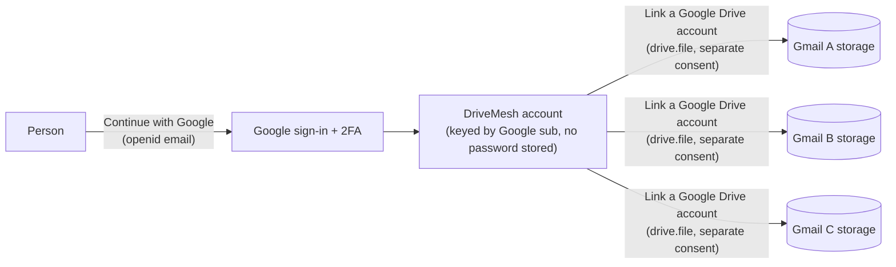
- **Sign up / sign in:** "Continue with Google". Google checks the password and 2-step verification; DriveMesh never sees them. A new Google identity creates a new DriveMesh account (open sign-up).
- **Link storage:** each Gmail you pool needs its own Google consent. Only someone who can sign in to that Gmail can link it, and **one Gmail belongs to one DriveMesh account**.
- **Sessions:** HttpOnly cookie backed by a server-side session table. Sign-out, 14-day expiry and **Sign out everywhere** take effect immediately.
- **API clients:** use JWT access tokens.
  ```bash
  # from a signed-in browser session (CSRF header required), get a token pair:
  POST /api/v1/auth/tokens            → {"access_token": "<JWT, 15 min>", "refresh_token": "<opaque, 30 d>"}
  curl -H "Authorization: Bearer $ACCESS" "http://localhost:8000/api/v1/fs?path=/"
  POST /api/v1/auth/tokens/refresh    {"refresh_token": "..."}  → a new pair; the old refresh token is now dead
  ```
  Replaying an already-used refresh token revokes the whole token chain (theft detection).
- **Operators** (accounts made with `drivemesh create-user`) can also link server-local folders and read `/metrics`; self-service users can't.

### Use real Google Drive accounts
You need a free Google Cloud OAuth client (one-time). The same client powers both "Continue with Google" and "Link a Google Drive account". The step-by-step guide is in [MANUAL_STEPS §2–3](docs/design/MANUAL_STEPS.md):
1. Create a Cloud project and enable the **Google Drive API**.
2. Configure the consent screen as External / Testing, and add your Gmail addresses as test users.
3. Scopes: `openid`, `userinfo.email` and `drive.file` only. DriveMesh can't see your other Drive files.
4. Create a **Web** client with redirect URI `http://localhost:8000/accounts/callback/google`.
5. Put the client ID and secret in `.env` as `DRIVEMESH_GOOGLE_CLIENT_ID` / `DRIVEMESH_GOOGLE_CLIENT_SECRET`.

In Testing mode:
- Only the Gmail addresses you list as **test users** can sign up or link: this is your allowlist.
- Google expires grants after 7 days. The account then shows `revoked` and you re-link it (one click).

Publishing the app (Google verification) removes both limits.

### Configuration that matters
All settings are environment variables `DRIVEMESH_<NAME>` (or `.env`). The full list is in [08 §9.1](docs/design/08-how-it-works.md#91-run-it-locally).

| Variable | Default | What it changes |
|---|---|---|
| `MASTER_KEYS` | (required) | master key ring `id:base64key,...`. **Back it up offline** |
| `DATABASE_URL` | `sqlite:///./data/drivemesh.db` | use Postgres when deployed |
| `DEFAULT_RF` | 2 | copies per chunk (1–5; per file with `?rf=` or `--rf`) |
| `CHUNK_SIZE` | 8 MiB | chunk size for new files |
| `INFLIGHT_CHUNKS` | 4 | parallelism and memory per transfer |
| `MAX_UPLOAD_BYTES` | 10 GiB | largest accepted upload |
| `DEAD_AFTER_SECONDS` | 600 | grace period before an unhealthy account's copies are re-replicated |
| `BACKUP_INTERVAL` | 900 | encrypted metadata snapshot cadence (RPO) |
| `GOOGLE_CLIENT_ID` / `_SECRET` | — | enables Drive linking |

### CLI
| Command | Does |
|---|---|
| `drivemesh gen-key` | generate a master key |
| `drivemesh init` / `create-user NAME` | migrate the DB / create the owner |
| `drivemesh account-add-local PATH` / `account-list` / `account-remove ID` | manage accounts (remove = evacuate first) |
| `drivemesh put LOCAL REMOTE [--rf N \| --ec K,M]` / `get REMOTE LOCAL` | upload / download |
| `drivemesh ls` / `mkdir -p` / `mv` / `rm [-r]` | namespace |
| `drivemesh status` / `fsck [--deep]` | health, consistency check |
| `drivemesh worker` / `jobs` | run background workers / run pending jobs once |
| `drivemesh backup` / `restore DIR` / `rewrap` | metadata snapshot, restore, master-key rotation |
| `drivemesh serve` | web UI + API (+ workers) |

## Security in one paragraph
**What's protected:**
- Google only ever sees ciphertext under random object names, plus object sizes and timing.
- Each chunk is bound to its file, version and position, so swapped, reordered or truncated chunks are detected.
- OAuth tokens and metadata snapshots are sealed with the master key, which lives only in the environment. Key rotation re-wraps keys without re-uploading data.

- Accounts sign in with Google (no DriveMesh passwords to steal). Sessions are revocable server-side. API JWTs expire in 15 minutes, and refresh tokens rotate with reuse detection.

**What isn't:**
- The DriveMesh server sees plaintext while it encrypts.
- The metadata DB stores file names in plaintext.
- **Losing the master key loses everything.** There's no escrow.

The full analysis is in the [threat model](docs/design/07-threat-model.md) and [08 §7](docs/design/08-how-it-works.md#7-security-model).

## Design docs
1. [Audit of the original prototype](docs/design/01-current-state.md)
2. [HDFS mapping & architecture](docs/design/02-architecture.md)
3. [Low-level design](docs/design/03-lld.md)
4. [Architecture decision records](docs/design/04-decisions.md)
5. [Roadmap](docs/design/05-roadmap.md)
6. [Threat model](docs/design/07-threat-model.md)
7. [Results](docs/design/results.md)
8. [**How it actually works**: a code-verified spec with the DB schema, cheat sheet and interview answers](docs/design/08-how-it-works.md). Where it disagrees with docs 02–06, it wins (see its §0.3).
9. [Manual steps (Google setup, benchmarks, deploy)](docs/design/MANUAL_STEPS.md)

## Development
```bash
ruff check . && ruff format --check .
pytest --cov=drivemesh                     # SQLite; set DRIVEMESH_TEST_DATABASE_URL for Postgres
DRIVEMESH_UI_TESTS=1 pytest tests/ui       # Playwright browser tests
python -m bench.run throughput --size-mb 1024
python -m bench.chaos all --trials 10
```
CI runs lint, the tests on SQLite **and** Postgres 16, `pip-audit`, Playwright UI tests, and a Docker build that is smoke-tested against Postgres.

## Limitations (honest)
- **Single process, single metadata DB, no hot standby.**
  - Snapshots are taken every 15 min, so files committed after the last one are lost if the DB is lost.
  - There's no CLI restore from a Drive account yet; restore works from a local account folder.
- **Losing the master key loses all data**, by design.
- On the free Render tier, workers sleep when the instance sleeps (no health checks, repair or backups while asleep).
- Google "Testing" OAuth apps expire grants after 7 days.
- **Every performance number above is local or simulated.** Google Drive numbers haven't been measured yet.
- Same-name uploads overwrite (no version history).
- Not a sync client and not POSIX. No sharing between users, and no per-user storage or bandwidth quota (relevant with open sign-up).
- The "Continue with Google" button is text-only; publishing a verified app requires Google's branded button.
