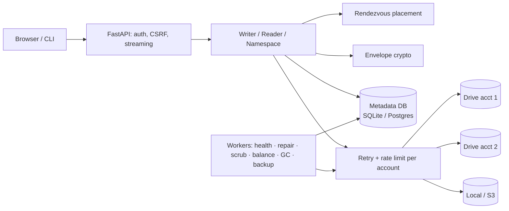

# DriveMesh

[](https://github.com/PRAJINRAJ-RANAWAT/DriveMesh/actions/workflows/ci.yml)

**A fault-tolerant, encrypted storage layer that pools the storage accounts you own** (several Google Drive accounts, local disks,
S3-compatible buckets) into one replicated namespace, designed after HDFS/GFS.

Files are streamed in chunks and encrypted on the server with per-file keys (AES-256-GCM, envelope encryption). Each chunk is replicated
to *different* accounts, chosen by weighted rendezvous hashing, with optional Reed–Solomon erasure coding. A metadata service (SQLite or Postgres)
tracks every replica. Background workers do the rest:
- health checks
- re-replication when an account disappears
- checksum scrubbing
- balancing
- garbage collection
- encrypted metadata backups stored on the accounts themselves

> Origin: this started as a 3-person course prototype (preserved unchanged in [`legacy/`](legacy/)). The prototype stored one copy of each chunk,
> identified accounts by list position, and leaked its key in git history. See the [audit](docs/design/01-current-state.md). Everything outside
> `legacy/` is a redesign and rebuild.

## Architecture

- **Write:**
  1. Reserve a `pending` version.
  2. Stream chunks: encrypt with AAD binding (file, version, index, last), place on RF distinct accounts, retry and fall back.
  3. Commit atomically. A crash at any point leaves nothing visible and GC cleans up.
- **Read:** pick the least-loaded healthy replica, verify SHA-256 and the GCM tag, fall back to other replicas, stream with bounded memory, support HTTP Range.
- **Failure handling:** heartbeats → `unreachable`/`revoked` → after a grace period, repair in fewest-healthy-first order. Repair never forgets a replica just because its account is temporarily away.

Design docs:
1. [Audit](docs/design/01-current-state.md)
2. [HDFS mapping & architecture](docs/design/02-architecture.md)
3. [Low-level design](docs/design/03-lld.md)
4. [ADRs](docs/design/04-decisions.md)
5. [Roadmap](docs/design/05-roadmap.md)
6. [Threat model](docs/design/07-threat-model.md)
7. [Results](docs/design/results.md)
8. [How it actually works (verified against the code, incl. DB schema)](docs/design/08-how-it-works.md)

## Measured results
All from scripted runs recorded with their method in [results.md](docs/design/results.md). **These are local-disk or simulated-network numbers.
Real Google Drive runs are pending** (see [MANUAL_STEPS](docs/design/MANUAL_STEPS.md#4-real-google-drive-benchmarks-fills-the-gdrive-rows-in-resultsmd)).

| What | Result |
|---|---|
| Chaos: account loss, chunk deletion and corruption, `SIGKILL` mid-upload and mid-repair, metadata wipe + restore | **0 files lost and 0 wrong bytes across 70 trials** (7 experiments × 10); fsck clean and 0 orphans after every trial |
| Memory while streaming 1 GB → 5 GB files | peak RSS ~291–331 MiB, flat across 1/2/3/5 GB (68 MiB interpreter baseline) |
| Parallel transfer, 8 accounts, simulated 10 MB/s per account | 47.2 MB/s mean vs 8.5 MB/s sequential; load-aware placement +39 % over plain hashing |
| Repair after losing 1 of 4 accounts (simulated 10 MB/s links) | 12.7 MB/s (parallel repair; 4.3 MB/s before the fix) |
| Storage overhead (measured) | RF=2: 2.0000×, RS(4,2): 1.5000×; encryption adds 32 B per chunk (legacy Fernet: +33.34 %) |
| Metadata at 1M chunks (Postgres 16) | repair scan 5.0 s, full fsck 7.9 s (fsck was 291 s before a query rewrite) |

## Quick start (local, no Google account needed)
```bash
python3.12 -m venv .venv && source .venv/bin/activate && pip install -e ".[dev,pg]"
export DRIVEMESH_MASTER_KEYS="$(drivemesh gen-key)"   # keep an offline copy!
drivemesh create-user owner
drivemesh account-add-local /tmp/dm/a && drivemesh account-add-local /tmp/dm/b && drivemesh account-add-local /tmp/dm/c
drivemesh put ./some-file.pdf /some-file.pdf && drivemesh ls / && drivemesh status
drivemesh serve            # web UI on http://localhost:8000
```
To link Google Drive accounts, set up an OAuth web client ([MANUAL_STEPS §2](docs/design/MANUAL_STEPS.md)).

## Development
```bash
ruff check . && ruff format --check .
pytest --cov=drivemesh                     # SQLite; set DRIVEMESH_TEST_DATABASE_URL for Postgres
python -m bench.run throughput --size-mb 1024
python -m bench.chaos all --trials 10
```
CI runs lint, the tests on SQLite **and** Postgres 16, `pip-audit`, and a Docker build that is smoke-tested against Postgres.

## Limitations (honest)
- Single process; no hot-standby metadata. RPO = metadata snapshot interval (15 min).
- **Losing the master key loses all data**: by design, there's no escrow.
- On the free Render tier, workers sleep when the instance sleeps.
- Google "Testing" OAuth apps expire grants after 7 days.
- Google Drive numbers haven't been measured yet. Every performance number above is local or simulated.
- Not a sync client and not POSIX; no sharing between users.
