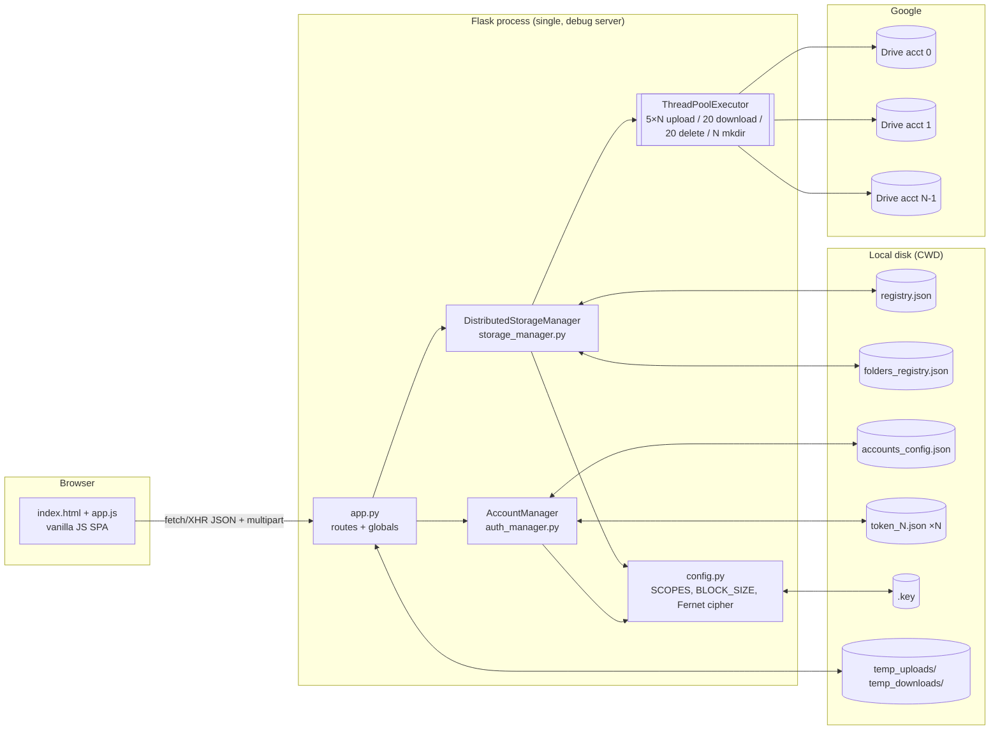
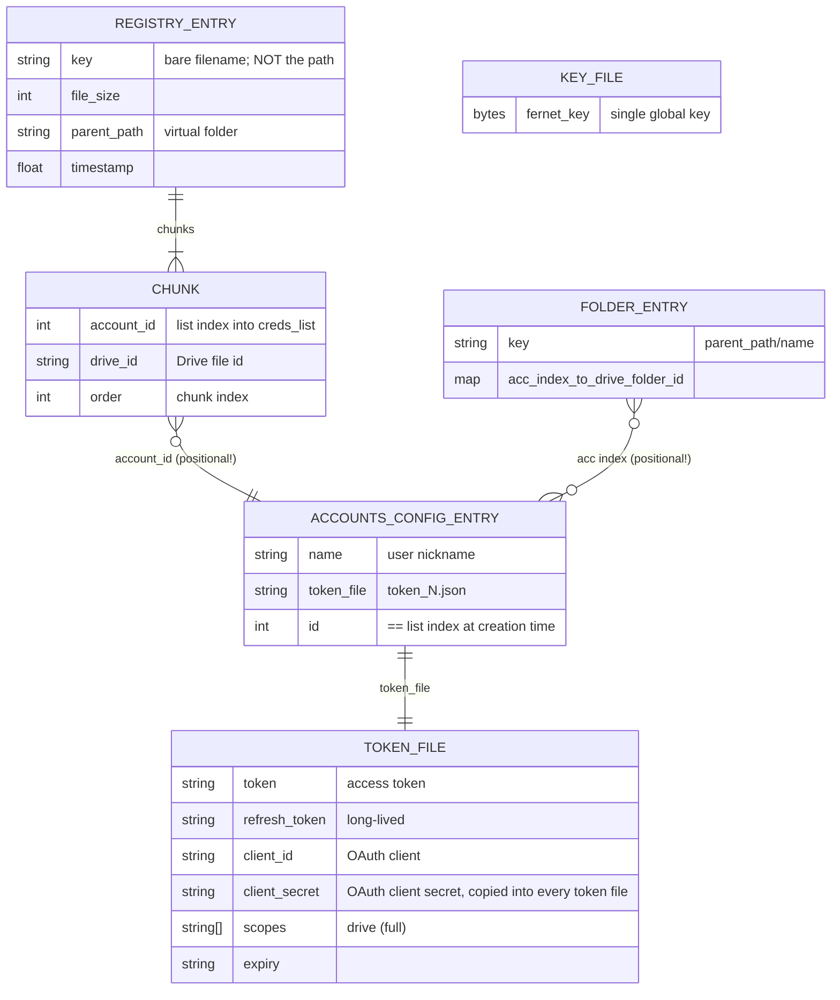

# 01 — Current State Audit (as forked)

Audited revision: `47ce4d8` (post history-scrub; see §0). Every claim cites `file:line` in that revision.
Files read in full: `app.py`, `auth_manager.py`, `storage_manager.py`, `drive_helpers.py`, `config.py`, `ui_utils.py`,
`templates/index.html`, `static/js/app.js`, `static/css/style.css` (styling only, not cited), `requirements.txt`, `README.md`.

---

## 0. Incident: secrets committed to git history (HIGH, rotation pending)

| File | Added in (original hash) | Untracked in (original hash) | New hash after rewrite |
|---|---|---|---|
| `.key` (Fernet master key) | `71c9c6c` | `95253e4` | `2baa2b4` / `f68970a` |
| `credentials.json` (OAuth client id + secret) | `71c9c6c` | `95253e4` | `2baa2b4` / `f68970a` |
| `folders_registry.json` (Drive folder IDs) | `dfe621e` | `95253e4` | `baac114` / `f68970a` |

- The files were removed with `git rm --cached` in `95253e4`, which does **not** remove them from history. The history was
  public on GitHub between 2026-03-16 and 2026-11-08.
- 2026-11-08: history rewritten with `git filter-repo --invert-paths` and force-pushed to `origin/main`
  (the only ref on the remote). Verified: neither `git log --all --name-only` nor `git rev-list --all --objects` lists any of the three paths.
- **Rewriting history does not un-leak a secret.** Clones, forks and caches may still hold it. Status:
  - OAuth client secret: **rotation pending (owner action)**.
  - `.key`: **treat as compromised; rotation pending.** Anything encrypted with it should be assumed readable by anyone
    who has both the old history and access to the chunk objects. Phase 1 replaces this key scheme entirely.
- Lesson recorded in the threat model (Phase 5): secrets never live in the working tree; they come from env vars or a secret manager.

---

## 1. What it actually does

**It is a Flask web app, not a CLI.** `README.md:3`, `README.md:15` and `README.md:122-127,170` describe a CLI with
`accounts`/`pull` menus that no longer exists. The only entry point is `app.py:349-352` (Flask dev server on
`localhost:5000`, `debug=True`). The CLI leftovers are dead code:
- `drive_helpers.py` is imported by nothing (checked with `grep` on every `import` line).
- `AccountManager.add_account()` calls `input()` (`auth_manager.py:69-85`) and nothing calls it.
- `list_distributed_files()` prints to stdout (`storage_manager.py:271-283`) and is never called.
- `UI.progress_bar` writes ANSI progress bars to the **server's** stdout during web requests (`storage_manager.py:84,108`).

### 1.1 Startup
1. `app.py:350` → `init_managers()` (`app.py:18-30`).
2. `AccountManager()` loads `accounts_config.json` (`auth_manager.py:52-56`) and calls `auth(token_file)` for each account (`auth_manager.py:62-67`).
3. If a token refresh fails, `auth()` catches **every** exception and starts an **interactive browser OAuth flow on the server**
   (`auth_manager.py:16-20`), so startup blocks waiting for a human.
4. `DistributedStorageManager()` loads `registry.json` and `folders_registry.json` into memory (`storage_manager.py:15-20`).
5. A one-off migration adds `parent_path='root'` to old entries (`app.py:24-30`).
6. Importing `config` has a side effect: it **creates `.key`** if it is missing (`config.py:7-11`), with default file permissions.

### 1.2 Upload
1. The browser POSTs multipart to `/api/upload` (`app.js:322-365`).
2. `app.py:80-100` takes `file.filename` **unsanitised** and joins it onto `temp_uploads/` (`app.py:98-100`).
3. The whole upload is written to disk first (`app.py:103`). There is no size limit (no `MAX_CONTENT_LENGTH` anywhere).
4. `upload_distributed()` (`storage_manager.py:66`) computes `ceil(size/5 MiB)` chunks (`:73`) and creates a pool with
   `5 × num_accounts` threads (`:79`).
5. Chunk *i* goes to account `i % N`, round-robin (`:88`), named `"<filename>.chunk<i>"` (`:93`) in that account's folder, if one is known (`:95-97`).
6. Each worker opens the file, seeks and reads its 5 MiB (`:42-44`), encrypts it with Fernet (`:46`), builds its own Drive service (`:49`)
   and does a **non-resumable** `files.create` (`:54-55`). On any exception it returns `None` (`:62-64`).
7. If any chunk failed, the function returns False (`:110-112`). **Chunks that already uploaded are left in Drive.**
8. Otherwise it sets `registry[filename] = {...}` and rewrites the whole `registry.json` (`:114-120`).
9. `finally` deletes the temp file (`app.py:117-120`).

### 1.3 Download
1. `GET /api/download/<filename>` (`app.py:125`). The browser buffers the whole response into a Blob (`app.js:379-389`).
2. The server reassembles into `temp_downloads/<filename>` (`app.py:131-133`).
3. `download_distributed()` sorts the chunks (`storage_manager.py:188`) and fetches them with **20 threads** (`:197`).
   Each worker downloads into a `BytesIO` and decrypts (`:163-177`).
4. **All decrypted chunks are kept in a list** (`:193,208`), then written out in order (`:217-219`).
5. `send_file` (`app.py:138`). The **decrypted plaintext file in `temp_downloads/` is never deleted.**

### 1.4 Delete file
1. `DELETE /api/files/<filename>` (`app.py:147-157`) → `delete_distributed()` (`storage_manager.py:228`).
2. Chunks whose `account_id >= len(creds_list)` are **silently skipped** (`:255-258`).
3. Per-chunk delete errors are **swallowed and counted as success** (`:247-249`).
4. The registry entry is removed unconditionally (`:266-267`). Result: unreferenced chunks stay in Drive and nothing will ever find them.

### 1.5 Delete folder
`app.py:241-282`: calls `delete_distributed` for each file under the prefix (`:246-253`). Then it deletes each per-account Drive folder,
with errors swallowed (`:262-272`), and removes the registry keys (`:274-276`).

### 1.6 mkdir
1. `POST /api/folders` (`app.py:162`) builds `path_key = f"{parent_path}/{name}"` (`:172`). It does not validate `/` in names.
2. `mkdir_distributed()` (`storage_manager.py:128`) creates a real Drive folder in **every** account in parallel
   (`:146-154`), using a **cached, shared** service object (`:137`).
3. **Partial success is recorded as success** (`:156-158`). Later uploads to accounts with no folder ID fall back to Drive root (`:95-97`).

### 1.7 Account add / remove / "switch"
- **Add:** `POST /api/accounts/add` (`app.py:197`) → `add_account_web()` (`auth_manager.py:87-106`).
  - It picks the next unused `token_<n>.json` (`:90-94`).
  - It runs `InstalledAppFlow.run_local_server(prompt='select_account')` (`:33-37`). This opens a browser on the **server** host
    and blocks the HTTP request thread until consent finishes. That only works when server and browser are the same machine.
  - It saves the token in plaintext (`:39-40`) and appends `{name, token_file, id: index}` (`:98-102`).
  - **No account email is recorded**, so the same Google account can be linked twice.
- **Remove:** `DELETE /api/accounts/<int:index>` (`app.py:214-236`) deletes the token file and `pop(index)`s the accounts list and
  `creds_list` (`:229-231`). Every later account's index shifts down by one (see W-02).
- **Switch:** there is no "active account". Every linked account takes part in every upload.

---

## 2. Components and data model





Concrete shapes:
```jsonc
// registry.json        (storage_manager.py:114-119)
{ "report.pdf": { "file_size": 12582912, "parent_path": "root/docs", "timestamp": 1713800000.0,
                  "chunks": [ {"account_id": 0, "drive_id": "1AbC…", "order": 0}, … ] } }
// folders_registry.json (storage_manager.py:157)
{ "root/docs": { "0": "<drive folder id in acct 0>", "1": "<id in acct 1>" } }
// accounts_config.json  (auth_manager.py:98-102)
[ { "name": "Personal", "token_file": "token_0.json", "id": 0 } ]
```
`token_N.json` is `Credentials.to_json()` (`auth_manager.py:39-40`). That output includes the refresh token **and the OAuth client secret**,
in plaintext. `.key` is one urlsafe-base64 Fernet key (`config.py:9-11`).

---

## 3. Concurrency model

| Operation | Pool size | Service object | Evidence |
|---|---|---|---|
| Upload | `5 × num_accounts` | new `build()` per chunk | `storage_manager.py:79,49` |
| Download | 20 (fixed) | new `build()` per chunk | `:197,166` |
| Delete | 20 (fixed) | new `build()` per chunk | `:251,244` |
| mkdir | `num_accounts` | **cached and shared across requests** | `:146,137,32-36` |
| HTTP requests | Flask dev server, threaded (default since Flask 1.0) | — | `app.py:352` |

- **Per-thread services are a correct instinct.** `httplib2` is not thread-safe, so building a service per task avoids sharing a connection.
  The cost is that every 5 MiB chunk pays to construct a service. The mkdir path breaks the rule: `service_cache` is shared, so two
  concurrent mkdir requests can drive the same `httplib2.Http` from two threads.
- **Credential refresh is not coordinated.** One `Credentials` object per account is shared by every worker thread (`storage_manager.py:89`).
  When the token expires, several threads can refresh it at once, with no lock. Refreshed tokens are written back to disk only inside `auth()` at startup
  (`auth_manager.py:25-26`), so a long-running server never persists them.
- **Shared mutable state has no locks.** `dist_manager.registry` and `folder_registry` are plain dicts that request threads mutate
  (`storage_manager.py:114,157,266`; `app.py:274`) and iterate (`app.py:49,65,247,295`). A `json.dump` in one thread while another thread
  inserts a key can raise `RuntimeError: dictionary changed size during iteration`. Two concurrent saves can also interleave writes into the same file.
- **Memory (estimate from code, not measured).**
  - Upload: each in-flight task holds 5 MiB of plaintext, a 6.67 MiB Fernet token (measured overhead, see `results.md` R-001) and a
    `BytesIO` copy. That is about 18 MiB per task, times `5N` tasks: about 0.9 GiB at N=10.
  - Download: holds the **entire decrypted file** (`:193-208`), so memory is O(file size). The browser then buffers it again (`app.js:381`).

---

## 4. Weaknesses

Severity: **High** = data loss, data exposure or a hard blocker for the stated goal. **Medium** = correctness or security problem with a workaround.
**Low** = hygiene.

| ID | Weakness | Verdict | Severity | Evidence |
|---|---|---|---|---|
| W-00 | Master key and OAuth client secret were committed and pushed to a public repo | **Confirmed** | High | §0 |
| W-01 | Replication factor 1: losing one account or one chunk loses the file | **Confirmed.** Each chunk has exactly one `{account_id, drive_id}`; download fails if any chunk fails | High | `storage_manager.py:57-61,88,212-214` |
| W-02 | Account identity is a list index; removing or reordering accounts corrupts mappings | **Confirmed.** `pop(index)` shifts `creds_list`; chunk and folder maps still hold old indices, so downloads hit the **wrong account** (404) and deletes target the wrong account | High | `app.py:229-231`; `storage_manager.py:201-202,256-257`; `auth_manager.py:101` |
| W-03 | Failed uploads leave orphan chunks; no GC | **Confirmed** | Medium | `storage_manager.py:110-112` (no cleanup); nothing lists `appProperties.type=chunk` |
| W-04 | Delete swallows errors and still removes the registry entry | **Confirmed.** Also silently skips chunks on removed accounts | High | `storage_manager.py:247-249,255-258,266`; folder delete `app.py:271-272` |
| W-05 | Same-name upload overwrites the entry and orphans old chunks | **Confirmed, and worse than stated.** The registry key is the **bare filename, not the path**, so `a.txt` in `/docs` silently replaces `a.txt` in `/`. Download and delete are also by bare name | High | `storage_manager.py:114`; `app.py:65-73,125-128,147-151` |
| W-06 | Non-atomic JSON writes; no locking between threads or processes | **Confirmed.** `open(path,'w')` truncates first, so a crash mid-dump leaves an empty or partial file and `json.load` fails on the next start | High | `storage_manager.py:28-30`; `auth_manager.py:58-60` |
| W-07 | Download holds the whole decrypted file in memory | **Confirmed**, plus the browser buffers it again | Medium | `storage_manager.py:193-219`; `app.js:379-389` |
| W-08 | No retries or backoff for 403/429/5xx; non-resumable uploads | **Confirmed.** Any exception fails the chunk; `resumable=False`; no HTTP timeouts are set | Medium | `storage_manager.py:54,62-64,178-180` |
| W-09 | Round-robin ignores free space and quotas | **Confirmed.** `c_idx % N`; no `about.get(storageQuota)` call anywhere | Medium | `storage_manager.py:88` |
| W-10 | Single local Fernet key: SPOF, no rotation, chunks not bound to position, no whole-file hash | **Confirmed.** Fernet authenticates each chunk alone, so swapping two `drive_id`s yields a wrong file that decrypts cleanly. No whole-file digest is stored. Losing `.key` loses all data | High | `config.py:7-16`; `storage_manager.py:46,176,114-119` |
| W-11 | Full `drive` scope; secrets in plaintext files | **Confirmed.** Full Drive is a *restricted* scope (heavier verification). Token files also embed the client secret | Medium | `config.py:4`; `auth_manager.py:25-26,39-40` |
| W-12 | No tests, CI, metrics or structured logging | **Confirmed.** No test files, no `.github/`, `print`-based logging | Medium | repo tree; `ui_utils.py:28-44` |
| W-13 | Path traversal via upload filename. A filename like `../../x` writes outside `temp_uploads/`, and `finally` then **deletes** that path | **New** | High | `app.py:100,103,118-120` (Werkzeug does not sanitise `filename`; `secure_filename` is not used) |
| W-14 | Decrypted plaintext persists on server disk forever | **New** | High | `app.py:131-138` (no cleanup) |
| W-15 | No authentication on any route; debug server with `debug=True` | **New.** Safe only while bound to localhost; a blocker for any deployment | High (for deploy) | `app.py:35-305,352` |
| W-16 | Desktop OAuth flow run inside a web request | **New.** Blocks a worker thread, opens a browser on the server, cannot work when deployed | High (for deploy) | `auth_manager.py:33-37`; `app.py:206` |
| W-17 | Same Google account can be linked twice; no email/subject stored | **New.** Two "replicas" could land on the same physical account | Medium | `auth_manager.py:98-102` |
| W-18 | Plaintext filenames leak to the storage provider via chunk names | **New.** Undercuts the "encrypted storage" claim | Medium | `storage_manager.py:50,93` |
| W-19 | Stored XSS / JS injection through filenames in inline `onclick` handlers. `escapeHtml` uses `textContent→innerHTML`, which escapes `& < >` but **not quotes** | **New** | Medium | `app.js:192,195,199,219,248,572-577` |
| W-20 | CSRF: multipart `POST /api/upload` is a CORS "simple request"; no CSRF token | **New** | Medium | `app.py:80`; `app.js:364` |
| W-21 | Partial mkdir recorded as success; accounts without folder IDs upload to Drive root | **New** | Low | `storage_manager.py:95-97,156-158` |
| W-22 | Interactive OAuth on startup when a refresh fails (broad `except`) | **New** | Medium | `auth_manager.py:16-20` |
| W-23 | Shared dict mutated by concurrent requests without locks | **New** | Medium | §3 |
| W-24 | Whole upload staged to disk before chunking; concurrent same-name uploads share one temp path | **New** | Low | `app.py:100,103` |
| W-25 | Fernet's base64 encoding inflates stored bytes by about 33%, so a quarter of every account's quota is overhead | **New, measured** | Medium | `storage_manager.py:46`; `results.md` R-001 |
| W-26 | Unpinned dependencies; stale README (CLI, another developer's Windows paths `README.md:81,89`); dead code | **New** | Low | `requirements.txt:1-5`; §1 |
| W-27 | Managers initialised only under `__main__`; any WSGI server would see `None` globals | **New** | Low | `app.py:15-16,349-350` |

---

## 5. What the code already does well
- **Commit-after-success on upload.** The registry entry is written only after every chunk succeeded (`storage_manager.py:110-120`).
  There are never dangling *metadata* entries, only dangling *data*. That is the right half of a two-phase write.
- **Reads by offset instead of loading the file.** Upload memory is bounded by concurrency, not file size (`storage_manager.py:42-44`).
- **Knows `httplib2` is not thread-safe.** It builds a service per task (`storage_manager.py:48-49`).
- **Client-side authenticated encryption.** Fernet = AES-128-CBC + HMAC-SHA256, so tampered chunks are rejected (`storage_manager.py:46,176`).
- **Tags chunks with `appProperties`** (`storage_manager.py:50`). That makes an orphan scan by listing possible later.
- **`prompt='select_account'`** to force picking a different Google account (`auth_manager.py:36`).
- **The virtual namespace is decoupled from provider folders** (`folders_registry.json`).
- **The UI is pleasant and mostly escapes output** (`app.js:184,218,494-496`). The gap is attribute and JS-string contexts (W-19).

---

## 6. Honest attribution
`git log` shows **no code authored by Prajinraj Ranawat** before this audit. The fork was built by **veer-mehta** (4 commits, +1071/−402:
chunking, Fernet encryption, multi-account OAuth, distributed folders) and **Shreyas/Shreyash Shukla** (9 commits, +2411/−193:
Flask web UI, front-end, README, rename). The ideas "chunk, encrypt, round-robin across Drive accounts" and the existing UI are theirs.
What is defensibly yours starts here: this audit (including finding the leaked-secrets incident and 13 new defects beyond the starting checklist),
the redesign into a replicated metadata/data-plane architecture, and every line from Phase 0 onward. In an interview, say:
"I forked a team prototype, audited it, found it had replication factor 1 and positional account IDs that corrupted data on account removal,
and rebuilt it as a fault-tolerant system".
Never claim the original chunk/encrypt/upload pipeline or UI as your own.
