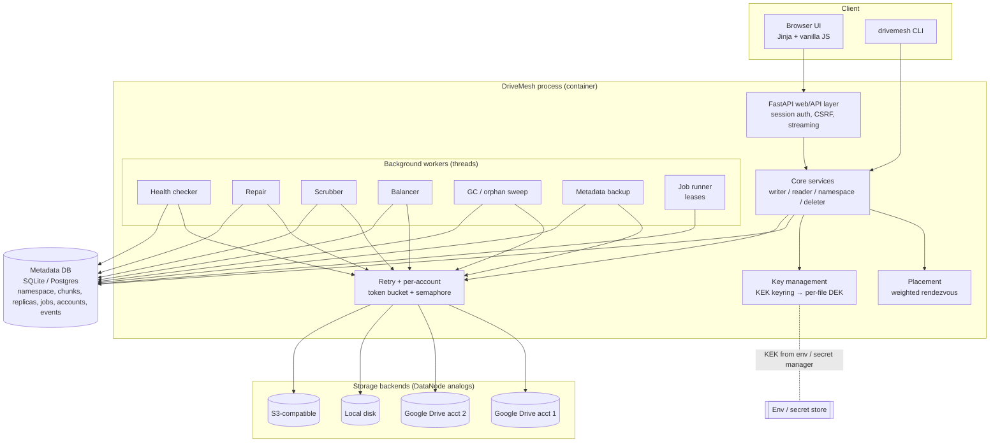

# 02 — HDFS/GFS Mapping and Target Architecture

DriveMesh is a **multi-account, multi-cloud encrypted storage layer**. It pools storage accounts the user legitimately owns
(Google Drive first; local disk and S3-compatible behind the same interface) into one namespace. Data is chunked, encrypted on the client,
replicated and repaired. The design borrows deliberately from GFS/HDFS, and it differs where a passive, quota-limited remote API forces it to.

---

## 1. Concept mapping

| HDFS / GFS concept | What it does there | DriveMesh equivalent |
|---|---|---|
| NameNode / GFS master | Owns the namespace and the block→DataNode map, in memory | **Metadata service**: `drivemesh.core` plus a SQL DB (SQLite locally, Postgres when deployed). Namespace = `folders`/`files`; block map = `chunks` + `replicas` |
| DataNode / chunkserver | Stores blocks on local disks, serves reads and writes | **Storage backend** = one *linked account* (one Google Drive account, one local dir, one S3 bucket). Accounts are **passive**: they run none of our code |
| Block (128 MiB) / chunk (64 MB) | Unit of placement and replication | **Chunk** (default 8 MiB, configurable; see ADR-009). Stored as one opaque object per replica |
| Replication factor (default 3) | Copies per block | `RF` per file (default **2**, configurable 1–5). DB constraint: **never two replicas of a chunk on one account** |
| Block placement policy | 1st replica local, 2nd/3rd on another rack | **Weighted rendezvous hashing** over healthy accounts, weighted by free space, **provider-diverse** first (§03-5) |
| Rack awareness | Survive a rack (switch/PSU) failure | **Account/provider awareness**. The failure domain is an *account* (revoked, deleted, banned) and, one level up, a *provider* (Google outage, ToS change). Prefer replicas on different providers when there are several |
| Heartbeats (3 s) / block reports (6 h) | DataNodes push liveness and block lists | **Active polling**. The health checker calls `backend.health()` per account (default every 60 s). The *reconcile* job lists an account's objects and diffs them with `replicas` (the block-report analog, run rarely because listing is expensive) |
| Dead-node detection (~10.5 min) | Mark a node dead, re-replicate its blocks | An account in `unreachable`/`revoked` longer than `dead_after` (default 10 min) has its replicas treated as lost and repair starts |
| Re-replication | NameNode schedules copies of under-replicated blocks, by priority | **Repair worker**: scans chunks with `healthy < RF`, fewest healthy first, copies from a healthy replica to a new account |
| Balancer | Moves blocks to even out disk utilisation | **Balancer job**: copy-then-delete from the fullest to the emptiest accounts, rate-limited, never dropping below RF |
| fsimage + edit log | Checkpointed namespace plus an append-only journal of mutations | **The SQL DB is both.** Its own WAL gives crash consistency. Periodic **encrypted logical snapshots** uploaded to every account are the off-site "fsimage". A separate edit log is **not** built (over-engineering for one user; see ADR-003) |
| Secondary / Standby NameNode | Checkpointing / hot failover | **Not a hot standby.** Metadata **backup and restore** from any account (cold standby, RPO = snapshot interval). Deployed, the managed Postgres provider's own backups add a second layer |
| Safe mode | NameNode read-only at startup until enough blocks are reported | **Safe mode**: writes, repair and GC disabled at startup until every account has passed one health check (or a timeout passes). Reads allowed |
| Leases for writers | One writer per file; lease recovery | **Immutable versions + atomic commit.** Writers never modify in place. Each write is a new `pending` version and the commit flips it to `committed` in one transaction. Concurrent writers → **last commit wins**, never a torn file. Job leases (visibility timeouts) make background work crash-safe |
| Block checksums (CRC32C per 512 B) | Detect disk corruption on read and by the scanner | **SHA-256 of each stored object** (checked on every read and by the scrubber, no key needed) **plus AES-GCM tags** (tamper/position binding) **plus a whole-file SHA-256** of the plaintext |
| DataNode block scanner | Background verification | **Scrubber**: rate-limited re-reads of the replicas with the oldest `verified_at` |
| Erasure coding (Hadoop 3, RS-6-3) | 1.5× overhead instead of 3× | **Optional RS(k, m) mode** per file (Phase 3). Default stays replication (§5, ADR-004) |

## 2. Where DriveMesh must differ from HDFS

| Constraint | Why it matters | Design consequence |
|---|---|---|
| **Passive storage nodes** | Drive runs none of our code: no heartbeats, no pipelines, no local checksumming, no block reports | All liveness and integrity checks are *pulled* by us. Replication is client fan-out (we upload each replica ourselves), not a DataNode→DataNode pipeline |
| **API quotas** | Drive: 1,000,000 quota units/min/project, 325,000/min/user/project; `files.create`/`update` cost 50 units each; 750 GB/day upload per user ([Drive limits](https://developers.google.com/workspace/drive/api/guides/limits)) | Per-account token bucket + concurrency cap. Repair and balance are throttled. Chunks are large enough that the request count, not the byte count, isn't the binding limit (§5) |
| **Rate limiting with 403/429** | Google returns 403 `userRateLimitExceeded` or 429 and asks for truncated exponential backoff | Retry layer with full jitter, cap 32 s; error classification (§03-7) |
| **High per-request latency** | Each object op is an HTTPS round trip (tens to hundreds of ms) vs microseconds to a local disk | Parallelism across accounts; pipelined chunk window; avoid per-chunk metadata round trips (one DB transaction per chunk, not per replica) |
| **No data locality** | HDFS moves compute to data; we have no compute at the storage side | Not a goal. DriveMesh is a storage system, not a compute platform |
| **Listing is slow and paged** (and historically not strongly consistent with recent writes) | Can't rely on `list` to discover our own objects right after writing them | The DB is the source of truth. Object names are **deterministic from the replica id** (`dm-<replica_id>`), so a crashed write can be cleaned up by name. Orphan sweeps use a long grace period |
| **OAuth tokens expire / get revoked** | A DataNode never logs out. Our "nodes" can (password change, user revokes access, test-mode 7-day expiry) | `revoked` health state; re-link flow keeps the account's stable id; data on a revoked account counts as unavailable until re-linked or past `dead_after` |
| **Shared, user-visible quota** | 15 GB free per Google account, shared with Gmail/Photos; the user can fill it outside DriveMesh | Free space is *polled*, not computed; placement leaves a reserve; `403 storageQuotaExceeded` marks the account `full` |
| **User can delete our objects** | Someone can delete files in the Drive UI | Scrubber/read path detects `missing` → repair. With the `drive.file` scope our objects live in one app folder |

## 3. Target architecture

- **Control plane:** the API, the core services and the DB. **Data plane:** the backends. Bytes never pass through the DB, and metadata never lives only in a backend
  (except the encrypted DB snapshots used for disaster recovery).
- **Job queue = a table in the metadata DB** (ADR-007). Claiming a job is a conditional `UPDATE` with a lease expiry. No Redis.
- One process runs the API and the worker threads (fits a free tier). `drivemesh worker` can run workers separately.

## 4. Requirements

**Functional**
1. Link N ≥ 1 storage accounts (Google Drive via web OAuth; local and S3 for dev/test) to a user. Stable ids; no duplicate links of the same external account.
2. Hierarchical namespace: mkdir, list, move/rename, delete (recursive), stat.
3. Upload/download files of any size up to the max, streaming, with progress; HTTP Range on download.
4. Replication with configurable RF; automatic repair, scrubbing, balancing and GC.
5. Client-side envelope encryption; key rotation without re-uploading data.
6. Unlink an account with evacuation (no data loss).
7. Status: per-account health/capacity, replica health, repair backlog, recent events.
8. Metadata backup to the backends; restore into an empty DB.
9. Import from the legacy `registry.json` format.

**Non-functional**

| Property | Target (v1) | How verified |
|---|---|---|
| Durability | No committed file lost when any **RF−1** accounts fail at once (RF=2 → 1, RF=3 → 2), given repair finishes before the next failure | Chaos tests C-1..C-3 (`results.md`) |
| Integrity | 0 undetected corruptions: every read verifies SHA-256 + GCM tag + whole-file hash | Chaos test C-4 (corrupt/swap chunks) |
| Crash safety | A crash at any point leaves no committed file that references a missing replica; orphans are collected | Chaos tests C-5/C-6 |
| Memory | Peak RSS bounded by `inflight_chunks × chunk_size × ~3 + baseline`, **independent of file size** | Benchmark B-3 |
| Throughput | Scales with the number of accounts until the host link is saturated. Number: **[placeholder]** | Benchmarks B-1/B-2 |
| Max file size | 1 TiB by design (≤131,072 chunks at 8 MiB); tested to [placeholder] GB | B-1 |
| Accounts | 1–100 per user | Placement is O(N) per chunk |
| Metadata scale | 1M chunks in SQLite/Postgres with indexed queries | Synthetic test (Phase 3) |
| Availability | Single process; restart-tolerant. **Not** HA | — |

**Non-goals (explicit):** POSIX semantics or mounting (FUSE); random writes or appends; multiple concurrent writers merged into one file;
real-time sync/collaboration; sharing between users; deduplication; hot-standby metadata HA; a multi-tenant public SaaS
(the schema is multi-user-*ready* but v1 serves one owner); circumventing any provider's quotas or terms. DriveMesh only uses
accounts the user owns, within each provider's published limits.

## 5. Back-of-envelope

*These are calculations, not measurements. Measured numbers go in `results.md`.*

**Storage overhead** (plus AES-GCM's 12-byte nonce + 16-byte tag + 4-byte magic per object = 32 B per 8 MiB chunk ≈ 0.0004 %.
Compare the legacy Fernet +33.34 %, R-001):

| Scheme | Raw bytes / logical byte | Account failures tolerated | Min accounts | Repair read amplification |
|---|---|---|---|---|
| RF=2 | 2.0× | 1 | 2 | 1× (copy one replica) |
| RF=3 | 3.0× | 2 | 3 | 1× |
| RS(4,2) | 1.5× | 2 | 6 | 4× (read 4 shards to rebuild 1) |
| RS(6,3) | 1.5× | 3 | 9 | 6× |

**API calls per GiB** at 8 MiB chunks: 128 chunks.
- Write, RF=2: 256 `files.create` × 50 units = **12,800 quota units/GiB**. Against 325,000 units/min/user, quota allows about 25 GiB/min per user.
  So **bandwidth, not quota, is the binding limit** for a laptop or free-tier host.
  - Resumable uploads cost 2 HTTP requests per object (initiate + PUT).
  - At the old 5 MiB the request count is 1.6× higher.
- Read: 128 `get_media` calls per GiB (one replica each).
- The 750 GB/day/user upload cap does not bind for a personal pool.

**Accounts needed.** Let U = usable GB per account (15 GB free minus what the user's own mail/photos use; assume U = 12), C = target logical capacity,
f = failures to tolerate.
- Replication: RF = f+1 and `N ≥ RF` (one replica per account). Raw needed = C·RF. To **re-protect after losing f accounts**, the survivors must
  still hold everything, so `N ≥ C·RF/U + f`.
  - C = 50 GB, f = 1, RF = 2: N ≥ 100/12 + 1 = 9.3 → **10 accounts**.
  - C = 20 GB, f = 1: **5 accounts**.
- RS(4,2) (f = 2): raw = 1.5·C. C = 50 GB → N ≥ 75/12 + 2 = 8.25 → **9 accounts** (and ≥ 6), *tolerating two losses* with fewer accounts than RF=2 needs for one.
  That is the core argument for erasure coding.

**Time to re-replicate after losing one account** holding D GB of replicas. Every lost replica is read from a survivor and written to a new account,
so the host moves D down and D up.
- `T ≈ D / min(B_down, B_up, quota_rate)`. With quota at about 25 GiB/min, the host uplink B_up dominates.
- D = 12 GB: at B_up = 10 MB/s, T ≈ **20 min**; at 2 MB/s (home uplink), T ≈ **1.7 h**.
- RS(4,2) reads 4× as much to rebuild the same bytes, so a download-bound repair is 4× slower.
- Window of vulnerability: during T a second failure loses data for RF=2. Hence repair priority goes to chunks with the fewest healthy replicas.
- Measured value: **[placeholder]**, benchmark B-5 (local backends, simulated bandwidth), and later on real Drive.

## 6. Failure modes

| Failure | Detection | Handling | User impact |
|---|---|---|---|
| Account revoked/deleted | `health()` gets AUTH error (`invalid_grant`, 401) or 404 on the app folder | State `revoked`. After `dead_after`, its replicas count as lost and repair re-replicates them. UI prompts to re-link | None if RF ≥ 2 and repair finishes. A banner shows the degraded account |
| Access token expired | 401 on a call | google-auth refreshes automatically using the refresh token; transparent | None |
| Refresh token expired (Testing-mode apps: 7 days) | `RefreshError` | Same as revoked. Documented in MANUAL_STEPS (publish the app with non-sensitive scopes to avoid it) | Re-link needed |
| Quota/storage full | 403 `storageQuotaExceeded`; free space < reserve | State `full`: placement excludes it, reads continue; balancer moves data off | Writes go to other accounts; fail only if fewer than RF accounts have space (clear error) |
| Rate limited | 403 `userRateLimitExceeded` / 429 | Backoff with full jitter; token bucket slows down | Slower transfers |
| Chunk deleted manually | 404 on read or scrub; reconcile diff | Replica → `missing`, read falls back to another replica, repair enqueued | None (RF ≥ 2) |
| Chunk corrupted / swapped | SHA-256 mismatch, or GCM tag fails (AAD binds file, version, index) | Replica → `corrupt`, fallback, repair | None (RF ≥ 2). Never silent |
| Crash mid-upload | File stays `pending` with an expired lease | GC aborts the file: deletes uploaded replicas by id and pending replicas *by deterministic name*, then the rows | The upload must be retried; no partial file is ever visible |
| Crash mid-repair | New replica row stays `pending`; job lease expires | Pending replica is cleaned up by name; the chunk is still under-replicated, so the next repair scan retries | None |
| Metadata DB lost | App startup finds an empty DB | `drivemesh restore` pulls the latest encrypted snapshot from any account (needs the KEK + access to one account) | Files committed after the last snapshot are lost from the namespace (RPO = snapshot interval). Orphan sweep is paused after a restore so their chunks aren't deleted |
| **Master key (KEK) lost** | Decryption fails | **Nothing can be done.** Data and backups are encrypted with it. That is the cost of client-side encryption with no escrow | **Total, permanent data loss.** The README says so in bold; the UI asks for an offline backup of the key |
| Two clients write the same path | Both insert `pending` versions | The partial unique index allows one `committed` row per path. Commits serialise; the later commit supersedes the earlier one (last-writer-wins), and the superseded version is GC'd. `overwrite=false` makes the second commit fail with 409 | One version wins whole; no torn file |
| Host network partition | All backends fail at once | Health marks every account unreachable, so no repair storm (repair requires ≥ 1 healthy source and a target). Enter safe mode if every account is down | Temporary unavailability |
