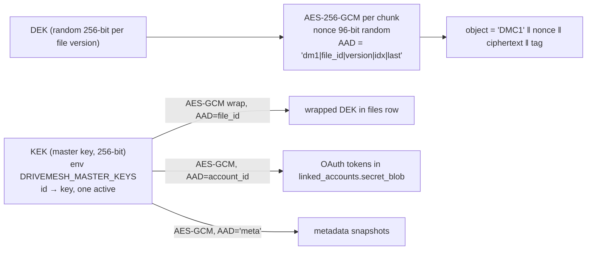

# 03 — Low-Level Design

Package: `drivemesh/` (Python 3.12). Access goes through **SQLAlchemy 2.0** with **Alembic** migrations. **SQLite** (WAL mode) is used locally and in tests;
**Postgres** when deployed. Both run from the same models (ADR-002). Every query is scoped by `user_id` (multi-user-ready).

## 1. Schema

```sql
-- Portable DDL (Postgres shown; SQLite types: TEXT/INTEGER/BLOB, same constraints). IDs are UUIDv4 strings.
CREATE TABLE users (
  id            TEXT PRIMARY KEY,
  username      TEXT NOT NULL UNIQUE,
  password_hash TEXT NOT NULL,              -- scrypt, see §8
  created_at    TIMESTAMP NOT NULL
);

CREATE TABLE linked_accounts (
  id              TEXT PRIMARY KEY,          -- stable; never a list index (fixes W-02)
  user_id         TEXT NOT NULL REFERENCES users(id),
  provider        TEXT NOT NULL CHECK (provider IN ('gdrive','local','s3','memory')),
  external_id     TEXT NOT NULL,             -- Google 'sub', local path, bucket+prefix
  display_name    TEXT NOT NULL,
  email           TEXT,
  config_json     TEXT NOT NULL DEFAULT '{}',-- non-secret settings (root folder id, path)
  secret_blob     BLOB,                      -- AES-GCM(KEK, tokens), AAD = account id
  state           TEXT NOT NULL DEFAULT 'active'
                  CHECK (state IN ('active','full','unreachable','revoked','draining','removed')),
  capacity_bytes  BIGINT, used_bytes BIGINT, free_bytes BIGINT,
  last_health_at  TIMESTAMP, last_ok_at TIMESTAMP, consecutive_failures INT NOT NULL DEFAULT 0,
  last_error      TEXT,
  created_at      TIMESTAMP NOT NULL,
  UNIQUE (user_id, provider, external_id)    -- same Google account cannot be linked twice (W-17)
);

CREATE TABLE folders (
  id         TEXT PRIMARY KEY,
  user_id    TEXT NOT NULL REFERENCES users(id),
  parent_id  TEXT REFERENCES folders(id),     -- NULL only for the user's root
  name       TEXT NOT NULL,                   -- validated: no '/', not '.'/'..', <=255 bytes
  created_at TIMESTAMP NOT NULL,
  UNIQUE (user_id, parent_id, name)
);

CREATE TABLE files (
  id             TEXT PRIMARY KEY,
  user_id        TEXT NOT NULL REFERENCES users(id),
  folder_id      TEXT NOT NULL REFERENCES folders(id),
  name           TEXT NOT NULL,
  version        INT  NOT NULL,                -- monotonically increasing per (folder,name)
  state          TEXT NOT NULL CHECK (state IN ('pending','committed','deleting','deleted','aborted')),
  size           BIGINT, sha256 TEXT,          -- whole-file plaintext hash, set at commit
  chunk_size     INT NOT NULL, chunk_count INT,
  scheme         TEXT NOT NULL DEFAULT 'replica' CHECK (scheme IN ('replica','ec')),
  rf             INT NOT NULL,                 -- replicas per chunk (replica scheme)
  ec_k           INT, ec_m INT,                -- erasure scheme params
  wrapped_dek    BLOB NOT NULL, kek_id TEXT NOT NULL,
  lease_expires_at TIMESTAMP,                  -- writer heartbeat while pending
  created_at TIMESTAMP NOT NULL, committed_at TIMESTAMP, deleted_at TIMESTAMP
);
-- Invariant: at most one committed version per path. Partial unique index (SQLite >= 3.8 and Postgres both support it).
CREATE UNIQUE INDEX ux_files_live_path ON files(user_id, folder_id, name) WHERE state = 'committed';
CREATE INDEX ix_files_state_lease ON files(state, lease_expires_at);

CREATE TABLE chunks (
  id          TEXT PRIMARY KEY,
  file_id     TEXT NOT NULL REFERENCES files(id) ON DELETE CASCADE,
  idx         INT  NOT NULL,
  plain_size  INT  NOT NULL,
  UNIQUE (file_id, idx)
);

CREATE TABLE replicas (
  id          TEXT PRIMARY KEY,               -- also the remote object name: 'dm-' || id
  chunk_id    TEXT NOT NULL REFERENCES chunks(id) ON DELETE CASCADE,
  account_id  TEXT NOT NULL REFERENCES linked_accounts(id),
  shard_idx   INT  NOT NULL DEFAULT 0,        -- EC shard number (0 for replicas)
  remote_id   TEXT,                           -- provider object id (Drive file id); NULL until uploaded
  size        INT, sha256 TEXT,               -- of the stored object bytes (verifiable without key)
  state       TEXT NOT NULL CHECK (state IN ('pending','ok','missing','corrupt','deleting')),
  created_at  TIMESTAMP NOT NULL, verified_at TIMESTAMP,
  UNIQUE (chunk_id, account_id)               -- never two replicas/shards of a chunk on one account
);
CREATE INDEX ix_replicas_account_state ON replicas(account_id, state);
CREATE INDEX ix_replicas_verified ON replicas(state, verified_at);

CREATE TABLE jobs (
  id            TEXT PRIMARY KEY,
  kind          TEXT NOT NULL,                -- delete_file | gc_file | evacuate | rebalance | backup | rewrap | reconcile
  payload_json  TEXT NOT NULL,
  dedupe_key    TEXT UNIQUE,                  -- e.g. 'delete_file:<file_id>' prevents duplicates
  state         TEXT NOT NULL CHECK (state IN ('queued','running','done','dead')),
  priority      INT NOT NULL DEFAULT 100,     -- lower runs first
  attempts      INT NOT NULL DEFAULT 0, max_attempts INT NOT NULL DEFAULT 8,
  run_after     TIMESTAMP NOT NULL,
  lease_owner   TEXT, lease_expires_at TIMESTAMP,
  last_error    TEXT, created_at TIMESTAMP NOT NULL, updated_at TIMESTAMP NOT NULL
);
CREATE INDEX ix_jobs_claim ON jobs(state, priority, run_after);

CREATE TABLE events (                         -- audit log, append-only
  id INTEGER PRIMARY KEY AUTOINCREMENT, ts TIMESTAMP NOT NULL, user_id TEXT,
  kind TEXT NOT NULL, level TEXT NOT NULL, file_id TEXT, account_id TEXT, detail_json TEXT
);

CREATE TABLE kv (key TEXT PRIMARY KEY, value TEXT NOT NULL);  -- cluster state: last_backup_at, restored_at, ...
```

**Invariants and where they are enforced**

| Invariant | Enforcement |
|---|---|
| One committed version per path | `ux_files_live_path` (DB) |
| No two replicas of a chunk on one account | `UNIQUE(chunk_id, account_id)` (DB) |
| Same external account linked once per user | `UNIQUE(user_id, provider, external_id)` (DB) |
| A committed file has chunks `0..n-1`, each with ≥ `min_write_replicas` `ok` replicas | Checked in the commit transaction (one aggregate query) and by `drivemesh fsck` (used in every chaos test) |
| A name is not both a file and a folder in one directory | Service layer, inside the same transaction as the insert |

Not using DB triggers for the "all chunks healthy" invariant is deliberate: it is a cross-table aggregate, the commit path checks it, and fsck audits it.

## 2. Write path (two-phase)

```mermaid
sequenceDiagram
  participant C as Client
  participant W as Writer
  participant DB as Metadata DB
  participant P as Placement
  participant A as Accounts (RF targets)
  C->>W: PUT /files/content?path=/a/b (stream)
  W->>DB: tx1: resolve folder, INSERT files(state=pending, version=max+1, wrapped_dek, lease)
  loop each chunk (window of `inflight_chunks`)
    W->>W: read ≤ chunk_size, sha256-update(plaintext), AES-GCM(DEK, AAD=file|ver|idx)
    W->>P: choose RF accounts (rendezvous, weights=free)
    W->>DB: tx: INSERT chunk + replicas(state=pending, id known ⇒ remote name known)
    par each replica
      W->>A: put('dm-'+replica_id, object) with retry/backoff
    end
    W->>DB: tx: replicas → ok(remote_id, size, sha256); extend file lease
    Note over W,A: failed target ⇒ next candidate in placement order
  end
  W->>DB: tx2 COMMIT: verify all chunks have ≥ min_write_replicas ok;<br/>old committed version → deleting (+delete job); new → committed
  W-->>C: 201 {file}
```

| Failure at step | State left behind | Recovery |
|---|---|---|
| Before tx1 | nothing | — |
| During chunk upload, retryable | — | Retry with backoff (§7). On permanent failure, try the next placement candidate |
| Fewer than `min_write_replicas` targets available | file `pending` | Writer aborts: marks the file `aborted` and enqueues `gc_file` (deletes uploaded objects) → 503 to client |
| Process crash anywhere before commit | file `pending`, lease stops being extended | GC scan: `pending` files with `lease_expires_at < now` → `aborted` + `gc_file` job. `gc_file` deletes `ok` replicas by `remote_id` and `pending` replicas **by name** (`dm-<id>`), since the crash may have happened after the remote put but before the DB update |
| Commit conflict (`overwrite=false` and a committed version exists) | file `pending` | Abort + GC → 409 |
| Crash after commit | committed | Nothing to do: commit is one transaction |

`min_write_replicas` defaults to `rf` (strict). Setting it lower trades durability-at-ack for availability; the repair worker then fills the gap.

**Bounded memory:** the writer holds at most `inflight_chunks` (default 4) chunks of plaintext + ciphertext. The HTTP handler pulls the request body
only as fast as the writer accepts chunks (backpressure).

## 3. Read path
1. Load the committed file, its chunks and replicas in one query. Unwrap the DEK.
2. For each chunk in the requested range, with a prefetch window of `inflight_chunks` (thread pool, results consumed in order):
   - Order candidate replicas: `ok` on `active` accounts first, then `ok` on `full`/`draining` accounts, then by EWMA latency per account
     (in-memory), with random tie-break.
   - `get(remote)` → check `sha256(object) == replicas.sha256` → AES-GCM decrypt with AAD.
   - On NotFound → replica `missing`. On checksum/tag failure → `corrupt`. On transient failure (after retries) → try the next replica. Every bad replica emits an event.
     Repair picks these up because the healthy count fell below RF.
   - If every replica fails: raise `ChunkUnavailable`. The HTTP stream is aborted (the client sees a truncated transfer, not wrong bytes).
3. Yield plaintext slices, updating a whole-file SHA-256 when the full file is read. A mismatch at the end is logged at CRITICAL and the
   stream aborted before the final bytes are sent. This is defence in depth: per-chunk AEAD already binds content and position.
4. **Range:** `bytes=a-b` maps to chunks `a // cs .. b // cs`. Only those are fetched; the whole-file hash is skipped for partial reads.

Memory is O(`inflight_chunks × chunk_size`) regardless of file size (fixes W-07).

## 4. Delete path
1. `tx`: file `committed → deleting`, `deleted_at=now`. Enqueue `delete_file:<file_id>` (deduped). Return 202. The namespace hides it immediately.
2. Job: for each replica, `backend.delete(remote_id)`. **NotFound counts as success** (idempotent). Delete the replica row on success.
   Transient error: the job raises, the attempt is recorded with `last_error`, and it is retried with backoff.
   Account `revoked`/`removed`: the replica row is dropped and a warning event recorded (the bytes are unreachable, so a later re-link + reconcile collects them).
3. When no replicas remain: chunks deleted, file → `deleted` (the row is kept as a tombstone for audit).
4. After `max_attempts` the job goes `dead`, visible on the status page. **No error is silently swallowed** (fixes W-04).

Folder delete (recursive): one transaction marks every committed file in the subtree `deleting` (enqueuing jobs) and deletes the folder rows.
Folders are pure metadata (no provider folders), which removes W-21.

## 5. Placement

Goal: choose `RF` distinct accounts for a chunk.
- Never the same account twice.
- Prefer distinct providers.
- Weight by free space.
- Deterministic for a given `(key, accounts, weights)` so tests are reproducible.

**Algorithm: weighted rendezvous (HRW) hashing.** For chunk key `k` (the chunk id) and account `a` with weight `w_a = free_bytes_a`:
`h = blake2b(k ‖ a.id) → u ∈ (0,1)`, `score_a = −w_a / ln(u)`. Sort by score, descending (Schindelhauer & Schomaker's weighted form).
Selection takes the best-scoring account of each provider first (diversity), then fills up to RF in score order.
Eligible accounts: `state = active`, `free_bytes − reserve ≥ chunk_size`, and not excluded (already holding a replica).

| | Weighted rendezvous | Consistent hashing ring (vnodes) |
|---|---|---|
| Per-lookup cost | O(N) hashes. Trivial for N ≤ 100 | O(log V) |
| Weights | Exact, and continuous (free bytes) | Approximate. Needs vnodes ∝ weight, and the ring is rebuilt when weights change |
| Minimal disruption on add/remove | Yes | Yes |
| Code | ~20 lines, no state | Ring structure + vnode tuning |
| **Choice** | ✅ | — |

The full candidate order also gives the **fallback list** when a target fails mid-write.

## 6. Background workers

All run as daemon threads in the app process (or via `drivemesh worker`). Each loop is a function `run_once()`, so tests call it directly
with no sleeping. Nothing runs in safe mode except the health checker.

| Worker | Cadence (default) | What it does |
|---|---|---|
| **Health checker** (heartbeat) | 60 s per account | `backend.health()` → free/used/capacity. AUTH error → `revoked`. 3 consecutive transient failures → `unreachable`. Success → `active` (or `full` if free < reserve). Exits safe mode once every non-removed account has been probed |
| **Repair** (re-replication) | 30 s scan, batch of 100 | Query chunks of committed files where `count(ok replicas on active/full/draining accounts, excluding accounts dead > dead_after) < rf`, ordered by healthy count ascending. Per chunk: read a verified healthy replica, place on new accounts (excluding current holders), put, mark ok. A replica on a dead account is marked `missing`. Zero healthy replicas → `chunk_lost` CRITICAL event (the file shows as damaged) |
| **Scrubber** | continuous, rate-limited (default 1 MiB/s) | Pick `ok` replicas ordered by `verified_at NULLS FIRST`; download; compare SHA-256; set `verified_at` or mark `corrupt`/`missing` |
| **Balancer** | 10 min | If `max(util) − min(util) > 10 %` among active accounts, move up to M replicas from the most- to the least-utilised: **copy, mark ok, then delete the old one**. RF never drops |
| **GC** | 5 min | (a) `pending` files with expired lease → `aborted` + `gc_file`. (b) `replicas.state='pending'` older than 1 h on committed files → delete by name. (c) **Orphan sweep**: list `dm-*` objects per account and delete those absent from `replicas` and older than `orphan_grace` (24 h). **Disabled for 7 days after a metadata restore** |
| **Backup** | 15 min, if metadata changed | Logical JSON dump of all tables → gzip → AES-GCM(KEK, AAD='meta') → `put('dm-meta-<ts>')` on every active account; keep the last 5 |
| **Job runner** | 1 s poll | Claims and runs `jobs` rows (below) |

**Job claim with lease** (portable SQLite/Postgres, no `SKIP LOCKED` needed at this scale):
```sql
-- 1. pick a candidate
SELECT id FROM jobs WHERE state IN ('queued','running') AND run_after <= :now
  AND (lease_expires_at IS NULL OR lease_expires_at < :now)
  ORDER BY priority, run_after LIMIT 1;
-- 2. claim atomically; rowcount==1 means we own it, else someone else won the race → retry
UPDATE jobs SET state='running', lease_owner=:me, lease_expires_at=:now+:visibility, attempts=attempts+1
  WHERE id=:id AND (lease_expires_at IS NULL OR lease_expires_at < :now) AND state IN ('queued','running');
```
- Success → `done`.
- Exception → `queued` with `run_after = now + backoff(attempts)` and `last_error` set, or `dead` once `attempts ≥ max_attempts`.
- A crashed worker's job is re-claimed after its lease expires. Jobs are written to be **idempotent**, because at-least-once execution is the contract.

## 7. Retries, rate limits, resumable uploads
- **Error taxonomy** (`drivemesh.backends.base`): `TransientError` (timeouts, connection reset, 5xx, 429, 403 `rateLimitExceeded`/`userRateLimitExceeded`),
  `NotFoundError` (404), `AuthError` (401, `invalid_grant`), `QuotaFullError` (403 `storageQuotaExceeded`), `PermanentError` (other 4xx).
- **Retry:** only `TransientError`, at most 6 attempts. Sleep = `uniform(0, min(32 s, 0.5 s · 2^attempt))` (full jitter, AWS Architecture Blog).
  The cap follows Google's recommended 32–64 s maximum.
- **Per-account limiter:** a token bucket (default 8 req/s, burst 16) and a semaphore (default 4 concurrent ops) wrap every backend call.
  Google's quota is per user, and every account is a different user.
- **Resumable uploads:** `GoogleDriveBackend.put` uses Drive resumable upload sessions (`MediaIoBaseUpload(resumable=True, chunksize=…)`) so a dropped connection
  resumes from the last acknowledged offset instead of restarting the chunk. At 8 MiB objects resuming saves little, so it mainly helps on flaky links.
  Retries of the *whole* object are idempotent because the remote name is deterministic. A retried put first deletes any partial object with the same name.

## 8. Encryption


- **AEAD with associated data** binds every chunk to (file id, version, index, is-last flag: the STREAM construction, Hoang–Reyhanitabar–Rogaway–Vizár 2015). Swapping, reordering, replaying a chunk from another
  file, or truncating the chunk list fails authentication (fixes W-10).
- **Overhead:** 32 bytes per object (vs Fernet's +33 %).
- **Nonce safety:** random 96-bit nonces under a per-file key. The NIST limit of 2³² messages per key with random nonces is far beyond the chunks in any one file.
- **Rotation:** add a new key id and make it active. The `rewrap` job re-wraps every file's DEK and every account's token blob with the new KEK.
  **No data is re-uploaded.** Once no row references the old `kek_id`, the old key can be removed from the env.
  Rotating DEKs themselves (after a suspected DEK compromise) requires re-encrypting, so it is done by re-uploading the file (a copy job).
- **Where the KEK lives:** locally, `.env` (gitignored, mode 600) or the shell environment. Deployed, the host's secret store, injected as an env var.
  A real KMS (AWS KMS / GCP KMS) would hold the KEK and do wrap/unwrap remotely. Out of scope for free tier; documented as "where a managed service wins".
- **KEK lost ⇒ all data lost.** No escrow and no recovery. The snapshots are also encrypted with it. Users must keep an offline copy.
- **Password hashing** for the login: `hashlib.scrypt` (n=2¹⁴, r=8, p=1, 16-byte salt). Standard library, memory-hard.

## 9. Storage backend interface

```python
class StorageBackend(Protocol):
    provider: str
    def put(self, name: str, data: bytes) -> PutResult: ...      # PutResult(remote_id, size)
    def get(self, remote_id: str) -> bytes: ...                   # one object; objects are ≤ chunk_size+32 B
    def delete(self, remote_id: str) -> None: ...                 # NotFound → NotFoundError (callers treat as success)
    def find(self, name: str) -> str | None: ...                  # remote_id by deterministic name (crash cleanup)
    def list(self, prefix: str = "dm-") -> Iterator[ObjectInfo]:  # name, remote_id, size, created_at (orphan sweep/reconcile)
    def health(self) -> HealthInfo: ...                           # capacity, used, free; raises AuthError/TransientError
```
- `get` returns bytes rather than a stream. Objects are bounded by the chunk size, so per-object buffering is **bounded memory by construction**.
  Streaming happens at the file level (chunk by chunk). This keeps every backend trivial.
- Implementations:
  - `LocalDiskBackend`: directory, atomic writes via temp + `os.replace`, `remote_id = name`.
  - `MemoryBackend`: dict, for unit tests.
  - `GoogleDriveBackend`: `drive.file` scope, one app folder `DriveMesh`; `remote_id` = Drive file id; `appProperties={'dm':'1'}`;
    `about.get(storageQuota)` for health.
  - `S3Backend`: boto3, any S3-compatible endpoint.
  - `FaultyBackend`: a wrapper that injects latency, bandwidth caps, error rates, "dead" mode and bit flips. Used by the chaos tests and benchmarks.
- A **backend factory** builds instances from `linked_accounts` rows (decrypting `secret_blob`) and wraps each in the rate limiter and retry layer.

## 10. Multi-account auth (Google)
- **Linking:**
  1. `GET /accounts/link/google` creates a `google_auth_oauthlib.flow.Flow` from env (`GOOGLE_CLIENT_ID`/`SECRET`), web-application client type.
     Scopes: `openid email https://www.googleapis.com/auth/drive.file`, `access_type=offline`, `prompt=consent select_account`,
     random `state` stored in the session, PKCE on.
  2. Redirect to Google.
  3. `GET /accounts/callback/google` checks `state`, exchanges the code and verifies the ID token.
     - `external_id = sub`. If that `sub` is already linked for this user, the tokens are **updated** (the re-link path) instead of duplicated.
     - Creates the `DriveMesh` app folder (its id is kept in `config_json`).
     - Stores tokens encrypted (§8). The state starts `active`.
- **Refresh:** `google.oauth2.credentials.Credentials` refreshes the access token automatically. A `RefreshError` maps to `AuthError`, so the account goes `revoked`.
  If the refresh token changes, the new one is persisted.
- **Scope trade-off:** `drive.file` is *non-sensitive* (only files the app created), while `drive` is *restricted*
  ([scope table](https://developers.google.com/workspace/drive/api/guides/api-specific-auth)) and needs a security assessment to go public.
  We lose the ability to read pre-existing Drive files (legacy migration needs the old full-scope token, used once, locally) and the ability to see objects created by a
  *different* Cloud project. We gain least privilege, and a user can trust that we cannot read their other files.
- **Testing-mode limits:** at most 100 test users; authorisations expire **7 days** after consent; unverified apps have a lifetime cap of 100 users
  ([Manage app audience](https://support.google.com/cloud/answer/15549945)).
  For a single-owner demo: either re-link weekly or publish the app (non-sensitive scopes only). See MANUAL_STEPS.
- **Unlink:**
  1. `DELETE /api/v1/accounts/{id}` → state `draining` and an `evacuate` job.
  2. The job re-replicates every chunk that has a replica there, then deletes the replicas on the draining account.
  3. Then: state `removed`, token revoked at Google (best effort), `secret_blob` cleared.
  4. Unlinking is refused (409) if the remaining active accounts cannot satisfy RF.

## 11. Web API (FastAPI, prefix `/api/v1`, JSON errors `{"error": {"code": "...", "message": "..."}}`)

All state-changing requests need a session cookie **and** the header `X-CSRF-Token` matching the session's token.

| Method & path | Purpose | Success | Errors |
|---|---|---|---|
| `POST /auth/login` `{username,password}` | Start a session | 200 `{user, csrf_token}` | 401 |
| `POST /auth/logout` | End the session | 204 | |
| `GET /auth/me` | Current user + CSRF token | 200 | 401 |
| `GET /fs?path=/docs` | List a folder | 200 `{path, folders:[{name,path}], files:[{name,path,size,version,committed_at,chunks,health}]}` | 404 |
| `POST /folders` `{path}` | mkdir (parents optional `?parents=true`) | 201 | 409 exists, 400 bad name |
| `DELETE /folders?path=&recursive=true` | Delete a folder | 202 `{files_deleted}` | 409 not empty, 404 |
| `POST /fs/move` `{src,dst}` | Rename/move a file or folder | 200 | 404, 409 |
| `PUT /files/content?path=&overwrite=false&rf=` | Upload. **Raw body stream** (no multipart buffering). `Content-Length` optional | 201 `{id,path,size,sha256,version,chunks}` | 409 exists, 413 too large, 503 safe-mode/insufficient accounts |
| `GET /files/content?path=` | Download, streamed, `Range: bytes=a-b` supported | 200 / 206 | 404, 416, 503 |
| `GET /files/meta?path=` | Stat incl. per-chunk replica health | 200 | 404 |
| `DELETE /files?path=` | Delete (async purge) | 202 | 404 |
| `GET /accounts` | Linked accounts with health and capacity | 200 | |
| `GET /accounts/link/google` *(non-API, redirect)* | Start OAuth | 302 | 503 if not configured |
| `POST /accounts/local` `{path,name}` | Link a local-disk backend (dev/demo; disabled when `DRIVEMESH_ALLOW_LOCAL_BACKENDS=false`) | 201 | 409 |
| `DELETE /accounts/{id}` | Unlink with evacuation | 202 `{job_id}` | 409 would violate RF |
| `GET /cluster/status` | Safe mode, per-account health, replica-state counts, under-replicated chunks, job backlog, recent events | 200 | |
| `GET /metrics` | Prometheus (bearer `DRIVEMESH_METRICS_TOKEN`) | 200 | 401 |
| `GET /healthz`, `GET /readyz` | Liveness / readiness (`readyz` = DB reachable and not in safe mode) | 200/503 | |

Example:
```http
PUT /api/v1/files/content?path=/photos/trip.zip HTTP/1.1
X-CSRF-Token: 3f9…
Content-Type: application/octet-stream

<bytes>

HTTP/1.1 201 Created
{"id":"5c1e…","path":"/photos/trip.zip","size":734003200,"sha256":"9a…","version":1,"chunks":88,"rf":2}
```
Upload limits: `DRIVEMESH_MAX_UPLOAD_BYTES` (default 10 GiB), enforced while streaming (→ 413). Names are validated server-side.
No client-supplied name ever touches the local filesystem (fixes W-13/W-14: there are no temp files at all).

## 12. Optional erasure-coding mode
- **Library:** `zfec` (Reed–Solomon over GF(2⁸), C implementation, wheels for CPython 3.12 on macOS and Linux). Writing RS by hand is a great exercise
  and a poor production choice.
- **Parameters:** per file `ec_k`, `ec_m` (defaults k=4, m=2).
- **Write:** each encrypted chunk object is split into k data shards plus m parity shards. Each shard is stored as a replica row with
  `shard_idx`, on k+m distinct accounts.
- **Read:** fetch any k shards that verify (shard SHA-256), decode, then the AEAD check on the reassembled object.
- **Repair:** fetch k shards, re-encode, upload the missing shard indices.
- Requires N ≥ k+m healthy accounts.
- **When replication is better:** few accounts (N < 6), small files (per-shard request overhead), read-latency-sensitive workloads
  (k requests per chunk vs 1), and repair bandwidth (k× read amplification). **Default = replication RF=2** (ADR-004).

## 13. Observability
- **Logs:** JSON lines on stdout (`ts, level, logger, msg, request_id, file_id, account_id, …`) via a stdlib `logging.Formatter`. A request id comes from
  middleware via `contextvars`. Secrets are never logged: tokens live only in `Credentials` objects, and a redaction filter drops known secret keys.
- **Prometheus metrics** (`prometheus_client`):
  - `dm_bytes_uploaded_total{account}`, `dm_bytes_downloaded_total{account}`
  - `dm_backend_op_seconds{op,provider}` (histogram), `dm_backend_retries_total{provider,reason}`
  - `dm_replicas{state}` (gauge), `dm_under_replicated_chunks` (gauge), `dm_jobs{state}` (gauge)
  - `dm_scrub_errors_total{kind}`, `dm_repairs_total{result}`, `dm_safe_mode`
- **Status page** `/status` (HTML) renders `/api/v1/cluster/status`: account cards (state, free/capacity bar, last error),
  replica health counts, repair backlog, dead jobs, recent events.
