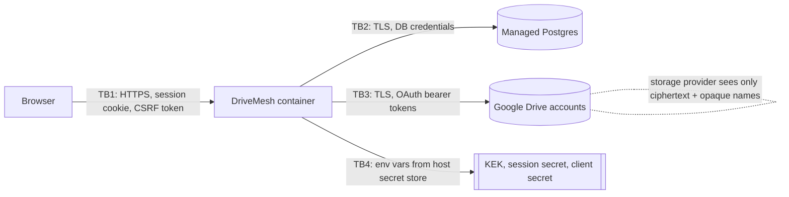

# 07 — Threat Model

Scope: DriveMesh v1 as deployed for a single owner (container plus managed Postgres plus linked Google accounts).
Method: assets → trust boundaries → STRIDE per boundary → mitigation, the test that proves it, and residual risk.

## Assets
| Asset | Why it matters |
|---|---|
| A1 File plaintext | User data |
| A2 Master key (KEK) | Decrypts every DEK, token and metadata snapshot. **Loss means total data loss; leak means total confidentiality loss** |
| A3 OAuth refresh tokens | Access to each linked account's DriveMesh objects (`drive.file` only) |
| A4 Metadata DB | Namespace and chunk map. Loss means data is unreachable (mitigated by snapshots) |
| A5 Owner credentials / session | Full control of the UI and API |
| A6 OAuth client secret | Lets someone else impersonate the app in a consent screen |

## Trust boundaries

## Threats (STRIDE)
| # | Threat | Boundary | Mitigation | Evidence (test) | Residual risk |
|---|---|---|---|---|---|
| T1 | **S**poofing: password guessing on login | TB1 | Google sign-in (Google enforces the password and 2FA; DriveMesh stores no password for these users); operator password accounts use scrypt, a per-IP throttle (429), generic errors and constant-work verification (also for Google-only users) | `test_login_is_rate_limited`, `test_password_hash_is_salted`, `test_google_only_accounts_cannot_use_password_login` | Operator password accounts have no MFA |
| T2 | **S**poofing: CSRF making the owner's browser upload or delete | TB1 | Synchronizer token in the `X-CSRF-Token` header on every unsafe method; `SameSite=Lax` cookie; OAuth `state` + PKCE | `test_csrf_required_for_mutations`, `test_oauth_rejects_state_mismatch` | None known |
| T3 | **S**poofing: session theft | TB1 | `HttpOnly`, `Secure` (prod), `SameSite=Lax`, signed cookie, new session on login, HSTS; **server-side session table**: logout and "sign out everywhere" revoke immediately, sessions expire after 14 d | `test_session_cookie_flags`, `test_logout_revokes_the_session_server_side`, `test_sign_out_everywhere`, `test_sessions_expire` | A stolen cookie works until logout, expiry or sign-out-everywhere |
| T4 | **T**ampering: storage provider modifies, swaps, replays or truncates chunks | TB3 | SHA-256 per object + AES-GCM with AAD `(file, version, idx, last)` + whole-file hash; bad replicas are marked and repaired | `test_w10_*`, `test_aad_binds_chunk_position`, `test_c3_*` | None for integrity; availability needs RF ≥ 2 |
| T5 | **T**ampering: XSS via file names | TB1 | DOM built with `textContent` only, no inline handlers, strict CSP (`script-src 'self'`) | `test_security_headers`; legacy W-19 | A CSP bypass would need a script on our own origin |
| T6 | **T**ampering: path traversal or server-file writes | TB1 | No client name touches the filesystem (no temp files); names validated; local backends disabled in prod | `test_w13_*`, `test_local_backends_can_be_disabled` | — |
| T7 | **R**epudiation: who deleted what | all | Append-only `events` table (logins, deletes, account changes, repairs); JSON logs with request ids | `cluster_status.recent_events` | The events table lives in the same DB an attacker with DB access could edit |
| T8 | **I**nformation disclosure: provider reads data | TB3 | Client-side envelope encryption; opaque object names (`dm-<uuid>`) | `test_w18_remote_names_are_opaque` | Sizes and access timing are visible to the provider |
| T9 | **I**nformation disclosure: DB leak reveals tokens | TB2 | Tokens sealed with the KEK (AAD = account id); the KEK is never in the DB | `test_secrets_never_stored_in_plaintext` | DB + KEK together means full compromise |
| T10 | **I**nformation disclosure: secrets in git or logs | TB4 | Secrets only via env (`SecretStr`), `.gitignore`, Claude Code deny rules, log redaction filter; the history was scrubbed after W-00 | `test_settings_from_env`, `test_json_formatter_redacts…` | **The previously leaked OAuth client secret and Fernet key must be rotated (MANUAL_STEPS §1)** |
| T11 | **I**nformation disclosure: cross-user access | TB1 | Every query scoped by `user_id`; other users' resources return 404 | `test_users_are_isolated*` | — |
| T12 | **D**oS: huge uploads or slow-loris | TB1 | `max_upload_bytes` enforced on declared length and while streaming; bounded memory per transfer | `test_upload_size_limit`, `test_w07_*` | No per-user storage quota; host-level timeouts depend on the platform |
| T13 | **D**oS: Google rate limits or quota exhaustion | TB3 | Token bucket + concurrency cap per account; backoff; full-account detection | `test_resilience.py`, `test_full_account_detected` | Daily 750 GB upload cap per Google user |
| T14 | **E**levation: OAuth over-privilege | TB3 | `drive.file` scope only (non-sensitive), checked at callback; token revoked on unlink | `test_oauth_requires_drive_scope`, `test_unlinking_google_account_revokes_token` | — |
| T15 | **E**levation: unsafe prod config | TB4 | `create_app` refuses to start in prod with an unsafe config (session secret, HTTPS, Postgres, local backends) | `test_app_refuses_unsafe_production_config` | — |
| T17 | **S**poofing: a stolen or forged API access token | TB1 | HS256 JWT, 15-minute lifetime, `alg` pinned (no `none`), `iss`/`aud`/`typ` checked, revoked by sign-out-everywhere | `test_access_tokens_expire_and_cannot_be_forged` | A stolen token works for ≤ 15 min unless the user signs out everywhere |
| T18 | **S**poofing: a stolen refresh token | TB1 | Opaque, stored hashed, single-use rotation; replaying a used token revokes its whole chain | `test_refresh_rotates_and_reuse_revokes_the_chain` | If the thief refreshes first, the real client's next refresh fails and the chain is revoked (detected, not prevented) |
| T19 | **E**levation: attaching someone else's Gmail, or one Gmail to two DriveMesh users | TB3 | Linking needs that Gmail owner's own Google consent (state + PKCE); `ux_accounts_external_live` makes a Gmail belong to one DriveMesh user | `test_a_gmail_can_be_linked_by_only_one_drivemesh_user`, `test_oauth_rejects_state_mismatch` | — |
| T20 | **E**levation / **I**nformation disclosure: open sign-up | TB1 | Self-service users are not admins: no server-local folders, no global metrics; status scoped to the caller | `test_signed_up_users_get_no_operator_powers`, `test_status_is_scoped_to_the_signed_in_user` | No per-user bandwidth/storage quota; Google Testing mode restricts sign-in to listed test users |
| T16 | Supply chain: vulnerable dependency | build | Pinned versions; `pip-audit` in CI; ruff `S` (bandit) rules | CI `audit` job | Zero-days; transitive deps are pinned only by the lock of the moment |

## Key-loss policy (stated bluntly)
The KEK is the root of trust and has **no escrow**. If it is lost, every file, every linked-account token and every metadata snapshot is
permanently unreadable. The owner must keep an offline copy (password manager plus paper) at first deploy; MANUAL_STEPS makes this a checklist item.
A managed KMS would remove the "lose the key" failure mode but adds cost and a cloud dependency (ADR-008).

## Out of scope for v1
- A malicious host or platform operator (they hold the env).
- A compromised owner device.
- Traffic analysis.
- Hardware side channels.
