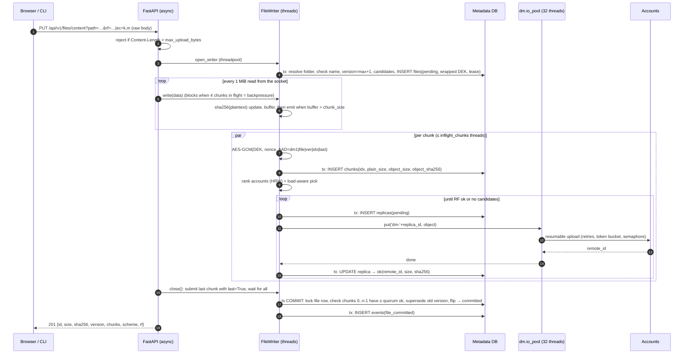
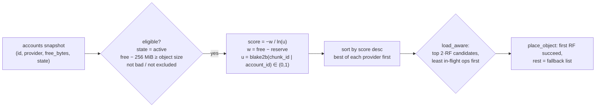
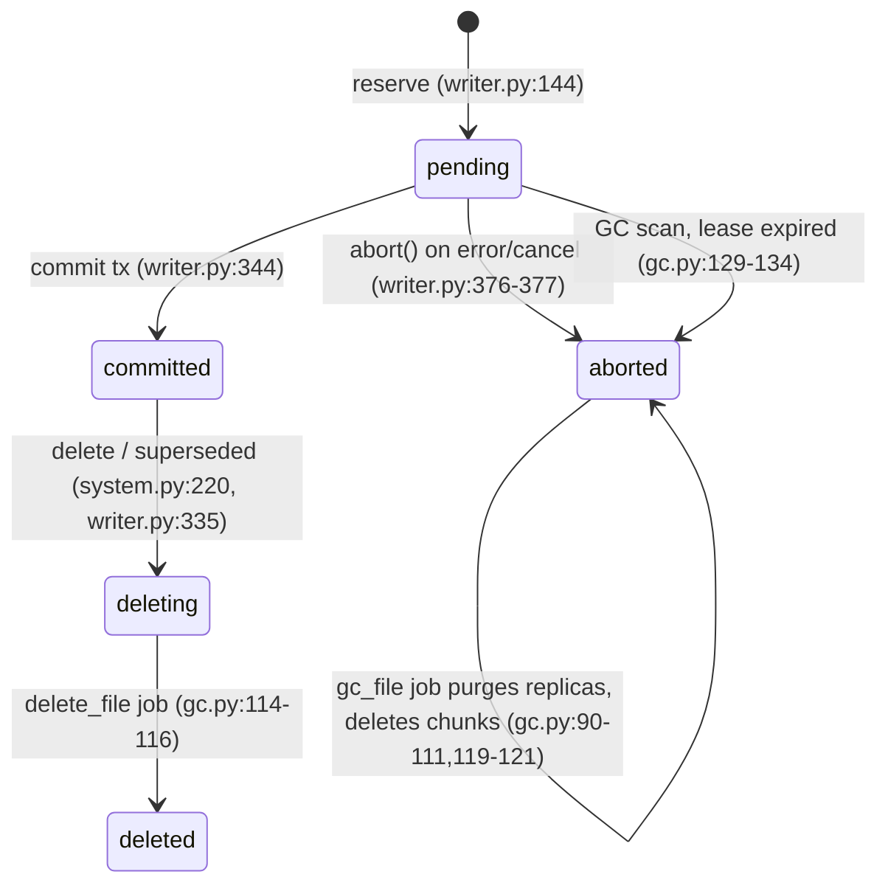
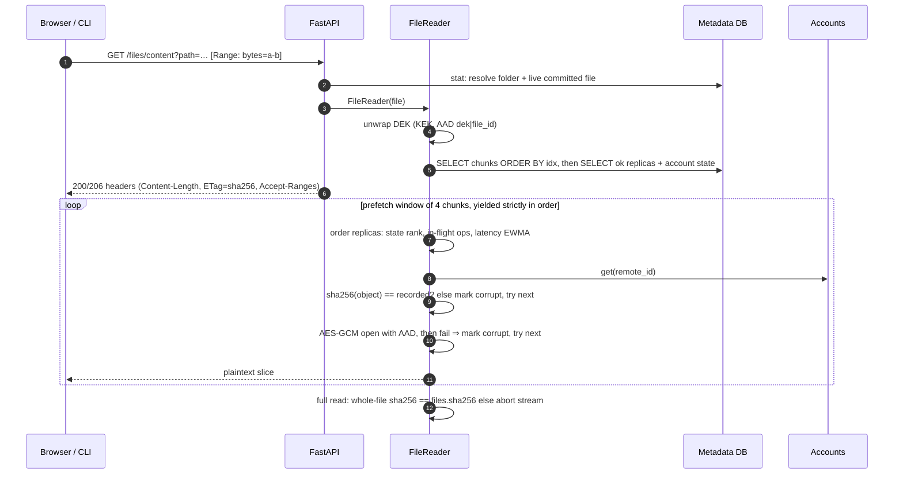
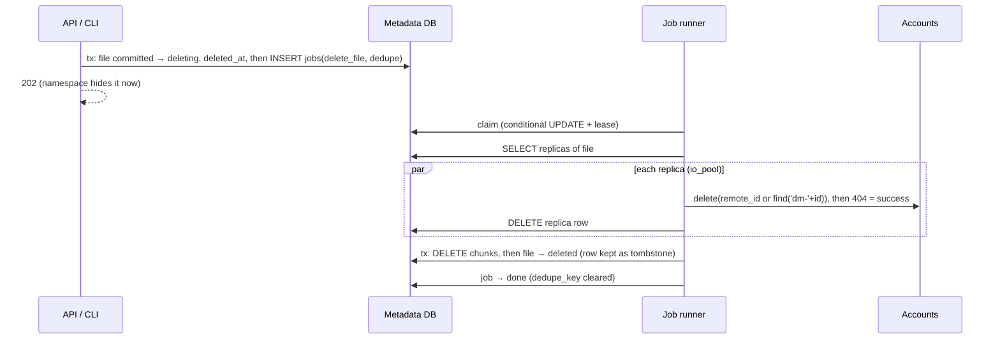
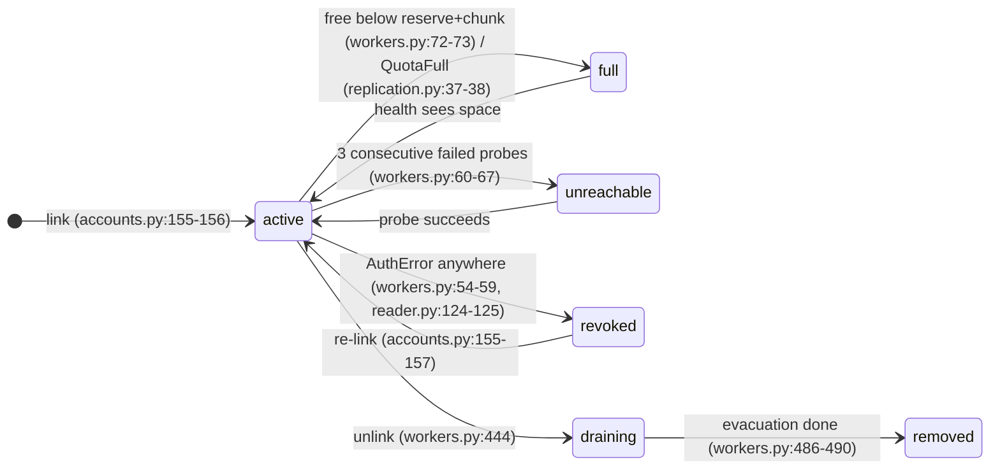
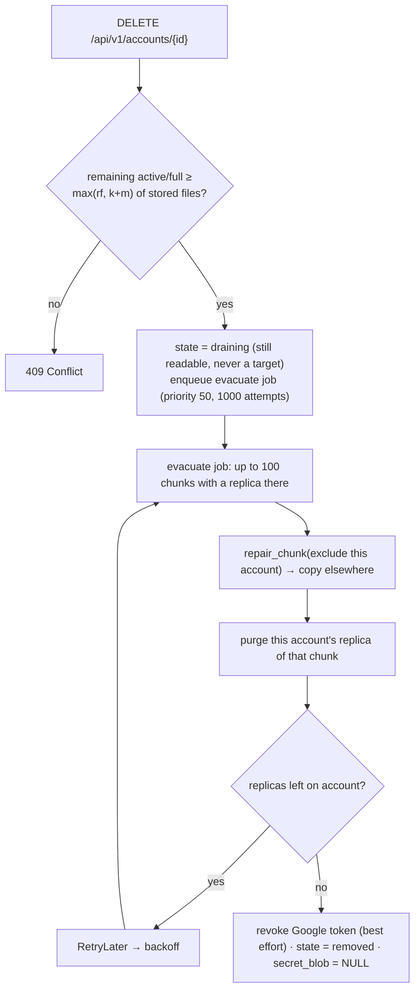
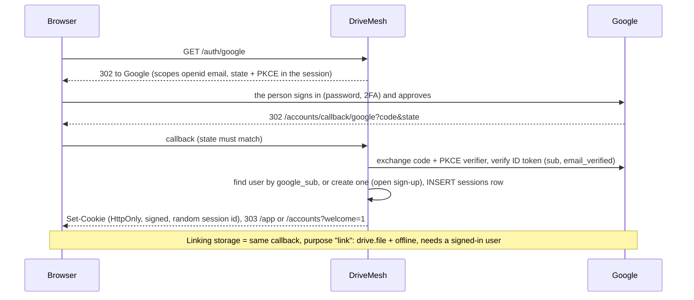
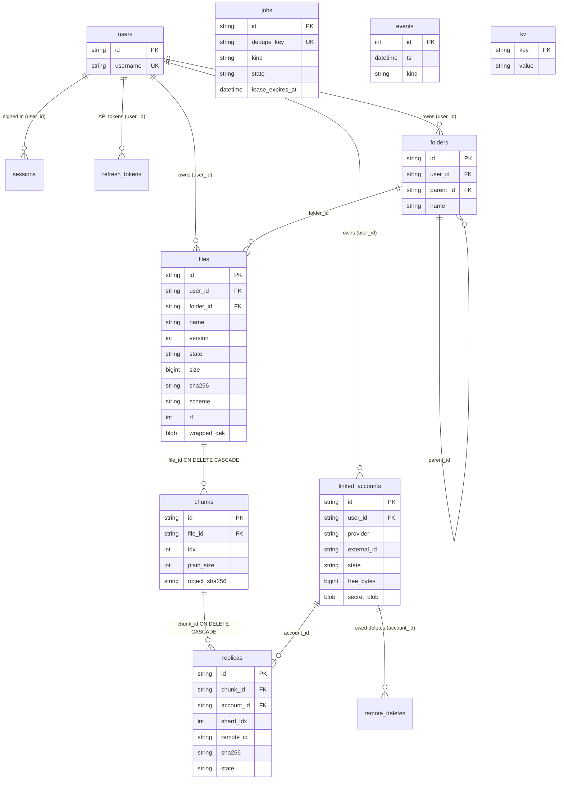
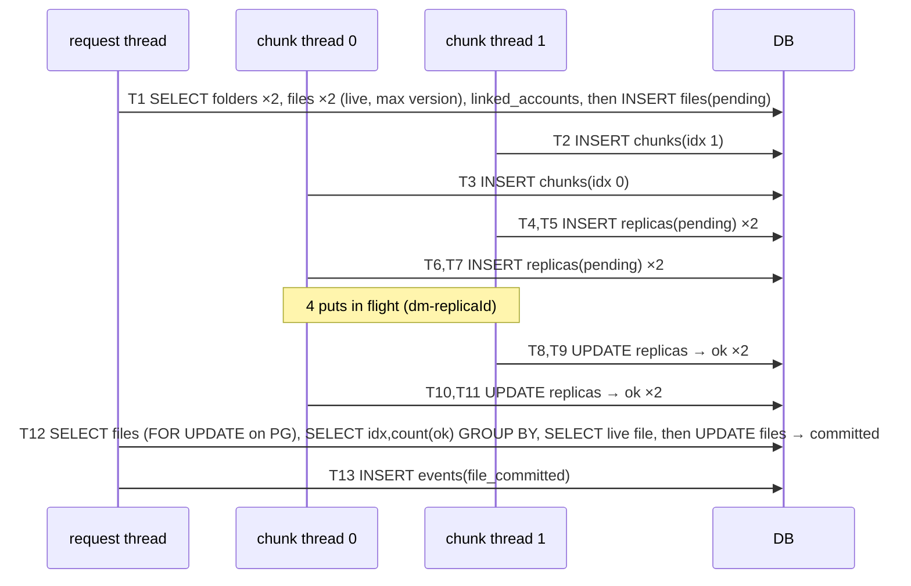

# 08: How DriveMesh Actually Works (verified against the code)

This is a spec of what the code does **today** (commit after `d3c7145`, 2026-11-09). It is not a spec of what the design docs intended.
Every claim cites `file:line`. When this document and an older doc disagree, **the code wins**, and §0.2 lists every mismatch found.

How it was verified:
- I read every module under `drivemesh/`.
- I ran three throwaway scripts against the real code:
  - a placement example (§1.3)
  - a SQL/transaction trace of upload, download, delete and repair on an Alembic-migrated SQLite DB (§12.4)
  - `EXPLAIN QUERY PLAN` on 20k chunks (results.md **R-014**)

Number labels used throughout:
- **[measured, local]** / **[measured, sim]**: from `results.md`, with its R-id.
- **[computed]**: arithmetic from code constants. Not a measurement.
- **[Google docs]**: from Google's published limits, fetched 2026-11-09.
- **[placeholder]**: not measured yet. Real Google Drive runs are still pending (results.md, "Pending").

> File naming: `08-ui-reference.md` already uses the `08` prefix. This file keeps the name that was requested.

---

## 0. Cheat sheet (learn this page by heart)

### 0.1 Ten numbers

| # | Number | What it is | Source |
|---|---|---|---|
| 1 | **8 MiB** | default chunk size (range 64 KiB–256 MiB) | `config.py:29` |
| 2 | **RF = 2** | default copies per chunk (range 1–5, per file) | `config.py:30`, `writer.py:90-92` |
| 3 | **32 B** | encryption overhead per stored object (4 B magic + 12 B nonce + 16 B tag) vs Fernet's +33.34 % | `crypto.py:26`, R-001 |
| 4 | **4** | chunks in flight per transfer, so at most 4 × RF = 8 concurrent object uploads per file | `config.py:32`, `writer.py:108` |
| 5 | **60 s / 3 / 600 s** | health-check interval / consecutive failures before `unreachable` / grace period before an unhealthy account's replicas stop counting | `config.py:46-48` |
| 6 | **900 s, keep 5** | metadata snapshot interval and retention per account | `config.py:59-60` |
| 7 | **10 GiB** | default max upload size | `config.py:33` |
| 8 | **0 / 210** | files lost / chaos trials: 70 each in R-008, R-015, R-016 | R-008, R-015, R-016 [measured, local] |
| 9 | **5.0 s / 7.9 s** | repair scan / fsck over 1M chunks on Postgres 16 (fsck was 291 s) | R-007 [measured, local] |
| 10 | **47.2 vs 8.5 MB/s** | 8 accounts parallel vs sequential, simulated 10 MB/s links. Peak RSS stays flat at 291–331 MiB from 1 to 5 GB | R-004 [measured, sim], R-003 [measured, local] |

### 0.2 Ten facts

1. **Two-phase write.**
   - Phase 1: a `pending` file row with a wrapped per-file key (`writer.py:111-163`).
   - Then chunks are streamed, encrypted and placed.
   - Phase 2: one transaction checks that chunks `0..n-1` all exist with ≥ quorum `ok` replicas, then flips `pending → committed` (`writer.py:325-381`).
   - A crash before commit leaves nothing visible.
2. **Placement** is weighted rendezvous hashing, with free bytes as the weight and provider-diverse ordering (`placement.py:44-79`). A "power of two choices" step then takes the least-loaded of the top 2·RF candidates (`placement.py:82-96`).
3. **Encryption.**
   - AES-256-GCM per chunk, with a random 96-bit nonce under a random per-file-version key (DEK) (`crypto.py:75-81`).
   - The associated data is `dm1|file_id|version|idx|last` (`crypto.py:123-124`).
   - The DEK is wrapped by the master key (KEK) (`crypto.py:93-94`).
   - Encryption happens **on the DriveMesh server**. The browser sends plaintext over HTTPS (`api.py:229-243`).
4. **Every read verifies three things:** the stored object's SHA-256 (no key needed), the GCM tag with its AAD, and, for full reads, the whole-file SHA-256 (`reader.py:142-145`, `reader.py:185-198`, `reader.py:225-229`).
5. **The metadata DB is the NameNode** and the single source of truth (`db.py:1-7`). Remote object names are opaque (`dm-<replica uuid>`, `db.py:172-174`).
6. **Repair** is a periodic scan, not a job.
   - Every 30 s it takes up to 100 under-replicated chunks, fewest-healthy first, and fixes 8 in parallel (`workers.py:328-347`).
   - A dead account's replicas stop counting after `dead_after`. They are never deleted or "forgotten" by repair (`workers.py:4-11`).
7. **Safe mode.**
   - It is entered at worker start (`workers.py:689`) and whenever a health pass finds accounts but none healthy (`workers.py:664-667`).
   - While it is on, writes, repair, scrub, GC, balancing, job execution and backup stop. Reads keep working (`writer.py:113-114`, `workers.py:673-686`).
8. **Background work** is 7 daemon threads in the web process: health, jobs, repair, gc, scrub, backup and balancer (`workers.py:642-653`). Jobs (`delete_file`, `gc_file`, `evacuate`) are rows in a `jobs` table with leases (`jobs.py:84-119`).
9. **Unlink = evacuate.** The account is marked `draining`, every chunk on it is re-replicated elsewhere, then its copies are deleted. After that the account is set to `removed` and its Google token is revoked (`workers.py:415-495`). Unlinking is refused if the remaining accounts can't hold the widest stored scheme (`workers.py:423-443`).
10. **The KEK is the root of everything.** Without it nothing decrypts: not the files, the stored OAuth tokens or the metadata snapshots (`crypto.py:93-120`, `accounts.py:104-114`, `backup.py:87-93`). There is no escrow. Rotation re-wraps keys only; no data is re-uploaded (`keys.py:21-37`).

### 0.3 Where the earlier docs are wrong (code wins)

| # | Doc says | Code does | Evidence |
|---|---|---|---|
| M1 | 03-lld §1: `CHECK` constraints on `provider`, account/file/replica/job `state`, `scheme` | **No CHECK constraints exist.** All enums are enforced only in Python | `db.py:45-214`, `0001_initial_schema.py:19-209` |
| M2 | 03-lld §1: `chunks(id, file_id, idx, plain_size)` | also `object_size`, `object_sha256` (needed for EC reconstruction checks) | `db.py:137-139` |
| M3 | 03-lld §1: index `ix_replicas_verified` | it is `ix_replicas_state_verified` | `db.py:154` |
| M4 | 03-lld §1/§6: job kinds include `rebalance`, `backup`, `rewrap`, `reconcile` | only `delete_file`, `gc_file`, `evacuate` are registered. Balance and backup are periodic tasks, rewrap is a CLI command, and "reconcile" doesn't exist | `gc.py:114,119`, `workers.py:459`, `workers.py:642-653` |
| M5 | 02 §1 / 03 §6: a block-report "reconcile" job "run rarely because listing is expensive" | the analogue is `gc.orphan_sweep`. It lists **every** active/full/draining account every `gc_interval` = **300 s** | `workers.py:646`, `gc.py:186-202`, `config.py:54` |
| M6 | 03 §2 diagram: one transaction inserts chunk + replicas; the lease is extended per chunk. 02 §2: "one DB transaction per chunk, not per replica" | chunk row = 1 commit; **each replica = 2 commits** (insert `pending`, update `ok`); so **1 + 2·RF commits per chunk** (traced). The lease heartbeat runs at most every lease/3 = 100 s, only when a chunk is submitted | `writer.py:236-246`, `replication.py:66-77,102-105`, `writer.py:214-227`; §12.4 trace |
| M7 | 03 §3: chunks and replicas loaded "in one query"; replica order uses a "random tie-break" | two queries; order = (account state rank, in-flight ops, latency EWMA), with **no randomness** | `reader.py:67-71`, `reader.py:99-109` |
| M8 | 02 §1: safe mode until "every account has passed one health check (or a timeout passes)". 03 §6: "exits once every non-removed account has been probed" | it exits after the **first** health pass in which **≥ 1** account is active/full/draining (or there are no accounts at all). There is no timeout: the unused `safe_mode_timeout` setting was **deleted 2026-11-09**, and the rule is pinned by `tests/test_safe_mode.py` | `workers.py:660-671` |
| M9 | 03 §6: "a replica on a dead account is marked `missing`"; a "`chunk_lost` CRITICAL event" | repair never marks dead-account replicas; they stop counting. The event is `chunks_unavailable` | `workers.py:4-11,235-243`, `workers.py:359-360` |
| M10 | 03 §7: "a retried put first deletes any partial object with the same name" | no such code. A duplicate object from a retried put is left for the orphan sweep (its id isn't in the DB) | `gdrive.py:204-232`, `gc.py:191-196` |
| M11 | 02 §5: "resumable uploads cost 2 HTTP requests per object"; reads cost 1 `get_media` each | at defaults an object is 8 MiB + 32 B. Upload = initiate + **3** PUTs of ≤ 4 MiB = **4 requests**; download = **3** ranged GETs. 02 §5 also ignores Google's **200-unit** download cost | `gdrive.py:44,209-231,241-245`; [Google docs] |
| M12 | ADR-009: "Drive's resumable granularity (256 KiB multiples) divides [8 MiB] evenly" | the object is 8 MiB **+ 32 B**, so the last resumable request carries 32 bytes | `crypto.py:26`, `gdrive.py:44` |
| M13 | ADR-009: "4 in-flight chunks ≈ 100 MiB peak memory" | measured peak RSS 214–331 MiB (68 MiB is the interpreter baseline) | R-003 |
| M14 | ADR-002: SQLite `busy_timeout=5000`; CI runs "a smoke suite" on Postgres | `busy_timeout=30000`; CI runs the **full** `pytest -q` on Postgres 16 | `db.py:239`, `.github/workflows/ci.yml:89` |
| M15 | ADR-004: EC "kept behind one `ChunkCodec` seam" | there's no `ChunkCodec`. EC branches are inline in the writer, reader and repair | `writer.py:247-266`, `reader.py:149-177`, `workers.py:248-282` |
| M16 | ADR-015: "dump **all** tables … every 15 min, **if changed**" | `events` is **not** backed up. The change hash covers `linked_accounts.last_health_at`, which every health pass rewrites, so in practice it backs up **every** interval | `backup.py:48`, `backup.py:82-84`, `workers.py:76-78` |
| M17 | 02 §6 / ADR-015: "`drivemesh restore` pulls the snapshot from **any account**" | the CLI restores only from a **local directory** (`restore_from_local_dir`). `restore_from_backend` exists but has no caller (no CLI or UI path for Drive) | `cli.py:250-256`, `backup.py:193-198` |
| M18 | 02 §4: "max file size 1 TiB by design" | enforced default **10 GiB**: on the declared `Content-Length` and while streaming | `config.py:33`, `api.py:191-194`, `writer.py:171-174` |
| M19 | 02 §6: a deleted account is detected by "404 on the app folder" | **was** false: the folder id is cached from `config_json`, so `health()` never checked it. **Fixed 2026-11-09:** `health()` now fetches the folder by id. 404 or `trashed` → `NotFoundError` → after 3 probes `unreachable` → repair (`gdrive.py`, `_check_folder`; `tests/test_gdrive.py`) | `gdrive.py:182-184`, `oauth.py:110-117` |
| M20 | 06: "Shipped **199 tests**"; "max file size tested to [placeholder] GB" | **265 tests**, 91 % (R-011, 2026-11-12); tested to **5 GB** (R-003) | results.md |
| M21 | 06 Q2: after an account fails, "reads skip it immediately" | `revoked` replicas are skipped. `unreachable` replicas are still tried, **last** | `reader.py:101,151-152` |
| M22 | 03 §13: metrics labelled `{account}` | the labels are `{provider}` | `metrics.py:9-14` |
| M23 | 03 §10: "if the refresh token changes, the new one is persisted" | secrets are written only at link time. Refreshed access tokens live only in memory | `accounts.py:152-153` (only caller of `write_secret`) |
| M24 | 03 §6: scrubber is "continuous, rate-limited 1 MiB/s" | bursty: once every 60 s it reads up to a 60 MiB budget (+ one object of overshoot), at most 100 replicas per pass | `workers.py:367-389`, `config.py:52-53` |
| M25 | 02 §1, ADR-008: "client-side encryption" | encryption is **server-side** (DriveMesh server), client-side only relative to Google. The README says this correctly | `api.py:229-243`, `README.md` |
| M26 | README / 06: "RPO = 15 min" | RPO ≥ interval + backup duration, and **no backups happen unless a `WorkerSet` runs** (a `drivemesh put` from the CLI starts no workers) | `workers.py:648,679-686`, `cli.py:129-141` |

There are also **defects found while writing this** (not doc mismatches). They are in §8.4 and §12.6. The most important ones:
- a GC-vs-commit lost-update race (§3.6), **now fixed**
- a download query plan that becomes O(all replicas) on SQLite (R-014), **now fixed**
- uploads that failed on connections slower than ~28 KB/s (§1.6), **now fixed**

---

## 1. The write path (upload / create)

### 1.1 Step by step



1. **Admission.**
   - The declared `Content-Length` is checked against `max_upload_bytes` before any work starts (`api.py:191-194`).
   - `ec=k,m` selects erasure coding; otherwise `rf` applies (`api.py:195-202`).
2. **Reserve (phase 1)** runs in one transaction (`writer.py:111-163`):
   - It refuses in safe mode (503) (`writer.py:113-114`).
   - It refuses if a folder has the same name (`writer.py:119-120`).
   - It refuses if a committed file exists and `overwrite` is false (409) (`writer.py:121-122`).
   - `version = max(version)+1` for that path (`writer.py:123-130`).
   - It snapshots the user's accounts as placement candidates (`writer.py:131`).
   - It refuses if fewer than the quorum are eligible (`writer.py:132-138`).
   - It generates a 256-bit DEK and wraps it with the active KEK (AAD `dek|file_id`) (`writer.py:140-141`, `crypto.py:93-94`).
   - It inserts `files(state='pending', lease_expires_at=now+300 s)` (`writer.py:145-163`, `config.py:55`).
3. **Chunking.**
   - The API reads the socket and calls `write()` every 1 MiB (`api.py:23,233-242`). The CLI reads the file in 1 MiB blocks (`system.py:186,195-197`).
   - The writer emits a chunk only when **strictly more** than `chunk_size` is buffered (`writer.py:178-183`). That holds back the final chunk so `close()` can encrypt it with `last=True` (`writer.py:310-312`).
4. **Hashing.**
   - Whole-file plaintext SHA-256 is updated incrementally (`writer.py:175`).
   - Each encrypted object gets its own SHA-256, recorded on the chunk (`writer.py:244`) and on every replica (`replication.py:57,104`).
5. **Encryption.**
   - `object = b"DMC1" ‖ nonce(12, os.urandom) ‖ AES-256-GCM(ciphertext ‖ tag(16))` (`crypto.py:5,79-81,127-128`).
   - The associated data is `f"dm1|{file_id}|{version}|{idx}|{int(last)}"` (`crypto.py:123-124`).
   - The chunk is encrypted once. Every replica stores **identical bytes**.
6. **Placement.** See §1.3: `writer.py:267-274`.
7. **Replication** (`replication.py:43-107`):
   - It inserts a `pending` replica row first; that row's id fixes the remote name `dm-<id>` (`replication.py:66-77`, `db.py:172-174`).
   - It submits `backend.put` to the shared I/O pool (`replication.py:78-79`).
   - It keeps up to `need` uploads in flight. On a permanent failure, it launches the next candidate (`replication.py:82-101`).
   - On success, the replica becomes `ok(remote_id, size, sha256, verified_at)` (`replication.py:102-106`).
   - A failed put leaves the row `pending`, for GC (`replication.py:93-95`).
8. **Resilience per account.** Every backend call goes through `ResilientBackend` (`accounts.py:80-88`, `resilience.py:117-182`), which applies:
   - a token bucket of 8 calls/s with burst 16 (`config.py:38-39`)
   - a semaphore allowing 4 concurrent calls (`config.py:37`)
   - up to 6 attempts with full-jitter backoff, capped at 32 s, **only for `TransientError`** (`resilience.py:38-71`, `config.py:40-42`)

   On Drive, `put` is a resumable session with 4 MiB requests. It resumes the same session up to 3 times on a transient error before giving up to the retry layer (`gdrive.py:204-232`).
9. **Commit (phase 2)** runs in one transaction (`writer.py:325-381`):
   - `SELECT … FOR UPDATE` on the file row (Postgres only; SQLite ignores it, §12.6).
   - The file must still be `pending`; otherwise it was aborted or its lease expired → 409 (`writer.py:333-334`).
   - One grouped query counts `ok` replicas per chunk index (`writer.py:335-346`). Indices must be exactly `0..n-1` (`writer.py:347-348`), each with ≥ quorum (`writer.py:349-351`).
   - If an old committed version exists: without `overwrite` → 409. With `overwrite` it becomes `deleting`, and a `delete_file` job is enqueued in the **same** transaction (`writer.py:352-364`, the transactional outbox).
   - The new version is flipped to `committed` with size, SHA-256 and chunk count (`writer.py:365-381`).
   - If a concurrent writer committed the same path first, the partial unique index raises `IntegrityError`. With `overwrite` the commit retries once; otherwise → 409 (`writer.py:382-386`).
10. **Parallelism.**
    - Per file: `inflight_chunks` = 4 chunk threads (`writer.py:108`). Each fans out RF puts at once, so there are **≤ 8 concurrent object uploads per file at defaults**.
    - Process-wide: a shared I/O pool of 32 threads (`system.py:66,83`).
    - Per account: ≤ 4 concurrent calls.
    - Backpressure waits for *any* chunk to finish, not the oldest one (`writer.py:189-192`). This fix came from R-004.

### 1.2 Replicas: how many, where configured, per file?
- **Default:** RF = 2 (`config.py:30`), set by `DRIVEMESH_DEFAULT_RF` (env prefix, `config.py:17-18`).
- **Per file:**
  - `?rf=N` on the API (`api.py:201-202`) or `--rf N` in the CLI (`cli.py:136-137`), validated 1–5 (`writer.py:90-92`).
  - Erasure coding per file: `?ec=k,m` / `--ec k,m` (`api.py:196-200`, `cli.py:133-135`).
  - Both are stored on the row (`files.rf`, `files.scheme`, `ec_k`, `ec_m`; `writer.py:154-157`).
- **Write quorum:** `min_write_replicas` (default unset = RF; `config.py:31,105-107`). Setting it below RF lets a commit succeed with fewer copies, and repair fills the gap later. EC always requires all k+m shards (`writer.py:87`).

### 1.3 Placement: rendezvous hashing + load awareness



- **Eligibility** (`placement.py:61-68`): `state == 'active'` only (`placement.py:21`). It needs free − reserve ≥ the object size (`writer.py:271-272`, reserve 256 MiB, `config.py:34`) and must not be in the upload's bad-account set (`writer.py:270`). Unknown free space gets weight 2³⁰ (`placement.py:22,38-41`).
- **Score** (`placement.py:44-48`): `−w/ln(u)`. An account's chance of being the top pick is proportional to its weight. Removing an account only moves the keys whose top pick was that account.
- **Provider diversity** (`placement.py:72-79`): the best account of each provider goes first. It has no effect when every account is Google.
- **Load awareness** (`placement.py:82-96`): from the top `2·RF` candidates, prefer the fewest in-flight backend calls (`writer.py:299-303`, `resilience.py:139,162-176`). It falls back to the plain order if this would reduce provider diversity.
- **The weights don't change within an upload.** `free_bytes` comes from the DB as of the last health check, snapshotted once at reserve (`writer.py:131`).

**Worked example.** I ran the real `placement.rank` on illustrative chunk keys `chunk-00..11`; real keys are random UUIDs (`writer.py:235`).
- Three Google accounts with free space A = 14 GB, B = 10 GB, C = 5 GB.
- A 100 MB file (10⁸ B) → ⌈10⁸ / 8 MiB⌉ = **12 chunks**: 11 × 8 MiB + 7,725,312 B.

| Chunk | u(A) / score | u(B) / score | u(C) / score | HRW order | Pure-HRW replicas (RF=2) |
|---|---|---|---|---|---|
| 00 | 0.927 / 180.3 | 0.749 / 33.8 | 0.214 / 3.1 | A, B, C | A, B |
| 01 | 0.168 / 7.7 | 0.351 / 9.3 | 0.350 / 4.5 | B, A, C | B, A |
| 02 | 0.080 / 5.5 | 0.156 / 5.2 | 0.795 / 20.7 | C, A, B | C, A |
| 03 | 0.979 / 660.8 | 0.040 / 3.0 | 0.465 / 6.2 | A, C, B | A, C |
| 04 | 0.801 / 61.8 | 0.642 / 22.0 | 0.108 / 2.1 | A, B, C | A, B |
| 05 | 0.711 / 40.3 | 0.514 / 14.6 | 0.686 / 12.6 | A, B, C | A, B |
| 06 | 0.135 / 6.9 | 0.369 / 9.8 | 0.651 / 11.0 | C, B, A | C, B |
| 07 | 0.284 / 10.9 | 0.556 / 16.6 | 0.902 / 46.1 | C, B, A | C, B |
| 08 | 0.429 / 16.2 | 0.692 / 26.4 | 0.053 / 1.6 | B, A, C | B, A |
| 09 | 0.749 / 47.6 | 0.611 / 19.8 | 0.301 / 3.9 | A, B, C | A, B |
| 10 | 0.788 / 57.6 | 0.458 / 12.5 | 0.455 / 6.0 | A, B, C | A, B |
| 11 | 0.566 / 24.2 | 0.031 / 2.8 | 0.859 / 31.2 | C, A, B | C, A |

Scores are in units of 10⁹, computed with weights `free − 256 MiB`.
- **Pure HRW** places A 10 replicas, B 9 and C 5 [computed].
- C gets fewest because its weight is smallest, but a high `u` can still put it first (chunks 02, 07, 11).
- Over 100,000 keys, the top-pick shares are A 49.0 % / B 34.4 % / C 16.6 %, against weight shares of 48.7 / 34.5 / 16.8 % [computed]. The weighting is working.
- **Then load awareness changes the result.** With 3 accounts and RF=2, the pool is the top 4, which means **all 3 accounts** (`placement.py:89-96`). So for N ≤ 2·RF, the actual pick is "the 2 least-busy accounts, ties broken by HRW order".
  - In a real 12 MiB trace the replicas landed A, B for chunk 0 and A, C for chunk 1 (§12.4).
  - HRW decides the long-run split; the momentary load decides individual chunks (ADR-005a, R-004).

### 1.4 Failure mid-upload, cancel, crash: what is left and how GC cleans it



| Event | What the code does | Left behind | Cleanup |
|---|---|---|---|
| One target account fails permanently (Auth/QuotaFull/Permanent, or Transient after 6 attempts) | Its replica row stays `pending`. `QuotaFull` → account `full`, `Auth` → `revoked` (`replication.py:36-40,93-101`). The account joins the upload's bad set (`writer.py:276`) and the next candidate is tried | a `pending` row, maybe a partial object | GC scan purges `pending`/`missing`/`corrupt` rows older than 1 h on committed files (`gc.py:150-162`, `config.py:56`) |
| Too few accounts for a chunk | `InsufficientAccounts` (503). `close()`/the API catch it and `abort()` (`writer.py:277-281,316-318`, `api.py:244-246`) | file `aborted`, uploaded replicas | `gc_file` job (enqueued in `abort`, `writer.py:414-420`) deletes every replica: by `remote_id`, or for `pending` ones by name (`gc.py:32-39`) |
| Client disconnects / cancels | the `request.stream()` loop raises; the API calls `abort()` (`api.py:244-246`) | as above | as above |
| Process crash / `SIGKILL` | nothing runs. The file stays `pending` and the lease stops being refreshed | `pending` file, rows, objects | GC scan: `pending` with `lease_expires_at < now` → `aborted` + `gc_file` (`gc.py:128-142`). An object whose upload outran its DB update is found by the deterministic name `dm-<replica_id>` (`gc.py:35`). Anything else, e.g. a duplicate from a retried put, goes to the orphan sweep after 24 h (`gc.py:171-227`, `config.py:57`) |
| Too large mid-stream | `abort("too large")` + 413 (`writer.py:171-174`) | as above | as above |

**Verified by:** R-008 `kill-upload`: 10/10 trials with 0 orphans, fsck clean [measured, local].

### 1.5 Drive API calls and time for a 1 GB upload

These are [computed] from code constants, for 1 GiB, RF = 2, 8 MiB chunks:
- 128 chunks → **256 objects** of 8 MiB + 32 B.
- Each object: 1 resumable-session initiate + ⌈8,388,640 / 4,194,304⌉ = **3 PUTs** = **4 HTTP requests** (`gdrive.py:44,209-231`).
  **≈ 1,024 HTTP requests to Drive** (+0 folder lookups; the folder id is cached, `gdrive.py:182-184`).
- Metadata: 1 + 128 × (1 + 2·2) + 1 + 1 = **643 DB commits** (pattern verified in the §12.4 trace).
- Quota units [Google docs]: edit methods cost 50 units, and the limits are 325,000 units/min per user and 1,000,000 per project.
  - Lower bound: 256 creates × 50 = **12,800 units**, if one resumable session is billed as one `files.create`.
  - Upper bound: 1,024 × 50 = **51,200 units**, if each HTTP request is billed. Which one applies is not verified.
  - Either way, a multi-minute upload spread over ≥ 2 accounts is **far below quota**. Quota is not what limits throughput.
- DriveMesh's own limiter: 8 calls/s per account (`config.py:38`), where one `put` = 1 token (`resilience.py:144`) ⇒ ≤ 64 MiB/s per account. Not binding either.
- Daily cap: [Google docs] 750 GB/day per user (the page words it for Workspace users). 1 GiB at RF=2 puts ≤ 1.07 GB on any one account. Not binding.
- **Time:** it is bandwidth-bound. The host must upload 2 × 1 GiB, so `T ≥ 2.15 GB / host uplink` [computed]. That is ≈ 3.6 min at 10 MB/s, before per-request latency.
  **Real Drive throughput: [placeholder]** (MANUAL_STEPS §4).

**Real-Drive defect found on first use (fixed 2026-11-09).**
- Google answers each 4 MiB part of a resumable upload with `308 Resume Incomplete`. httplib2 ≥ 0.19 treats 308 as a redirect, so every object larger than one part (every 8 MiB chunk) failed with `Redirected but the response is missing a Location: header`.
- After the retries, the chunk's upload failed and was aborted cleanly. Nothing was committed and GC removed the leftovers.
- The cause: `gdrive.py` built its `httplib2.Http` by hand and skipped the workaround that googleapiclient's `build_http()` applies. `drive_http()` now removes 308 from the redirect codes.
- Why tests missed it: the fake Drive never ran httplib2. `test_resumable_upload_over_real_httplib2_survives_308` now runs the real googleapiclient → AuthorizedHttp → httplib2 stack against a local server that speaks the resumable protocol, and it failed with the same message before the fix.

### 1.6 Streaming, max size, memory
- **Streamed end to end.** No temp files; the body is pulled in 1 MiB pieces, and `write()` blocks while 4 chunks are in flight (`api.py:229-243`, `writer.py:188-196`).
- **Max file size:** `max_upload_bytes` = 10 GiB default, configurable with no code upper bound (`config.py:33`).
- **Memory.** In theory: buffer ≤ chunk + 1 MiB, plus 4 × (plaintext + ciphertext), plus per-put copies.
  **Measured** peak RSS: 214 MiB (100 MB file) to 331 MiB (5 GB file), flat from 1 GB to 5 GB (R-003 [measured, local], upload + download in one process).
- **Slow clients (fixed 2026-11-09).**
  - The lease used to be renewed only when a whole chunk was submitted. A client that took > 300 s to deliver 8 MiB (≈ 28 KB/s, [computed] 8,388,608 / 300) lost its lease, GC aborted the upload, and the commit returned 409. Behind the API's 1 MiB buffer the threshold was ≈ 3.5 KB/s.
  - Now `write()` renews the lease whenever it's due (every lease/3 = 100 s of the injected clock), and the HTTP loop hands buffered bytes to the writer early when `writer.heartbeat_due()` (`writer.py`, `write`/`heartbeat_due`; `api.py`, `_stream_upload`).
  - A client now keeps its upload as long as *some* bytes arrive within each 300 s lease. A stalled client still loses it, which is intended.
  - Tests: `tests/test_upload_lease.py` (writer level and HTTP level; both failed before the fix).

---

## 2. The read path (download)



### 2.1 Steps
1. **Metadata lookup.** `dm.stat` resolves the path to the single `committed` row (`api.py:282`, `system.py:206-208`, `namespace.py:71-79`). The reader:
   - unwraps the DEK (`reader.py:62`)
   - loads chunks in index order, plus all `ok` replicas with their account states, in **two** queries (`reader.py:66-96`)
2. **Replica selection.** Replicas are ordered by `(state rank, pending, latency)`. The rank is active 0, full/draining 1, anything else 2; `pending` is in-flight calls on that account; latency is the EWMA of recent calls (`reader.py:99-109`, `resilience.py:179-181`). **Why:** the least-loaded healthy replica spreads reads across accounts. This is the read side of R-004's fix.
3. **Fallback order** (`reader.py:147-157`):
   - Replicas on `revoked`/`removed` accounts are skipped; `unreachable` ones are tried last (`reader.py:151-152`).
   - **Missing** (404) → the replica is marked `missing` + an event, then the next one is tried (`reader.py:131-133`).
   - **Auth error** → the account is marked `revoked`, then the next replica (`reader.py:134-136`).
   - **Slow / transient** → the retry layer retries up to 6× first (`resilience.py:44-71`), then the next replica. There is **no hedged read and no timeout-based failover** beyond the HTTP timeout (60 s, `gdrive.py:141`). A slow replica is only avoided by the next read's EWMA ordering.
   - **Corrupted** (SHA-256 mismatch) → marked `corrupt`, next (`reader.py:142-144`).
   - **Hash matches but the AEAD tag fails**: the recorded object is wrong for this position (e.g. a swapped row). It's marked `corrupt` and the remaining replicas are tried (`reader.py:185-196`).
   - **None works** → `ChunkUnavailable` (503) if it happens before streaming starts. Mid-stream, the response is cut short. Wrong bytes are never sent.
4. **Decrypt + verify:** AES-GCM with the AAD (`reader.py:180-186`), then a plaintext-length check (`reader.py:197-198`).
5. **Reassembly / streaming.**
   - A window of `inflight_chunks` futures is consumed strictly in order (`reader.py:212-224`).
   - For a full read, the whole-file SHA-256 is checked when the last chunk arrives. On a mismatch a `file_hash_mismatch` CRITICAL event is logged and the stream is aborted (`reader.py:210-211,225-229`).
6. **Repair hand-off.** Marking a replica `missing`/`corrupt` lowers the healthy count, so the next repair scan picks the chunk up (`workers.py:132`).

### 2.2 Range requests / video seeking
- **Supported:** a single range `bytes=a-b`, `bytes=a-` and suffix `bytes=-n` → 206 with `Content-Range` (`api.py:260-303`). Only chunks `a//cs … b//cs` are fetched (`reader.py:208-209,230-232`). `Accept-Ranges: bytes` is always sent (`api.py:285-289`). So `<video>` seeking works.
- **Not supported:**
  - Multi-range requests are answered **416**. The RFC would allow ignoring the header with a 200 instead (`api.py:260,264-266,291-294`).
  - `If-Range` is ignored.
  - Partial reads skip the whole-file hash; the per-chunk AEAD still applies (`reader.py:210`).
- Downloads are excluded from gzip so `Content-Length`/`Range` stay valid (`security.py:84`).

### 2.3 Parallelism and memory
- Per download: 4 chunk fetches in flight (`reader.py:212`, `config.py:32`). Per account: ≤ 4 concurrent calls.
- On Drive, each object is fetched with 4 MiB ranged GETs: 3 requests per 8 MiB object (`gdrive.py:234-247`).
- Memory ≈ 4 × (object + plaintext + the Drive `BytesIO` copy), independent of file size. Measured download peak RSS is in R-003 (same processes as the upload).
- Measured read throughput: 1.0–1.1 GB/s local (R-003); 47.1 MB/s at 8 simulated 10 MB/s accounts (R-004). **Real Drive: [placeholder].**

---

## 3. Delete, rename, move, folders, overwrite



### 3.1 Delete file
1. In one transaction: `committed → deleting` plus the enqueued `delete_file:<id>` job (`system.py:216-224`). It returns 202 (`api.py:334-337`).
2. The job purges every copy from **every linked Drive** in parallel (`gc.py`, `purge_replicas`). A Drive `files.delete` is permanent, so it skips the trash and frees quota at once. Each copy is handled by the state of its account:
   - **Reachable:** the object is deleted now; a remote 404 counts as success.
   - **Disconnected** (`unreachable`, `revoked`, or a draining account that keeps failing health checks; `gc.py`, `is_disconnected`): the object can't be deleted *now*. The replica row moves to **`remote_deletes`** and the user's delete completes. GC pays off that queue whenever the account is reachable again (`gc.py`, `drain_remote_deletes`, run on every GC pass), and the Accounts page shows "N deleted objects still to remove from this account". *(Since 2026-11-09; before that the job retried, died after 8 attempts and left the file stuck in `deleting`.)*
   - **Removed** (unlinked): DriveMesh has no access any more; the row is dropped and a `replica_abandoned` event recorded.
3. A failure on a *reachable* account keeps the row and raises `RetryLater` (backoff `min(300, 2^attempts)·U(0.5, 1)` s; `dead` after 8 attempts, then GC re-enqueues the job). **A delete never claims success while an object it could reach remains, and an object it can't reach is never forgotten.**
4. When no replica rows remain: chunks are deleted and the file becomes `deleted` (`gc.py:105-110`).

### 3.2 Rename / move
- **Metadata only, one transaction.**
  - Files: `folder_id`/`name` are updated (`namespace.py:168-172`).
  - Folders: `parent_id`/`name` are updated; moving a folder into itself is refused (`namespace.py:173-179`).
- The destination must not exist as a file or folder (`namespace.py:166-167`). The partial unique index and `uq_folder_name` back this up (`db.py:97-105,83`).
- No Drive calls are made: objects are flat and opaquely named (`gdrive.py:3`).

### 3.3 Folders
- `mkdir` (optionally with `parents`) inserts rows (`namespace.py:116-126`). There are no provider folders.
- Recursive delete, in one transaction (`system.py:238-265`):
  - every committed file in the subtree → `deleting` + a job
  - non-committed versions are re-parented to the root (so the folder FK holds)
  - folder rows are deleted, children first

  A non-empty folder without `recursive` → 409 (`system.py:248-249`).

### 3.4 Same-name uploads: versioning or overwrite?
- **Overwrite, not versioning.**
  - Without `overwrite` the upload is refused with 409, both at reserve and at commit (`writer.py:121-122,354-355`).
  - With `overwrite` the old version is superseded and **purged**: `deleting` + a `delete_file` job in the commit transaction (`writer.py:352-364`). There is no history.
- The `version` counter only increments (`writer.py:123-130`). It feeds the AAD, so an old version's chunk can't be replayed into a new version.
- Two concurrent writers can read the same `max(version)`. **Duplicate version numbers are possible** because there's no unique constraint on `version`. This is harmless (the AAD also binds `file_id`), but `version` is not a reliable sequence.
- **Concurrent writers:** last commit wins. The partial unique index ensures one `committed` row per path (`db.py:97-105`, `writer.py:382-386`).

### 3.5 What if an operation fails halfway?
- Delete / move / mkdir / folder delete are each one transaction: all or nothing (`system.py:91-101`).
- The remote half of a delete is a durable job: retried, never silently dropped (§3.1).
- Overwrite: the old version is purged only after the new one committed (same transaction, outbox).

### 3.6 Fixed: GC-vs-commit lost update (reproduced, then fixed)
- **Before the fix** (commit `4a8cd76`), `gc.scan` read expired `pending` files, then set `state='aborted'` through the ORM **without re-checking the state** in the `UPDATE`.
- Suppose a writer's lease had expired but it was still finishing, e.g. `close()` waiting > ~200 s on slow puts, since nothing heartbeated during `close()` then. If the writer committed **between GC's SELECT and its flush**:
  1. GC overwrites `committed` with `aborted`.
  2. GC enqueues `gc_file`.
  3. `_purge_file`'s guard (`gc.py:93-94`) sees `aborted` and purges a committed file.
- The window is milliseconds, but the outcome is data loss.
- **Reproduced:** `tests/test_gc_commit_race.py::test_gc_abort_cannot_overwrite_a_concurrent_commit` forces this exact interleaving with an SQLAlchemy `after_cursor_execute` hook. Before the fix, the committed file came back `NotFound`: it had been aborted and purged.
- **Fixed** (2026-11-09) in three parts:
  1. GC's abort is now a conditional `UPDATE … WHERE id=:id AND state='pending' AND lease_expires_at < :now` that checks `rowcount`, the same pattern as the job claim (`gc.py`, `scan`). The `gc_file` job is enqueued only when that row was actually aborted.
  2. The commit flip is conditional too (`WHERE state='pending'`, `rowcount` must be 1, otherwise 409). So on SQLite, where the commit's checks run before the write lock, an aborted file is never resurrected (`writer.py`, `_commit`).
  3. The writer waits on in-flight chunks in 1 s slices and renews the lease between slices, both during backpressure and in `close()` (`writer.py`, `_wait_inflight`). Test: `test_close_keeps_the_lease_alive_while_waiting_for_slow_puts`.

---

## 4. Durability and self-healing



### 4.1 Health checks ("heartbeats")
- **What:** `backend.health()` for every non-removed account, **one after another** (`workers.py:44-92`). On Drive that is `about.get(storageQuota)` plus, since 2026-11-09, `files.get(folder_id, fields=id,trashed)`: **2 read requests** (5 quota units each [Google docs]). A missing or trashed app folder is a failed probe (`gdrive.py`, `_check_folder`). It records capacity, used, free and `last_ok_at`.
- **How often:** every 60 s (`config.py:46`). It is the only task that also runs in safe mode (`workers.py:643`).
- **Unhealthy:**
  - `AuthError` → `revoked` immediately (`workers.py:54-59`).
  - Any other `BackendError`, each after the retry layer's ≤ 6 attempts, increments `consecutive_failures`. At 3 the account becomes `unreachable` (`workers.py:60-67`, `config.py:48`).
  - `mark_state` stamps `unhealthy_since` (`accounts.py:226-227`).
- **Full:** free < 256 MiB + one chunk → `full`, excluded from placement but still readable (`workers.py:72-73`, `accounts.py:27`).
- **"Dead":** there is no dead state. Replicas on an `unreachable`/`revoked` account **keep counting as healthy** until `unhealthy_since` is older than `dead_after` = 600 s (`workers.py:95-107`, `config.py:47`).
- **Time until repair starts** [computed]:
  - A revoked account: ≤ 60 s to detect + 600 s + ≤ 30 s ≈ **11–12 min**.
  - A transient outage: 3 probes ≈ 2–3 min + 600 s + ≤ 30 s ≈ **13–14 min**.
  - This is the price of "no repair storms on network blips".

### 4.2 Repair (re-replication)
- **Trigger:** a periodic scan every 30 s, while not in safe mode (`workers.py:328-331,645`, `config.py:49`). It is not event-driven.
- **Queue:** chunks of committed files whose distinct healthy units (replica ids, or distinct shard indices for EC) are below the target, **ordered fewest-healthy first**, limit 100 (`workers.py:125-145,332`, `config.py:50`). This is HDFS's priority queues flattened into one sort.
- **Per chunk** (`workers.py:223-303`):
  1. Purge rows already verified `missing`/`corrupt`.
  2. Read a verified copy from a readable replica.
  3. Rank targets with HRW (key `chunk:repair`), excluding **every account that already holds a row**, dead ones included.
  4. Apply load awareness, then `place_object` for the missing count.
  5. EC: fetch k shards, decode, check the object SHA-256, re-encode, and place only the missing shard indices (`workers.py:248-282`).
- **Parallelism:** 8 chunks at once (`workers.py:346-347`, `config.py:51`). Per-account token buckets and semaphores still apply.
- **Storm avoidance:**
  - The 600 s grace period.
  - The 100-chunk batch per pass. The next pass starts 30 s after the previous one *finishes* (`workers.py:679-686`).
  - Per-account rate limits.
  - Safe mode when every account is down (`workers.py:664-667`).
  - Repair never drops a replica just because its account is away; it just stops counting it (`workers.py:4-11`).
- **Trimming:** chunks above RF counting only active/full accounts (e.g. a dead account came back) lose their excess replicas, fullest account first (`workers.py:156-175,306-325,357-358`).
- **Not done:** repair never deletes the rows of a dead account. They stay until the account is re-linked (then trimmed) or unlinked (then abandoned during evacuation).
- **Measured:** 1 of 4 accounts lost, simulated 10 MB/s links → 12.7 MB/s, 11.2 s for 134–143 MB (R-006 [measured, sim]).

### 4.3 Scrubber
- **Verifies:** it re-downloads `ok` replicas on readable accounts, oldest `verified_at` first, and compares SHA-256 (`workers.py:367-411`). It catches `missing` (404) and `corrupt` (bit rot or tampering) **without the key**. It doesn't decrypt.
- **Cadence:** every 60 s, budget = 1 MiB/s × 60 s = 60 MiB, at most 100 replicas per pass (`workers.py:371-375,383`, `config.py:52-53`).
- **Cost** [computed]:
  - ≈ 8 objects (64 MiB) per minute ≈ 90 GiB/day.
  - A full cycle over 20 GB of replicas takes ≈ 5 h.
  - Each Drive object is 3 ranged GETs. At [Google docs] 200 units per download call that's ≤ 600 units/object, ≈ 4,800 units/min, ~1.5 % of the per-user quota.

### 4.4 Unlinking an account (evacuation)


Code: `workers.py:415-456` (start), `workers.py:459-495` (job), `workers.py:498-511` (token revoke), `api.py:379-386`.
- **Unlinking a disconnected account works** (2026-11-09). Its chunks are re-copied from their other copies, its replica rows are queued as owed deletes, and the account is set to `removed`. The objects still sitting on that Drive can't be deleted without access, so DriveMesh records an `objects_left_on_unlinked_account` event: the user can delete the `DriveMesh` folder in that Drive by hand. They're encrypted either way. Previously this evacuation retried forever.
- If the account *is* reachable, unlinking first deletes everything it still owes (`RetryLater` until done).
- Covered by `tests/test_durability.py::test_unlink_with_evacuation` and `tests/test_disconnected.py`. No chaos experiment covers unlinking (R-008 has none).

### 4.5 Safe mode
- **Enters:**
  - at `WorkerSet.start()` (`workers.py:688-692`)
  - when a health pass finds accounts and **none** is active/full/draining (`workers.py:660-667`)
- **Leaves:** on the first health pass with ≥ 1 healthy account, or with no accounts at all (`workers.py:668-670`). It runs synchronously at start (`workers.py:691-692`), so normally startup leaves it at once.
- **Blocked:** new uploads → 503 (`writer.py:113-114`); the repair, scrub, GC, backup, balancer and job threads skip their work (`workers.py:673-686`, `workers.py:330-331,369-370`, `balancer.py:36-37`). `/readyz` returns 503 (`app.py:221-224`).
- **Allowed:** reads, listing, move, mkdir, and delete tombstoning. The purge job waits.
- **No timeout.** The unused `safe_mode_timeout` setting was deleted on 2026-11-09 instead of being implemented. The exit rule above is already safe:
  - Writes check their own quorum (`writer.py:135-138`).
  - Repair ignores unhealthy accounts until `dead_after` (`workers.py:99-107`).
  - The orphan sweep and backups only touch healthy accounts (`gc.py:186-190`, `backup.py:111-113`).

  A startup timeout would only have delayed writes. The rule is pinned by `tests/test_safe_mode.py`: enter at start; enter again after `unreachable_after_failures` passes with every account failing; leave on the first pass with one healthy account; zero accounts is not safe mode.
- **When there's no `WorkerSet`** (CLI commands, `workers_enabled=false`), safe mode is never entered (`system.py:82`).

### 4.6 Metadata backup and restore
- **What:** a logical dump of `users, linked_accounts, folders, files, chunks, replicas, jobs, kv` (**not `events`**) (`backup.py:48,68-79`). It's gzipped, then sealed with the KEK, context `meta` (`backup.py:87-89`).
- **Where:** as `dm-meta-<timestamp>` on **every** active/full account, one after another, keeping the newest 5 per account (`backup.py:105-134,153-159`, `config.py:60`).
- **How often:** every 900 s, "if changed" (`config.py:59`, `backup.py:137-150`). That's effectively every interval (M16). It also runs immediately at worker start.
- **Restore:** only into an empty DB (`backup.py:175-176`). It re-queues `running` jobs (`backup.py:182-183`), sets `restored_at`, and pauses the orphan sweep for 7 days (`backup.py:187`, `gc.py:179-185`, `config.py:58`). The CLI path reads a local account dir only (M17).
- **Worst-case data-loss window ("15 minutes"):**
  - The RPO is **900 s + the time the backup run itself takes**, because the next run is scheduled 900 s after the previous one *ends* (`workers.py:679-686`). It is unbounded if no `WorkerSet` is running.
  - **Lost on restore:** files committed after the snapshot. Their wrapped DEKs existed only in the lost DB, so their objects are undecryptable garbage, not "recoverable later".
  - **Files deleted after the snapshot reappear** but their objects are gone, so they read as `ChunkUnavailable`.
  - **Replicas moved by repair or the balancer after the snapshot:** the snapshot points at purged copies and doesn't know the new ones. That can make chunks unavailable.
  - The R-008 `metadata-restore` chaos test restores **immediately** after a backup, so this case is **untested**.
- Measured restore time: 0.014–0.045 s for small namespaces (R-008).

### 4.7 Exactly what survives

The failure domain is one account. "Simultaneous" means within one detection + repair window (§4.1 + §4.2).

| Scheme | Survives | Does **not** survive |
|---|---|---|
| RF = 1 | nothing | the loss of any account holding a chunk |
| RF = 2 | any **1** account lost/revoked/corrupted at a time; bit-flips on one copy; deleted objects on one copy | 2 accounts lost before repair finishes, for chunks with both copies there. With N = 2 a single loss can't be re-protected, because there's no 3rd account to copy to (`workers.py:244,294-303`) |
| RF = 3 | any **2** at a time (R-008 `account-loss-rf3` [measured, local]) | 3 |
| RS(k, m) | any **m** shards (`test_ec_file_survives_m_losses_and_repairs`) | m+1. With N = k+m, a loss **can't be repaired** until another account is linked: every surviving account already holds a shard (`workers.py:271-281`). Writes also need all k+m accounts writable (`writer.py:87,135-138`) |

**Never survived, under any scheme:**
- losing the KEK
- losing the metadata DB *and* every snapshot (or the KEK)
- changes after the last snapshot (§4.6)
- corruption inside the metadata DB itself (it has no checksums)
- a DriveMesh bug
- a provider-wide event (a Google outage, or a policy action across all linked Google accounts) when every account is Google. In that case provider diversity (`placement.py:72-79`) has nothing to diversify.

---

## 5. Capacity math

All figures are [computed]. Each free Google account has **15 GB shared across Gmail, Drive and Photos** [Google docs].
- `U` = space DriveMesh can use per account = 15 GB − Gmail/Photos usage − 256 MiB reserve − one chunk before `full` (`config.py:34`, `workers.py:72`).
- Best case (empty Gmail/Photos): **U = 14.72 GB**. Real accounts are lower; plug in your own U.
- Usable capacity = `N·U / overhead`.
- "Usable with self-heal headroom" = `(N−1)·U / overhead`: what you can store and still re-protect everything after one account dies.
- Overheads, measured (R-002): RF=k → k.0000×; RS(4,2) and RS(6,3) → 1.5000×.
- Encryption: 32 B per 8 MiB object = 0.0004 %.
- Metadata on the accounts: 5 snapshots of the DB per account (`config.py:60`). Snapshot size: **[placeholder]**; `drivemesh backup` prints `bytes`.

| N accounts | Raw | RF=1 (f=0) | RF=2 (f=1) | RF=3 (f=2) | RS(2,1) (f=1) | RS(3,1) (f=1) | RS(4,2) (f=2) | RS(6,3) (f=3) | RS(8,2) (f=2) |
|---|---|---|---|---|---|---|---|---|---|
| 2 | 30 GB | 29.4 | 14.7 / heal — | n/a | n/a | n/a | n/a | n/a | n/a |
| 3 | 45 GB | 44.2 | 22.1 / 14.7 | 14.7 / — | 29.4 / — | n/a | n/a | n/a | n/a |
| 5 | 75 GB | 73.6 | 36.8 / 29.4 | 24.5 / 19.6 | 49.1 / 39.3 | 55.2 / 44.2 | n/a | n/a | n/a |
| 10 | 150 GB | 147.2 | 73.6 / 66.3 | 49.1 / 44.2 | 98.2 / 88.3 | 110.4 / 99.4 | 98.2 / 88.3 | 98.2 / 88.3 | 117.8 / — |

How to read the table:
- Cells are "usable GB / usable with self-heal headroom". "—" means the scheme works but a loss can't be repaired until an account is added. "n/a" means fewer accounts than the scheme needs.
- f = simultaneous account losses survived.
- RF=1 has no redundancy, so it has no heal column.

**Supported EC configs:**
- any `1 ≤ k ≤ 32`, `1 ≤ m ≤ 16`, `k+m ≤ 48` (`erasure.py:29-31`), with defaults k=4, m=2 (`erasure.py:12-13`). It needs the optional `zfec` extra (`erasure.py:16-26`).
- With **3 accounts** only `k+m ≤ 3` works: **RS(1,1)** (= 2 copies), **RS(1,2)** (= 3 copies) and **RS(2,1)** (1.5×, survives 1).

**Is every fragment on a different account?** Yes, enforced twice:
- The writer excludes accounts already used for the chunk (`writer.py:251-264`).
- `UNIQUE(chunk_id, account_id)` makes it a DB invariant for shards as well as replicas (`db.py:148`).
- Reserve also refuses if fewer than k+m accounts are eligible (`writer.py:135-138`). Covered by `test_ec_needs_k_plus_m_accounts`.

**Uneven fill:**
- Placement weight is free − reserve, so emptier accounts receive proportionally more (§1.3).
- An account becomes ineligible when free − 256 MiB < object size (`placement.py:66`). It is marked `full` at the next health check (`workers.py:72-73`), or immediately on Drive's `storageQuotaExceeded` (`replication.py:37-38`, `gdrive.py:80-81`).
- `free_bytes` is up to 60 s stale, so an account can overshoot until the quota error.
- The balancer moves replicas from the most- to the least-utilised active account when the spread is > 10 % (`balancer.py:35-97`, `config.py:61-63`). Utilisation uses Drive's total `usage`, Gmail included (`gdrive.py:313`).
- **Writes are refused** (503 `insufficient_accounts`) when fewer than the quorum are eligible: at reserve (`writer.py:135-138`), or per chunk mid-upload (`writer.py:277-281`).

**Recommendation for exactly 3 accounts: RF = 2 (the default).**
1. It survives any single loss.
2. It is the only option that **heals itself** with 3 accounts: after a loss, every under-replicated chunk can be copied to the third account. RF=3 and RS(2,1) are stuck at "degraded until you link another account" (`workers.py:244,271-281`).
3. It keeps a fallback target during uploads. With RS(2,1) or RF=3, any one account being slow, full or revoked blocks **all** writes.
4. Reads need one object, not k.

**Cost:** 22.1 GB usable at best, and only 14.7 GB if you want to stay self-healing after a loss. If you need more space and can tolerate "degraded until I add an account", RS(2,1) gives 29.4 GB with the same single-failure tolerance.

---

## 6. Is it "just like Hadoop"?

| HDFS concept | HDFS | DriveMesh (code) | Same / different, and why |
|---|---|---|---|
| NameNode | in-memory namespace + block map, persisted as fsimage + edit log | SQL DB: `folders`/`files` = namespace, `chunks`/`replicas` = block map (`db.py:81-170`) | **Different storage:** the DB's WAL *is* the edit log (ADR-003). Every lookup is a query, not a RAM hash |
| DataNodes | run HDFS code: store blocks, checksum, pipeline, report | accounts are **passive object stores** with 6 methods (`backends/base.py:64-78`) | **Fundamentally different:** no code runs on Drive, so every check is *pulled* |
| Blocks | 128 MiB | chunks of 8 MiB (`config.py:29`) | smaller: memory per transfer, retry cost and parallelism across accounts (R-005) |
| Replication | default 3, pipelined DataNode→DataNode | default 2, **client fan-out**: the server uploads each copy (`replication.py:78-79`) | no pipeline is possible between Google accounts; RF=2 fits 15 GB accounts |
| Placement | writer-local, then another rack, then same rack/other node | weighted HRW + provider diversity + least-loaded (`placement.py`) | no locality to exploit; the "rack" is the provider |
| Heartbeats | DataNode → NameNode every 3 s | NameNode polls `health()` every 60 s (`config.py:46`) | inverted direction; the slower cadence suits API quotas |
| Dead node | ~10.5 min without heartbeats | `unreachable`/`revoked` + 600 s (`config.py:47`) | similar grace; OAuth revocation is a new failure kind |
| Block reports | DataNodes send block lists (default every 6 h) | orphan sweep lists every account every 300 s (`gc.py:171-227`) | used for **GC only**. It never adds knowledge (the DB is authoritative) |
| Re-replication | priority queues by replica deficit | one scan ordered by healthy count (`workers.py:125-145`) | same idea, flattened |
| Balancer | moves blocks above a utilisation threshold (default 10 %) | copy-then-delete, threshold 10 % (`balancer.py`, `config.py:62`) | same; per user, one high→low pair per pass |
| Block scanner | DataNode re-reads local blocks (~3-week period) | scrubber, 1 MiB/s budget (`workers.py:367-411`) | same, but every byte crosses the network |
| Checksums | CRC32C per 512 B | SHA-256 per object + GCM tag + whole-file SHA-256 | stronger: it also detects tampering and position swaps |
| fsimage/edits checkpoint | Secondary/Checkpoint NameNode | encrypted logical snapshots on the accounts (`backup.py`) | an off-site cold copy, not a checkpoint helper |
| Standby NameNode / HA | QJM + ZKFC automatic failover | **none** | single process, single DB (§10.4) |
| Safe mode | until a threshold of blocks is reported | until ≥ 1 account answers (`workers.py:660-671`) | much weaker gate (M8) |
| Leases | single writer per file, lease recovery | immutable versions, last commit wins (`writer.py:325-386`) | no in-place writes, so no lease recovery needed |
| Erasure coding | RS-6-3 striped across DataNodes | optional RS(k,m) per chunk object (`erasure.py`) | same math; repair reads k shards (k× amplification) |

**What HDFS has that DriveMesh lacks, and whether it makes sense here:**
- **NameNode HA:** yes, it would make sense. The cheap version is managed Postgres HA + a stateless app + leader election for periodic tasks (§10.4).
- **Data-local compute** (MapReduce/Spark short-circuit reads): no. You can't run code next to Drive.
- **Append / hflush:** not worth it. Objects are immutable and a new version is cheap; appends would need chunk-level versioning.
- **Snapshots:** yes, and cheap. Superseded versions could be kept by refcounting chunks instead of purging (`writer.py:352-364`).
- **Federation:** not needed at personal scale.
- **Rack awareness via a topology script:** partly there as provider diversity.
- **Quotas per directory:** missing. No per-user storage quota exists (07-threat-model T12).

**Why it differs:**
- passive storage nodes
- per-user API quotas (token buckets, `resilience.py:74-114`)
- no data locality
- 50–500 ms remote latency instead of LAN, hence chunk parallelism
- OAuth expiry/revocation as a failure mode (`revoked`)
- a user-visible quota shared with Gmail (the `full` state, the reserve)

---

## 7. Security model

| Attacker has | Learns | Can do |
|---|---|---|
| **One Drive account** | Ciphertext objects `dm-<uuid>` with sizes and `createdTime` in one `DriveMesh` folder, tagged `appProperties.dm=1` (`gdrive.py:208`). Encrypted `dm-meta-*` snapshots. Upload bursts reveal roughly which objects form one file, and the last smaller object approximates its size. **No file names, no plaintext** | Delete or corrupt objects: detected on read or scrub, repaired if RF ≥ 2. Can't forge: no DEK, and the AAD binds position |
| **All Drive accounts** | Everything above, plus: identical ciphertext across accounts reveals which objects are replicas of one chunk, and so the placement | Destroy all data (availability). **Roll back the namespace** by deleting newer `dm-meta-*` snapshots so a restore picks an older one (`backup.py:162-166`). It can't forge one (KEK seal) |
| **The metadata DB** | **Plaintext namespace:** file and folder names, sizes, timestamps, plaintext SHA-256 (enables "do you store this known file?" checks), account emails, the event log with paths (`system.py:223`, `writer.py:387-394`), scrypt password hashes. Wrapped DEKs and sealed tokens are useless without the KEK | Delete rows (data becomes unreachable). Tampering with chunk rows, versions or `chunk_count` is caught by the AAD/STREAM `last` flag (`reader.py:180-186`). **One gap:** lowering `files.size` *within* the final chunk truncates output without an error, because the hash covers whole chunks (`reader.py:225-232`) |
| **The master key (KEK) alone** | nothing by itself | With any one account it can fetch a snapshot → unseal it → get the DB, all wrapped DEKs and **all OAuth refresh tokens** (`accounts.py:104-107`) → read every account → decrypt everything. **KEK + any one account = total compromise** |
| **The server** (env + process) | KEK, DB credentials, OAuth client secret, session secret, and **plaintext of every file in transit**, since encryption happens there (`api.py:229-243`) | everything |

**What Google sees:**
- object count, sizes, creation and modification times
- the request pattern: uploads and `get_media` downloads, including scrubber reads every minute
- the server's IP address and the OAuth client
- an app folder named `DriveMesh`

It does **not** see names or contents, whatever the file size: a file up to one chunk (8 MiB) is not split but is still one AES-256-GCM object of size+32 B, larger files are one encrypted object per chunk, empty files store nothing, and snapshots are sealed. Pinned by `tests/test_encryption_at_rest.py`. Names are random UUIDs (`db.py:32-33,172-174`) and the 32 B-overhead AEAD hides content (`crypto.py:127-128`).

**The master key:**
- **Creation:** `drivemesh gen-key` → `k1:` + base64url(32 random bytes from `os.urandom`) (`cli.py:61-71`, `crypto.py:71-72`).
- **Storage:** env var `DRIVEMESH_MASTER_KEYS` as `id:key,…`, with `DRIVEMESH_ACTIVE_KEY_ID` choosing the wrapping key (default: the last one) (`config.py:24-26`, `crypto.py:43-62`). It's a `SecretStr`, so it never appears in reprs or logs (`config.py:2`). The app refuses to start without it (`system.py:71-75`).
- **Rotation:**
  1. Add a key and make it active.
  2. Run `drivemesh rewrap`. It re-wraps file DEKs (up to 50,000 per run, `keys.py:25`; rerun until `remaining_old` is 0) and account secrets (`keys.py:21-37`).
  3. Remove the old key.

  DEKs are not rotated (no re-encryption). Old snapshots stay sealed with the old key until pruned (`backup.py:153-159`).
- **If lost:** every DEK, token and snapshot is undecryptable. **Total, permanent loss** of all data, with no recovery path (07-threat-model, "Key-loss policy").

### 7.1 Accounts, sign-in and sessions (added 2026-11-09)



- **Sign-up / sign-in:** "Continue with Google" is OpenID Connect with `openid email` only (`oauth.py`, `sign_in_with_google`, `_finish_sign_in`).
  - Google authenticates the person; DriveMesh stores no password for them (`password_hash = "!"`, which never verifies).
  - The DriveMesh user is keyed by Google's stable `sub` (`users.google_sub`, unique), **never by email**, so a changed or recycled address can't take over an account (`system.py`, `get_or_create_google_user`).
  - Unverified emails are refused.
- **Linking a Gmail for storage** is a separate consent (`drive.file`, offline). It works only for someone who can sign in to that Gmail, so a stranger cannot attach an innocent person's Gmail.
- **One Gmail → one DriveMesh user (global):** partial unique index `ux_accounts_external_live (provider, external_id) WHERE state != 'removed'` plus a clear 409 (`db.py`, `accounts.py`, `link`). Sharing would have shared one app folder, and one user's unlink revokes Google's grant for both.
- **Browser sessions are server-side** (`web/auth.py`):
  - The signed HttpOnly cookie carries a random id; the `sessions` table stores only its SHA-256, with expiry (`session_days`, 14) and revocation.
  - Logout revokes the row, so a copied cookie stops working. "Sign out everywhere" (`POST /api/v1/auth/logout-all`) revokes every session and token (`users.tokens_valid_after`).
- **API clients** use JWTs instead of cookies:
  - `POST /api/v1/auth/tokens` (signed-in browser + CSRF) returns a **JWT access token**: HS256, 15 min, `iss`/`aud`/`typ` checked, `alg=none` refused.
  - It also returns an **opaque refresh token** (30 days, stored as SHA-256). `POST …/tokens/refresh` rotates it; **replaying a used refresh token revokes the whole chain** (theft detection). `POST …/tokens/revoke` revokes a chain.
  - Bearer requests are exempt from CSRF, because browsers never attach them automatically.
  - Why not JWT in the browser: a script-readable token is stealable by XSS, and a JWT can't be revoked early without the server-side table anyway.
- **Open sign-up guards:**
  - Self-service users are never `is_admin`: they can't link server-local folders (that would expose the server's disk) and can't read the global `/metrics`.
  - `cluster_status` is scoped to the caller: their replicas, files and events only; no global job queue (`workers.py`, `cluster_status(admin=False)`).
  - Operators are users created by the CLI or the owner bootstrap; migration 0003 marks all existing users as admins.
- **Tests:** `tests/test_auth.py`, 13 tests: sign-up, re-sign-in, state and unverified-email rejection, no password login for Google-only users, the one-Gmail rule, cookie replay after logout, expiry, sign-out-everywhere, bearer without CSRF, forged/expired/`alg=none`/wrong-`typ`/wrong-`aud` JWTs, refresh rotation and reuse revocation, status scoping.
- **Residual risks:**
  - No per-user storage or bandwidth quota yet (users bring their own Gmail storage, but share the server's bandwidth and DB).
  - Google "Testing" mode only lets listed test users sign in at all. Going public needs Google's app verification.
  - The "Continue with Google" button is text-only; Google's branding guidelines expect their logo for a verified app.

---

## 8. Performance and limits

### 8.1 Real numbers (results.md)

| What | Value | Label |
|---|---|---|
| Upload / download, 3 accounts, RF=2 | 563.6 / 1009.3 MB/s (100 MB) … 224.0 / 1081.9 MB/s (5 GB); the upload falls off from 3 GB (SSD fsync bound) | R-003 [measured, local] |
| Peak RSS | 214.1 MiB (100 MB) → 330.9 MiB (5 GB); 68 MiB baseline | R-003 [measured, local] |
| Parallel vs sequential, 8 accounts | 47.16 vs 8.49 MB/s (5.6×); load-aware +39 % vs HRW-only | R-004 [measured, sim: 100 ms/request, 10 MB/s/account] |
| Chunk-size sweep, 4 accounts, RF=2 | upload 16.2–19.5 MB/s; download peaks at 35.6 MB/s with 16 MiB chunks | R-005 [measured, sim] |
| Repair, 1 of 4 accounts lost | 12.74 MB/s sim (was 4.30); 933 MB/s local | R-006 |
| Metadata at 1M chunks | Postgres: repair scan 5.04 s, fsck 7.87 s; SQLite: 26.4 s / 16.5 s | R-007 [measured, local] |
| Chaos | 70 trials, 0 files lost, 0 wrong bytes; re-run after the fixes: another 70, 0 lost | R-008, R-015 [measured, local] |
| Hot-path query plans | download replica query 3.9 → 19.6 ms without statistics at 40k replicas | R-014 [measured, local] |
| **Anything on real Google Drive** | **[placeholder]** | results.md "Pending" |

### 8.2 Drive quotas that matter [Google docs]
- 1,000,000 quota units/min per project; **325,000/min per user per project**. Each linked account is its own user.
- Costs per call: read 5, list 100, **edit (create) 50**, **download 200**.
- 750 GB/day upload per user. 1 TB/day egress per project.

What they mean in practice [computed]:
- A sustained 1 GiB/min upload at RF=2 costs 12,800–51,200 units/min across all accounts (§1.5).
- Downloading 1 GiB = 128 objects × 3 ranged GETs = **384 requests**, i.e. 25,600–76,800 units depending on whether each ranged GET is billed.
- The **project-wide 1 TB/day egress** is the first Google limit a heavy user would hit, because downloads, scrubbing, repair and balancing all count.
- Per-account throughput is otherwise limited by bandwidth and latency, not quota.

### 8.3 Bottlenecks by scale (from code; not measured unless cited)

| Scale | First thing to strain | Why (code) |
|---|---|---|
| 100 files | nothing | — |
| 10k files | **folder listing**: `/fs` returns every file in a folder with no pagination and computes health over all their chunks (`namespace.py:129-145`, `api.py:95-132,135-149`); the dashboard polls status every 10 s and the status page every 5 s (`dashboard.js:56`, `status.js:37`) | `cluster_status` runs `under_replicated()` **without a limit** on every poll (`workers.py:592`) |
| 1M chunks | **the backup task** loads every row of 8 tables into Python and serializes them every 15 min just to compare a hash (`backup.py:68-79,137-150`); **the orphan sweep** loads all replica ids every 5 min and lists every object on every account (`gc.py:194-202`). Repair and fsck are fine on Postgres (R-007) | full-table work on fixed short timers |
| 10 accounts | fine. Health is 10 serial probes per minute | `workers.py:50-91` |
| 100 accounts | **serial loops:** health, backup puts and orphan listings run one account after another, and one slow account (60 s HTTP timeout × 6 attempts) stalls the pass. **Per-file parallelism doesn't grow with N:** ≤ inflight × RF = 8 puts per upload (`writer.py:108`). The shared I/O pool is 32 threads (`system.py:66`). Postgres pool is 10 + 10 connections (`db.py:244`) | fixed pools |

**What breaks first in practice:**
- With lots of data: the 15-min full dump (memory/time) and the 5-min full orphan listing.
- With lots of accounts: the serial health/backup loops.
- In both cases, upload throughput stops scaling past ~8 concurrent puts per file.

### 8.4 Known limitations and honest gaps
1. No real-Drive measurements yet (R-pending).
2. ~~GC-vs-commit lost update (§3.6)~~ **Fixed 2026-11-09** with a regression test.
3. ~~On SQLite without `ANALYZE`, the download replica query became O(all replicas) (R-014)~~ **Fixed 2026-11-09**: the lookup is now by `chunk_id IN (…)`, pinned by a plan test.
4. ~~Uploads slower than ~28 KB/s fail (lease, §1.6)~~ **Fixed 2026-11-09.**
5. RPO ≥ 15 min. Restore after post-snapshot repair/balance can lose chunks (§4.6). There's no CLI restore from Drive (M17).
6. ~~A deleted `DriveMesh` folder isn't detected by health checks (M19)~~ **Fixed 2026-11-09.** Recovery: restore the folder from Drive's trash (the account becomes active again and any extra copies are trimmed), or unlink the account (evacuation). Re-linking creates a *new* folder; the old replica rows then show up as `missing` on read or scrub and get repaired.
7. Single process, single DB, no HA. Signed-cookie sessions can't be revoked server-side (07 T3).
8. The metadata DB holds the namespace in plaintext, including plaintext SHA-256 (§7).
9. EC with N = k+m can't self-heal (§4.7).
10. Same-name uploads overwrite. There's no version history. Version numbers can collide (§3.4).
11. No per-user storage quota, no listing pagination, single-range HTTP only (§2.2).
12. On the free tier, nothing (health, repair, scrub, backup) runs while the instance sleeps (§9.2).

---

## 9. Operations

### 9.1 Run it locally
Order taken from `README.md` "Quick start":
1. `pip install -e ".[dev,pg]"`
2. `export DRIVEMESH_MASTER_KEYS="$(drivemesh gen-key)"` and keep an offline copy.
3. `drivemesh create-user owner`
4. `drivemesh account-add-local /tmp/dm/a …` three times.
5. `drivemesh serve`, which listens on 127.0.0.1:8000 (`cli.py:289-301,363-365`).

Every CLI command runs Alembic migrations first (`cli.py:35-45`), and so does the web app (`app.py:88-89`).

**Config that matters** (env `DRIVEMESH_<NAME>`, `config.py:16-84`):

| Setting | Default | Changes |
|---|---|---|
| `DATABASE_URL` | `sqlite:///./data/drivemesh.db` | metadata store; `postgres://…` is normalised to psycopg 3 (`db.py:217-222`) |
| `MASTER_KEYS`, `ACTIVE_KEY_ID` | — | key ring (§7) |
| `CHUNK_SIZE` | 8 MiB | new files only (stored per file, `writer.py:153`) |
| `DEFAULT_RF`, `MIN_WRITE_REPLICAS` | 2, = RF | durability / write availability |
| `INFLIGHT_CHUNKS` | 4 | per-transfer parallelism and memory |
| `MAX_UPLOAD_BYTES` | 10 GiB | 413 limit |
| `FREE_SPACE_RESERVE` | 256 MiB | headroom left on each account |
| `ACCOUNT_CONCURRENCY`, `ACCOUNT_RATE`, `ACCOUNT_BURST` | 4, 8/s, 16 | per-account limiter |
| `RETRY_MAX_ATTEMPTS`, `RETRY_BASE_SECONDS`, `RETRY_CAP_SECONDS` | 6, 0.5, 32 | backoff |
| `WORKERS_ENABLED` | true | in-process background threads |
| `HEALTH_INTERVAL`, `UNREACHABLE_AFTER_FAILURES`, `DEAD_AFTER_SECONDS` | 60, 3, 600 | failure detection → repair delay |
| `REPAIR_INTERVAL`, `REPAIR_BATCH`, `REPAIR_PARALLELISM` | 30, 100, 8 | repair speed |
| `SCRUB_INTERVAL`, `SCRUB_BYTES_PER_SECOND` | 60, 1 MiB | scrub cost |
| `GC_INTERVAL`, `PENDING_LEASE_SECONDS`, `PENDING_REPLICA_GRACE_SECONDS`, `ORPHAN_GRACE_SECONDS` | 300, 300, 3600, 86400 | cleanup timing |
| `BACKUP_INTERVAL`, `BACKUP_KEEP`, `RESTORE_QUIET_SECONDS` | 900, 5, 7 days | RPO, snapshot retention |
| `BALANCER_INTERVAL`, `BALANCER_THRESHOLD`, `BALANCER_BATCH` | 600, 0.10, 50 | rebalancing |
| `SESSION_SECRET`, `SECURE_COOKIES`, `ALLOW_LOCAL_BACKENDS`, `PUBLIC_BASE_URL`, `METRICS_TOKEN` | — | web security. `ENV=prod` refuses unsafe combinations (`config.py:86-103`, `app.py:92-93`) |
| `GOOGLE_CLIENT_ID`, `GOOGLE_CLIENT_SECRET` | — | enables Drive linking (`oauth.py:37-38`) |

### 9.2 Restart and sleep
- **Restart:**
  1. Migrations run, then the owner bootstrap (`app.py:105`).
  2. `WorkerSet.start()`: safe mode on → synchronous health pass → 7 threads start, each running its task immediately (`workers.py:679-698`).
  3. Jobs that were `running` are re-claimed after their 300 s lease (`jobs.py:91-93`, `config.py:65`).
  4. Interrupted uploads are aborted by GC once their lease expires.
- **Lost on restart:** in-memory state, i.e. upload progress (`app.py:131`), latency EWMAs, the login throttle, and **sessions too if `SESSION_SECRET` is unset** (`app.py:94-98`).
- **Free-tier sleep** (ADR-011): the workers are threads inside the web process, so **nothing runs while it sleeps**: no health checks, repair, scrubbing, GC or backups. Jobs wait in the DB and resume on wake. A failure that happens during sleep is detected only after wake + §4.1 delays.

### 9.3 Telling from the dashboard that something is wrong
- **Safe-mode banner:** "Uploads and repairs are paused until accounts respond" (`dashboard.js:11-12`).
- **Replica health:** non-zero under-replicated or **unavailable** chunks (red) (`dashboard.js:22`, `status.js:15-17`).
- **Account cards:** state `unreachable`/`revoked`/`full`, plus `last_error` (`workers.py:595-609`).
- **Status page:** dead jobs with their errors (`status.js:32`), and "last backup" age (`status.js:18`), which should stay ≤ ~15 min.
- **Per-file health badges** in the file list: `repairing`, `under_replicated`, `unavailable` (`api.py:95-132`).
- **Recent events** with warning/critical levels: `replica_corrupt`, `chunks_unavailable`, `job_dead`, `file_hash_mismatch`.
- `/readyz` 503, and Prometheus `dm_safe_mode`, `dm_under_replicated_chunks`, `dm_backend_errors_total` (`metrics.py`, `app.py:214-236`).

---

## 10. Interview questions, answered from the code

**10.1 Why a two-phase write? What breaks without it?**
A streamed file doesn't exist until its last byte arrives, but its chunks are uploaded long before that. Phase 1 makes a `pending` row that nobody can read (`writer.py:145-163`). Phase 2 atomically checks that all `0..n-1` chunks have quorum copies, then flips the row to `committed`, superseding the old version in the same transaction (`writer.py:325-381`). Without it, a crash or a failed account mid-upload would publish a torn or under-replicated file, or wipe the old version before the new one was safe. The leftovers are found and cleaned because they're `pending` with an expired lease (`gc.py:128-142`).

**10.2 Why rendezvous hashing over consistent hashing or round-robin?**
Round-robin ignores free space and remaps everything when the account list changes; the legacy list-index bug W-02 was exactly that. Weighted HRW gives exact, continuous weights from free bytes (`placement.py:44-48`), with no ring or vnode tuning. Removing an account moves only the keys whose top pick was that account. It also hands back a full fallback order for failed puts (`replication.py:59-65`). At ≤ 100 accounts the O(N) cost per chunk doesn't matter. The measured top-pick shares match the weights to within 0.4 points (§1.3).

**10.3 How do you detect a chunk that was swapped or reordered?**
Each chunk is AES-GCM-encrypted with associated data `dm1|file_id|version|idx|last` (`crypto.py:123-124`). An object moved to another index, file or version, or a truncated file whose new last chunk lacks `last=1`, fails authentication. The reader marks that replica `corrupt` and tries the others (`reader.py:185-196`). Before that, the stored object's SHA-256 is compared against the replica row, which catches plain corruption without the key (`reader.py:142-144`). Full reads also check the whole-file hash (`reader.py:225-229`). R-008 `corrupt-chunks`: 0 wrong bytes in 10 trials.

**10.4 What's the single point of failure, and how would you remove it?**
There are three: the metadata DB, the single process (API + workers, `app.py:103-119`), and the KEK. Today the mitigation is encrypted snapshots on every account (RPO ≥ 15 min, §4.6). To remove them:
- Managed Postgres with HA and point-in-time recovery for the DB.
- Run 2+ stateless API replicas. Jobs are already lease-safe (`jobs.py:84-119`); periodic tasks would need a leader lease (a `kv` row or a Postgres advisory lock).
- Move the KEK into a KMS, so losing the env no longer means losing the key.

**10.5 Why AES-GCM with associated data instead of Fernet?**
Fernet is AES-128-CBC + HMAC with base64 encoding: **+33.34 %** stored bytes (R-001), and no way to bind context. GCM costs 32 bytes per 8 MiB object (`crypto.py:26`) and is hardware-accelerated. Its associated data binds every chunk to its file, version and position, which is the STREAM construction. Fernet authenticates bytes; AAD authenticates *meaning*. Random 96-bit nonces are safe because each file version has its own DEK (`crypto.py:75-81`).

**10.6 How would you scale to 100 accounts and 10 million files?**
- Metadata on Postgres with an **incremental under-replication queue** that state changes keep up to date, instead of full scans.
- Replicas partitioned by account.
- Paginated listings.
- Rely on Postgres point-in-time recovery instead of the 15-min full JSON dump (`backup.py:68-79`).
- Reconcile per account with Drive's *changes* feed (cursor-based) instead of full listings every 5 min (`gc.py:194-202`).
- Run health checks and backups in parallel, not serially (`workers.py:50`, `backup.py:115`).
- Raise per-file parallelism with N (`writer.py:108`).
- Run workers as several processes sharing the lease-based job table.

**10.7 What would you change for S3 instead of Drive?**
An `S3Backend` already exists (`backends/s3.py:86-175`; `test_s3_backend_in_full_system`). With S3 as the target:
- Use conditional writes (`If-None-Match: *`) to make retried puts idempotent with no duplicate objects (fixes M10).
- Verify with `x-amz-checksum-sha256` on upload.
- Use cheap strongly consistent listing, or S3 Inventory, for reconciliation.
- Push GC into lifecycle rules for aborted multipart uploads.
- Use presigned URLs so clients upload straight to storage. Server-side encryption would then need client-side crypto.
- S3 is already designed for 11 nines within one region, so cross-account replication would mainly protect against *provider/account* loss.

**10.8 What's the hardest bug you found, and how did you find it?**
The R-007 quadratic query plan. The repair scan and fsck passed every test, but at 20k chunks they took 68 s: 4× the rows gave 21× the time. The same SQL was fast on one SQLite file and slow on another with an identical schema. `EXPLAIN QUERY PLAN` showed the planner, lacking statistics, choosing the `(state, verified_at)` index for the replica join. That scans every `ok` replica per chunk. The fix:
- a composite `(chunk_id, state)` index (migration `0002`, `db.py:149-152`)
- a single-pass fsck
- a plan regression test (`tests/test_scalability.py:208-222`)

Result: 0.033 s at 20k chunks; fsck at 1M chunks on Postgres went from 291 s to 7.9 s. Writing this doc showed the same trap is still open on the download query (R-014), so the lesson is now "assert plans on every hot query".

**10.9 What would you build next, and why?**
1. Fix the GC/commit race (§3.6) and the download query plan (R-014): correctness first.
2. Real Google Drive benchmarks, to replace every [placeholder] and settle the chunk size (ADR-009a).
3. An incremental repair queue plus Drive changes-feed reconciliation, so cost scales with *changes*, not *size*.
4. Version history via chunk refcounts (cheap snapshots).
5. KMS-held KEK and Postgres HA, to remove the SPOFs.

---

## 11. Diagrams index
- Write: §1.1 (sequence), §1.3 (placement), §1.4 (file states)
- Read: §2
- Delete: §3
- Accounts: §4 (state machine), §4.4 (evacuation)
- Database: §12.2 (ER), §12.4 (upload transactions)

---

## 12. Database

Sources:
- models `drivemesh/db.py`
- migrations `0001_initial_schema.py` (rev `d29bc289b785`), `0002_replica_chunk_state_index.py` (rev `d5a37403a62e`) `0003_auth_sessions_tokens.py` (rev `263c772823d8`: users' Google identity, `sessions`, `refresh_tokens`, global account uniqueness) and **latest** `0004_remote_deletes.py` (deletes owed to disconnected accounts)

Verified: `alembic.autogenerate.compare_metadata` against a freshly migrated DB reports **no difference** between the models and the migrations (R-014).

### 12.1 Tables

IDs are `String(32)` = `uuid4().hex` (`db.py:32-33`). Timestamps are naive UTC (`db.py:36-38`). **There are no CHECK constraints anywhere** (M1). "NN" = NOT NULL.

**`users`** (`db.py`, `0001…py:64-72`, `0003_auth_sessions_tokens.py`)

| Column | Type | Constraints |
|---|---|---|
| id | VARCHAR(32) | **PK** |
| username | VARCHAR(255) | NN, **UNIQUE** (email for Google sign-ups) |
| password_hash | TEXT | NN (scrypt, `crypto.py:146-149`; `!` = Google-only, never verifies) |
| google_sub | VARCHAR(255) | **UNIQUE `uq_users_google_sub`** (0003) |
| email | VARCHAR(320) | (0003) |
| is_admin | BOOLEAN | NN, default false; existing users set true by 0003 |
| tokens_valid_after | DATETIME | "sign out everywhere" cutoff (0003) |
| created_at | DATETIME | NN |

**`sessions`** (0003): `id_hash` VARCHAR(64) **PK** (SHA-256 of the cookie's random id); `user_id` NN **FK → users.id**, index; `created_at`, `last_seen_at`, `expires_at` NN; `revoked_at`; `user_agent`; `ip`.

**`refresh_tokens`** (0003): `id` **PK**; `token_hash` VARCHAR(64) NN **UNIQUE**; `family_id` NN, index; `user_id` NN **FK → users.id**, index; `created_at`, `expires_at` NN; `used_at`; `revoked_at`.

**`linked_accounts`** (`db.py:56-78`, `0001…py:95-123`)

| Column | Type | Constraints |
|---|---|---|
| id | VARCHAR(32) | **PK** |
| user_id | VARCHAR(32) | NN, **FK → users.id**, index `ix_linked_accounts_user_id` |
| provider | VARCHAR(16) | NN (`gdrive`/`local`/`s3`/`memory`, Python only, `accounts.py:33-51`) |
| external_id | VARCHAR(512) | NN |
| display_name | VARCHAR(255) | NN |
| email | VARCHAR(320) | |
| config_json | TEXT | NN, default `{}` |
| secret_blob | BLOB | sealed with the KEK, context `account|<id>` (`accounts.py:109-114`) |
| state | VARCHAR(16) | NN, default `active` (enum `db.py:53`, Python only) |
| capacity_bytes, used_bytes, free_bytes | BIGINT | |
| last_health_at, last_ok_at, unhealthy_since | DATETIME | |
| consecutive_failures | INTEGER | NN, default 0 |
| last_error | TEXT | |
| created_at | DATETIME | NN |
| | | **partial UNIQUE `ux_accounts_external_live` (provider, external_id) WHERE state != 'removed'**. Migration 0003 replaced the per-user `uq_account_external (user_id, provider, external_id)`: one Gmail now belongs to at most one DriveMesh user |

**`folders`** (`db.py:81-88`, `0001…py:73-93`)

| Column | Type | Constraints |
|---|---|---|
| id | VARCHAR(32) | **PK** |
| user_id | VARCHAR(32) | NN, **FK → users.id**, index |
| parent_id | VARCHAR(32) | **FK → folders.id**, index; NULL = root |
| name | VARCHAR(255) | NN |
| created_at | DATETIME | NN |
| | | **UNIQUE `uq_folder_name` (user_id, parent_id, name)** |

**`files`** (`db.py:94-127`, `0001…py:125-167`)

| Column | Type | Constraints |
|---|---|---|
| id | VARCHAR(32) | **PK** |
| user_id | VARCHAR(32) | NN, **FK → users.id**, index `ix_files_user_id` |
| folder_id | VARCHAR(32) | NN, **FK → folders.id**, index `ix_files_folder_id` |
| name | VARCHAR(255) | NN |
| version | INTEGER | NN (not unique) |
| state | VARCHAR(16) | NN (`pending/committed/deleting/deleted/aborted`, `db.py:91`, Python only) |
| size | BIGINT | set at commit |
| sha256 | VARCHAR(64) | plaintext whole-file hash |
| chunk_size | INTEGER | NN |
| chunk_count | INTEGER | set at commit |
| scheme | VARCHAR(16) | NN, default `replica` |
| rf | INTEGER | NN (1 for EC, `writer.py:155`) |
| ec_k, ec_m | INTEGER | |
| wrapped_dek | BLOB | NN |
| kek_id | VARCHAR(64) | NN |
| lease_expires_at, created_at (NN), committed_at, deleted_at | DATETIME | |
| | | **partial UNIQUE `ux_files_live_path` (user_id, folder_id, name) WHERE state='committed'**; index `ix_files_state_lease (state, lease_expires_at)` |

**`chunks`** (`db.py:130-139`, `0001…py:169-182`)

| Column | Type | Constraints |
|---|---|---|
| id | VARCHAR(32) | **PK** |
| file_id | VARCHAR(32) | NN, **FK → files.id ON DELETE CASCADE**, index `ix_chunks_file_id` |
| idx | INTEGER | NN |
| plain_size | INTEGER | NN |
| object_size | INTEGER | encrypted object size |
| object_sha256 | VARCHAR(64) | hash of the full encrypted object |
| | | **UNIQUE `uq_chunk_file_idx` (file_id, idx)** |

**`replicas`** (`db.py:145-170`, `0001…py:184-207`, `0002…py:18-24`)

| Column | Type | Constraints |
|---|---|---|
| id | VARCHAR(32) | **PK**; remote name `dm-<id>` |
| chunk_id | VARCHAR(32) | NN, **FK → chunks.id ON DELETE CASCADE** |
| account_id | VARCHAR(32) | NN, **FK → linked_accounts.id** |
| shard_idx | INTEGER | NN, default 0 (EC shard number) |
| remote_id | VARCHAR(512) | provider object id; NULL until uploaded |
| size | INTEGER | |
| sha256 | VARCHAR(64) | hash of the stored bytes |
| state | VARCHAR(16) | NN, default `pending` (`pending/ok/missing/corrupt/deleting`, `db.py:142`, Python only; `deleting` is never written) |
| created_at | DATETIME | NN |
| verified_at | DATETIME | |
| | | **UNIQUE `uq_replica_chunk_account` (chunk_id, account_id)**; indexes `ix_replicas_chunk_state (chunk_id, state)` (migration 0002, replacing `ix_replicas_chunk_id`), `ix_replicas_account_state (account_id, state)`, `ix_replicas_state_verified (state, verified_at)` |

**`jobs`** (`db.py:180-196`, `0001…py:36-56`)
- Columns: id **PK**; kind NN; payload_json NN; **dedupe_key UNIQUE** (nullable; cleared on done/dead, `jobs.py:129,133`); state NN default `queued`; priority NN 100; attempts NN 0; max_attempts NN 8; run_after NN; lease_owner; lease_expires_at; last_error; created_at NN; updated_at NN.
- Index `ix_jobs_claim (state, priority, run_after)`.

**`events`** (`db.py:199-208`, `0001…py:21-34`)
- Columns: id INTEGER **PK** autoincrement; ts NN, index `ix_events_ts`; user_id; kind NN; level NN; file_id; account_id; detail_json NN.
- **No FKs** (append-only audit log).

**`remote_deletes`** (migration 0004): `id` **PK**; `account_id` NN **FK → linked_accounts.id**, index; `remote_id` (NULL if the upload outcome was unknown, so look it up by name); `object_name` NN (`dm-<replica id>`); `reason` NN; `attempts` NN; `last_error`; `created_at` NN. These are objects to delete from an account once it's reachable again. Included in metadata snapshots.

**`kv`** (`db.py:211-214`): key VARCHAR(128) **PK**, value TEXT NN. Holds `last_backup_at`, `last_backup_hash`, `restored_at`, `restored_from`.

### 12.2 ER diagram



### 12.3 Invariants: enforced by the DB vs only in Python

| Invariant | Enforced by | Where |
|---|---|---|
| ≤ 1 committed version per path | **DB** partial unique index | `db.py:97-105` |
| no two replicas *or EC shards* of a chunk on one account | **DB** unique | `db.py:148` |
| no duplicate chunk index in a file | **DB** unique | `db.py:132` |
| unique folder name under a parent | **DB** unique, but **not for roots**: `parent_id` NULL values are distinct in both SQLite and Postgres | `db.py:83` |
| an external account (e.g. one Gmail) is linked by at most one DriveMesh user at a time | **DB** partial unique `ux_accounts_external_live` + a 409 in `accounts.link` | `db.py`, `accounts.py` |
| one DriveMesh user per Google identity | **DB** unique `uq_users_google_sub` | `db.py` |
| a refresh token is used at most once | Python, with a conditional `UPDATE … WHERE used_at IS NULL` (reuse → the chain is revoked) | `web/auth.py`, `refresh_tokens` |
| one queued/running job per dedupe key | **DB** unique + a Python pre-check | `db.py:186`, `jobs.py:59-62` |
| referential integrity, cascades | **DB** FKs (SQLite needs `PRAGMA foreign_keys=ON`) | `db.py:238` |
| **committed file has chunks 0..n-1, each with ≥ quorum `ok` replicas** | **Python, at commit only**; audited afterwards by fsck | `writer.py:335-351`, `fsck.py:35-89` |
| a name isn't both a file and a folder | Python | `writer.py:119-120`, `namespace.py:89-90,121-122,166-167` |
| exactly one root folder per user | Python | `namespace.py:52-60` |
| enum values (states, provider, scheme) | Python (no CHECK) | `db.py:53,91,142,177` |
| RF 1–5, EC parameter ranges | Python | `writer.py:90-92`, `erasure.py:29-31` |
| a replica's account belongs to the file's owner | Python (placement uses the user's candidates); **not enforced** by the DB | `writer.py:131`, `accounts.py:208-215` |
| `remote_id` set ⇔ `state='ok'` | Python | `replication.py:102-105` |
| replica state only leaves `ok` once (no resurrection) | Python | `reader.py:114-115`, `workers.py:211` |
| version strictly increasing per path | Python, **not guaranteed** under concurrency | `writer.py:123-130` |
| a file isn't purged while live | Python guard | `gc.py:93-94` (but see §3.6) |
| the cascade never drops a replica row whose object still exists | Python ordering: replicas are purged before chunks are deleted; on failure `RetryLater` is raised first | `gc.py:102-106` |

### 12.4 Row-by-row walkthroughs (traced on a migrated SQLite DB)
I ran these by attaching SQLAlchemy `commit` and `before_cursor_execute` listeners to the real engine. Setup: 3 local accounts, 8 MiB chunks, a **12 MiB** file at RF=2, which is 2 chunks (8 MiB + 4 MiB). With 12 MB = 12,000,000 B it would also be 2 chunks.

**Upload: 13 commits, 25 statements**



- Order: T1 runs first and T12 waits for every chunk. The chunk transactions interleave freely: chunk 1 inserted before chunk 0 in this trace.
- Result: chunk 0 on A, B; chunk 1 on A, C.
- In general: commits = 1 + chunks × (1 + 2·RF) + 2 (+1 lease heartbeat per 100 s).

**Download: 2 transactions, read-only**
- T1: `SELECT folders` (path walk) + `SELECT files` (live file).
- T2: `SELECT chunks ORDER BY idx` + `SELECT replicas ⋈ chunks ⋈ linked_accounts WHERE file_id=? AND state='ok'`.
- There are no writes unless a replica turns out bad: then `UPDATE replicas SET state` + `INSERT events` (`reader.py:111-123`).
- Reads don't update `verified_at`.

**Delete: 2 synchronous commits + the job**
- Synchronous: T1 `SELECT folders, files; UPDATE files SET state='deleting', deleted_at; SELECT jobs (dedupe); INSERT jobs`, then T2 `INSERT events`.
- The job:
  - claim (`SELECT jobs` + conditional `UPDATE jobs … state='running', lease`, commit)
  - reload the job
  - `SELECT files; SELECT replicas ⋈ chunks`
  - `SELECT linked_accounts` (states)
  - one `DELETE FROM replicas WHERE id=?` commit per replica, in parallel on the I/O pool
  - `DELETE FROM chunks WHERE file_id=?; UPDATE files SET state='deleted'` (one commit)
  - `INSERT events`
  - `UPDATE jobs SET state='done', dedupe_key=NULL`
- Traced after the repair below: 14 commits, **6** replica deletes. That's 4 originals + 2 repair copies, *including the 2 rows still on the lost account*.

**Repair after losing account A** (directory deleted; `dead_after` set to 0 for the trace)
- Three failed health passes: `UPDATE linked_accounts SET last_health_at, consecutive_failures(, last_error)` each. The third adds `UPDATE … SET state='unreachable', unhealthy_since` + `INSERT events`.
- Repair pass: 11 commits.
  1. T1: the `under_replicated` query → 2 chunks.
  2. Per chunk, in parallel threads `dm-repair_0/1`:
     - `SELECT replicas ⋈ linked_accounts WHERE chunk_id=?`
     - `SELECT linked_accounts` (candidates)
     - read the surviving copy
     - `INSERT replicas(pending)` → put → `SELECT replicas; UPDATE replicas → ok`
  3. Then `over_replicated` (nothing to trim, because the A rows are on an `unreachable` account) and `INSERT events(repair_pass)`.
- The rows on A are **left as they are**.

### 12.5 Download and repair SQL, and the index each uses
Generated from the real queries (`literal_binds`); plans are SQLite `EXPLAIN QUERY PLAN` on 20k chunks after `ANALYZE` (R-014).

```sql
-- Download 1: path lookup (namespace.live_file, namespace.py:71-79)  → ux_files_live_path
SELECT files.* FROM files
WHERE files.user_id = ? AND files.folder_id = ? AND files.name = ? AND files.state = 'committed';

-- Download 2: chunks (reader.py:68-70)  → uq_chunk_file_idx (sqlite_autoindex_chunks_2)
SELECT chunks.* FROM chunks WHERE chunks.file_id = ? ORDER BY chunks.idx;

-- Download 3: ok replicas, in batches of 500 chunk ids (reader.py, _load_chunks)
--   → ix_replicas_chunk_state (chunk_id=? AND state=?) with or without statistics (R-014 fix).
--   The old form joined chunks and filtered on state; without stats SQLite planned it from
--   ix_replicas_state_verified and visited every ok replica in the DB.
SELECT replicas.*, linked_accounts.state FROM replicas
JOIN linked_accounts ON linked_accounts.id = replicas.account_id
WHERE replicas.chunk_id IN (?, ?, …) AND replicas.state = 'ok';

-- Repair 1: queue (workers.py:125-145)  → files scan / ix_files_state_lease, ix_chunks_file_id,
--   correlated subquery on ix_replicas_chunk_state (chunk_id=? AND state=?)  (the R-007 fix, pinned by
--   tests/test_scalability.py:208-222)
SELECT chunks.*, files.*, (
  SELECT count(DISTINCT CASE WHEN files.scheme = 'ec' THEN CAST(replicas.shard_idx AS VARCHAR) ELSE replicas.id END)
  FROM replicas JOIN linked_accounts ON linked_accounts.id = replicas.account_id
  WHERE replicas.chunk_id = chunks.id AND replicas.state = 'ok'
    AND (linked_accounts.state IN ('active','full','draining')
         OR linked_accounts.state IN ('unreachable','revoked') AND linked_accounts.unhealthy_since > :cutoff)
) AS healthy
FROM chunks JOIN files ON files.id = chunks.file_id
WHERE files.state = 'committed' AND (<same subquery>) < coalesce(files.ec_k + files.ec_m, files.rf)
ORDER BY (<same subquery>), chunks.id LIMIT 100;

-- Repair 2: replicas of one chunk (workers.py:178-186)  → ix_replicas_chunk_state (chunk_id=?)
SELECT replicas.*, linked_accounts.state, linked_accounts.unhealthy_since FROM replicas
JOIN linked_accounts ON linked_accounts.id = replicas.account_id WHERE replicas.chunk_id = ?;

-- Repair 3: candidates (accounts.py:208-215)  → ix_linked_accounts_user_id
SELECT linked_accounts.* FROM linked_accounts WHERE user_id = ? AND state != 'removed';

-- Job claim (jobs.py:88-116)  → ix_jobs_claim (state=?)
SELECT id FROM jobs WHERE state IN ('queued','running') AND run_after <= :now
  AND (lease_expires_at IS NULL OR lease_expires_at < :now) ORDER BY priority, run_after LIMIT 5;
UPDATE jobs SET state='running', lease_owner=:me, lease_expires_at=:now+300s, attempts=attempts+1, updated_at=:now
WHERE id = :id AND state IN ('queued','running') AND (lease_expires_at IS NULL OR lease_expires_at < :now);
```

Note: the repair SQL repeats the correlated subquery three times (SELECT, WHERE, ORDER BY). SQLite evaluates it per chunk of each committed file, so the scan is O(total chunks) per pass. That is fine at 1M on Postgres (5.0 s, R-007), but it runs every 30 s plus on every status poll (§8.3).

### 12.6 SQLite vs Postgres differences that matter

| Topic | SQLite (dev/tests) | Postgres (deployed) | Consequence |
|---|---|---|---|
| Writers | one writer at a time (WAL lets readers proceed), `busy_timeout` 30 s, `synchronous=NORMAL` (`db.py:232-241`) | row-level locks, many concurrent writers; pool 10+10 (`db.py:244`) | each chunk costs 1 + 2·RF tiny write transactions, so busy SQLite serialises them; `database is locked` after 30 s |
| `SELECT … FOR UPDATE` in commit | **ignored** (not emitted, confirmed in the trace) | locks the file row (`writer.py:332`) | on SQLite the commit check-then-flip relies on the global write lock |
| Transaction start | pysqlite starts a transaction only at the first INSERT/UPDATE/DELETE, so the commit's validation SELECTs run before `BEGIN` | `BEGIN` at the first statement, READ COMMITTED | on SQLite the commit's checks and its flip aren't one snapshot. The validated state can change in between. Both DBs are exposed to the §3.6 lost update, because neither re-checks state in the `UPDATE` |
| Concurrent same-path commits | the second writer waits for the lock, then hits the unique index | the second waits on the index entry until the first commits, then raises `IntegrityError` | both end at `writer.py:382-386` (retry once with overwrite, else 409) |
| Partial unique index | supported (`sqlite_where`) | supported (`postgresql_where`) | same invariant on both (`db.py:103-104`) |
| Statistics | **none unless `ANALYZE` runs, and nothing runs it** | autovacuum analyzes automatically | the **quadratic plan** (R-007: 68 s at 20k chunks, before the fix) came from SQLite choosing `ix_replicas_state_verified` without statistics. It was fixed for the repair scan with the `(chunk_id, state)` index + a plan test, the **download** query had the same trap (R-014: 3.9 → 19.6 ms at 40k replicas without stats). **Fixed 2026-11-09** by looking up `chunk_id IN (…)`, which uses the composite index regardless of stats, and pinned by a plan test |
| Scale | 1M chunks: repair scan 26.4 s, fsck 16.5 s; a bigger page cache didn't help (R-007, R-009) | 5.04 s / 7.87 s (R-007) | production must be Postgres; `ENV=prod` refuses SQLite (`config.py:101-102`) |
| `NULLS FIRST` (scrub order) | supported (3.30+) | supported | portable (`workers.py:382`) |
| FKs / cascade | only with `PRAGMA foreign_keys=ON` (set on every connection, `db.py:238`) | always | same behaviour |
| Plan regression tests (repair + download) | run | **skipped** | Postgres plans aren't pinned by tests |
